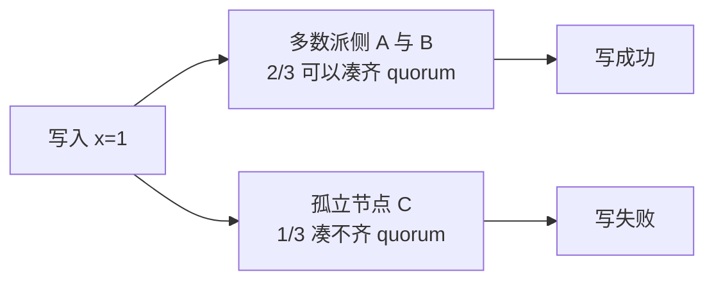

# CAP 讲的不是「三选二」

| 编写人 | 编写内容 | 编写时间 |
| --- | --- | --- |
| growdu | 初稿，讲清 CAP 的真实形状、quorum 为什么就是那个开关、一致性级别怎么落到接口上，附三组可复现的验证步骤 | 2026-11-23 |

> **一句话答案**：CAP 不是让你在三样里挑两样常驻。它说的是**分区发生的那一刻**
> 你必须放弃一致性或者可用性；没有分区的时候你两者都要，代价记在延迟上。

## 本文解决什么

三个问题：

1. CAP 说的「三选二」到底是什么意思，为什么「我们是 CP 的所以安全」这句话几乎总是错的；
2. 落到你自己的系统里，那条「一致性 vs 可用性」的开关具体长什么样；
3. 一致性级别怎么写进接口、怎么验证、怎么按操作选。

读完这篇你应该能做完三件事：给一条读写路径说清楚它的一致性级别；
给分区场景写出降级路径；给混沌测试补上延迟与丢包注入。

大多数人对 CAP 的第一反应是那张著名的三角图：一致性、可用性、分区容错，三选二。
这句话流传得足够广，以至于它在设计评审里会变成一句不需要论证的话——
「我们这个系统是 CP 的，所以安全」。

这句话几乎总是错的。CAP 说的不是「你能在三个里挑两个常驻」，而是：
**当网络分区真的发生时，你的系统在那一刻必须放弃一致性或者可用性。**
没有分区的时候，它两者都要——代价记在别处，记在延迟上。

这条差别不是抠字眼。它决定了三件很具体的事：分区期间你的接口长什么样、
没有分区的时候你的 p99 为什么突然抖、以及你到底该在哪一层声明一致性。

## 分区不是「宕机」

先把词掰清楚。CAP 里的 partition 不是「服务器挂了」，
是**两个节点互相以为对方挂了**。

节点 A 和节点 B 之间网络不通。A 能访问自己，也能访问集群里的 C，B 同理。
此时 A 说「C 还在，B 挂了」，B 说「C 还在，A 挂了」。
如果两边都还能接受写请求，那么 C 上就有两份互相矛盾的数据，
而且没有任何一个进程能判断哪份是对的。

这就是定理的真正来源。设客户端先向 A 写入 `x = 1`，写入成功返回；
随后客户端向 B 发起读，读到的可能是 0（还没同步过去）也可能是 1（已经同步过去）。
如果这个读**有可能**返回 0，而写已经返回过成功，那么这个系统就不是线性一致的了。

反过来，如果为了保证读一定能返回最新值，读必须等到写入传播到所有副本——
那么在分区期间，另一侧根本没人能完成这个读，**它就不 available 了**。

这里 available 是个很严格的词。Gilbert 与 Lynch 2002 给的定义是：
**每个发往非故障节点的请求，最终都要有一个响应**
（原文是 "must result in a response"；同段还补了一句
"any algorithm used by the service must eventually terminate"）。

有个容易踩的细节：**错误响应也算响应**。所以「返回 5xx」在 CAP 的定义上
**并不违反可用性**——按字面读，一个只会回 503 的服务也是 available 的。

工程上说的「不 available」比这严：指的是**用不了**——少数派侧直接拒绝服务、
请求挂住不回。这才是 CAP 在选型里真正要你二选一的东西。
把两个口径分开说，评审时才不会为了「返回错误算不算 available」吵半天。

所以定理说的是：在分区发生时，(C, A) 这对组合**不能同时保住**。
系统必须二选一——要么牺牲可用性（少数派拒绝服务），
要么牺牲一致性（两侧都接受写，读的时候自己想办法合并）。

## 二选一之后：quorum 是那个开关

多数读者到这里已经懂了，接下来是它在你系统里长什么样。

最常见的一致性系统是复制状态机 + quorum：N 个副本，读写都要拿到多数派
（`⌊N/2⌋ + 1`）的确认。3 副本就是 2。关键在于——**quorum 的大小就是那个开关**。



3 副本、quorum=2，节点 C 被隔离，剩下 A、B 两个节点：A、B 能凑够 2，仍然可以写。
这不是巧合——**多数派那一侧始终存在**，因为 3 个节点分成 2+1，
大的那半永远能凑够 2。

现在把 A、B 真的断开：A 这一侧只有 1 个节点，凑不到 2，写请求必须失败。
这就是 **CP**：牺牲可用性，换取线性一致。

反过来，如果把 quorum 降到 1（每个节点自己写自己、异步复制），那么两侧都能写成功——
**AP**：牺牲一致性，换取可用性。代价是 A 和 B 上可能同时有 `x = 1` 和 `x = 2`，
读的时候必须问多个副本、比对版本、挑新的（read repair），
而且**在冲突解决之前，你读到的是不确定的那个**。

这两条路的差别不在实现难度，在**你的读接口能不能接受「读到旧值」**。

## 「三选二」误读导致的三个具体后果

### 后果一：以为 CAP 不管没有分区的时候

「我们是 CP 的所以安全」——安全在哪？安全在分区时。
但你的系统 99.9% 的时间没有分区，那 99.9% 里一致性是怎么保证的？
靠每次写都等多数派确认，那就是**两次网络往返**；靠 leader 复制，
那是 leader 所在节点的一次往返加复制延迟。

这笔账 CAP 不管，它写在 PACELC 里（Abadi 等人 2012 年给出的推广）：

- **P**artition 发生时 → 在 **A**vailability 和 **C**onsistency 之间选；
- **E**lse（没有分区）→ 在 **L**atency 和 **C**onsistency 之间选。

后半句才是你每天真正在付的钱。一个 5 副本、Raft 协议的键值存储，
每次写要等 3 个节点确认才返回；一次多数派确认就是一次 RTT；
同城机房 RTT 通常在一毫秒以内，跨洲则从 30 毫秒起。
而 **leader 切换**时还有额外的一段空窗。

所以「我们的系统是 CP 的」这句话，实际上经常意味着
「我们的系统在正常时期也比必要的多付了一次 RTT」——而你从来没为这笔账做过预算。

### 后果二：以为降级路径是自动的

很多设计文档里写着「发生分区时降级为最终一致」。但降级不是自动的，
它是一组需要产品决策的行为：

- 写失败时，返回错误，还是进本地队列等恢复后补写？
  两者对用户是天壤之别：前者用户看到「操作失败」，
  后者用户看到「成功」，但这个「成功」在分区期间是**可能**丢的。
- 读要不要带一个客户端 token，强制路由到持有最新副本的节点？
  不带，读就有概率读到旧值——这不是 bug，这是你选择的一致性级别的一部分。
- 恢复之后怎么合并？「最后写入者赢」在时钟不同步时会静默丢数据。

这三个问题在设计时都得回答，不能等分区真的发生。

### 后果三：以为一致性是系统的属性

一致性级别几乎总是**逐操作**的，而不是逐系统的。

同一个数据库里，「扣余额」和「给好友点赞」可以是两个级别；
同一个 HTTP 接口里，「下单」和「查推荐列表」也可以是两个级别。
系统层面你写下的只是一个**默认值**，真正的规格写在每个接口上。

这带来一个很实际的结论：**如果你的接口文档里没有一致性这一栏，
那么你的系统实际上没有一致性规格**——它现在的行为只是实现碰巧的样子。

## 一致性级别怎么落到接口上

先建立一个最小的阶梯，从弱到强：

| 级别 | 保证 | 读者能观察到什么 |
| --- | --- | --- |
| 最终一致 | 副本最终收敛 | 同一时刻两个客户端可能读到不同的值 |
| 读己之写 | 一个客户端写完立刻读，能看到自己的写 | 换了客户端就读不到 |
| 单调读 | 一个客户端的读不倒退 | 不会先读到新值再读到旧值 |
| 因果一致 | 有因果关系的事件顺序一致 | 并发事件之间的顺序不定 |
| 线性一致 | 全局实时顺序 | 所有人立刻看到同一份按时间排好的历史 |

实现代价差别很大，但**最常被漏掉的其实是中间三档**，
因为它们不需要共识协议就能做：

- 读己之写：客户端记住上一次写的版本号，读的时候带上，
  服务端保证返回不小于该版本的副本。
- 单调读：客户端记住上一次读到的版本号，读的时候带上。
- 两者合起来叫**会话保证（session guarantee）**，
  成本只是多带一个 token、少一次重定向。

按操作选级别的几个常见判断：

- **钱、库存扣减**：宁可不可用，也不能超卖。用 quorum 写 + 强一致读。
- **购物车、收藏夹**：需要读己之写（用户加完东西要立刻看见），不需要全局线性一致。
- **点赞数、浏览量、商品推荐**：最终一致就够，追一致性是浪费预算。
- **会话 / 登录态**：多数系统干脆做成单点或 sticky session，一致性问题根本不存在。

## 怎么验证

这一节给的是**可复现的步骤**，不是「我们的实测结论」——
请在你自己的环境里跑一遍，因为参数（副本数、网络栈、磁盘）都会影响表现。

**实验一：制造分区，看 quorum 侧的行为。**

以 3 成员 etcd 为例（默认 quorum 是 2）：

```bash
# 记下成员与 leader
etcdctl member list -w table
etcdctl endpoint status -w table
```

用 iptables 隔离一个成员（记得实验结束后删掉规则）：

```bash
iptables -A INPUT  -s <被隔离节点IP> -j DROP
iptables -A OUTPUT -d <被隔离节点IP> -j DROP
```

然后在**剩下的两个节点**上读写、在**被隔离的那个节点**上读写。
预期：多数派侧读写正常；被隔离的那侧写会超时失败（它是少数派，凑不到 quorum）。
这就是 CP 的形状。

**实验二：没有分区，注入延迟。**

这是更贴近生产的故障。把上面的 DROP 换成丢一部分包、或者用 `tc netem` 加延迟：

```bash
tc qdisc add dev eth0 root netem delay 200ms
```

注入延迟期间（**没有断连**），观察写延迟的 p99。
CP 系统在这里一样会慢——慢在多数派确认的那次 RTT 上。

**实验三：丢一部分包（半开的连接）。**

这条很多人会漏：真实世界里最常见的不是「网络断了」，也不只是「网络变慢了」，
而是**丢包**——连接还在，数据时通时不通。

```bash
tc qdisc add dev eth0 root netem loss 10%
```

注入之后观察：连接**不会立刻断**，但请求开始超时。
客户端看到的是「等不到结果」，不是「连不上」——这两种故障在监控上完全不一样，
对重试策略的要求也不同（前者要退避，后者可以立刻换节点）。

所以混沌测试里至少要有三种注入：断连、延迟、丢包，权重按你线上的
真实故障分布来定。三组实验做完，别忘了把规则清掉：

```bash
tc qdisc del dev eth0 root
iptables -D INPUT  -s <被隔离节点IP> -j DROP
iptables -D OUTPUT -d <被隔离节点IP> -j DROP
```

## 一份可以带走的清单

1. 每个写路径标出它的一致性级别（quorum？leader？异步？）。
2. 每个读路径标出它允许的 staleness（多久之前的数据算可接受）。
3. 降级路径写进 API 契约：写失败是报错还是排队？读要不要带 token？
4. 把「恢复后怎么合并」写成一句话，放进故障手册。
5. 混沌测试注入延迟与丢包，而不只注入断连。
6. 预算里显式写出每次写的那次 RTT——它是 CAP 三个字母都不提的那笔账。

## 延伸阅读

- Gilbert, S. & Lynch, N. (2002).
  *Brewer's conjecture and the feasibility of consistent, available,
  partition-tolerant web services*. SIGACT News.
- Abadi, D. et al. (2012).
  *Consistency tradeoffs in modern distributed database system design:
  CAP is only part of the story*. Computer, 45(2).
