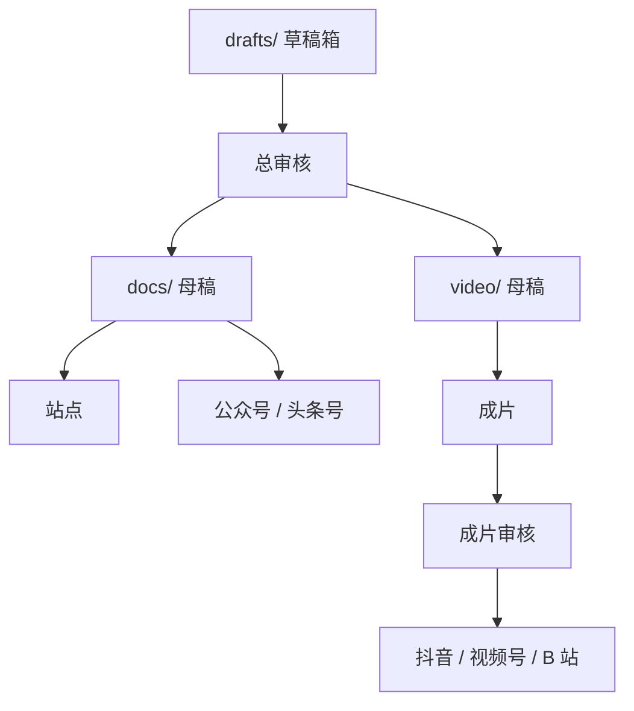

# 两条流水线，一个草稿箱

| 编写人 | 编写时间 | 适用版本 |
| --- | --- | --- |
| growdu | 2026-11-17 | 站点 572 篇 · 契约层 5 份规格 · 视频线 6 期成片 |

上一篇讲的是**这个仓库是什么**：一个内容工厂，三条产线共用一个底座。
这一篇往下一层，讲**仓库长什么样**——目录怎么切、稿子从哪来、谁审。

为什么值得单独写一篇？因为这套东西每加一条产线、每加一个平台，
都要在目录上留下痕迹。目录切对了，加平台是「加一个目录加一份 TOML」；
目录切错了，之后每一次改动都要绕路，而绕路这种事不会报错，
只会让你多花半小时然后忘了当初为什么这么设计。

---

## 一、两条流水线，一个入口

| 流水线 | 入口 | 总审核 | 母稿 | 产物审核 | 终点 |
| --- | --- | --- | --- | --- | --- |
| 文档流 | `drafts/` | `review/` | `docs/` | — | 站点 + 公众号 + 头条号 |
| 视频流 | `drafts/` | `video/review/` | `video/` | `video/review/`（看帧） | 抖音 + 视频号 + B 站 |



两条线的**入口相同、审核口径不同、母稿不同、终点不同**，中间那一段完全平行。

文档流的产物链是：markdown → 内容单元 → 页面。
视频流的产物链是：视觉分镜契约 → 时间轴 → 片段 → 成片。
把这两条链拼成一条，每一步都要先问一句「这次是文章还是视频」——
于是每个工具里都会长出一个 `if kind`，而 `if kind` 会一路传染下去。

所以它们不拼。两条线各自是一条直线，只在两个地方碰头：

1. **入口**：都是 markdown 稿子，都先落 `drafts/`，都过同一套总审核口径。
2. **分发层**：契约层用一个字段把两者区分开，不用一个分支。

第二个碰头的地方值得多说一句。分发层的发布清单里有一个 `kind` 字段，
取值就是 `document` 或 `video`。整个分发层（能力模型、清单、调度、快照）
只认这一个字段——它不判断「这篇是文章还是视频」，
它只判断「这个平台要的是文章还是视频」。**两条流水线在分发层是正交的**：
同一套分发契约、同一份接缝格式，两种内容形态从旁边走过去。

这也解释了为什么五个平台能住在同一个目录下：
公众号要文章，抖音要视频，但它们接的是同一种接缝——
一份能力声明、一份发布清单。
五个 adapter 的代码是各写各的副本，不共用模块；共用的是**接口**。
形态是内容的事，平台是分发的事，两者不该混在同一层。

---

## 二、目录分层

仓库根目录现在长这样：

| 层 | 位置 | 装什么 | 谁读它 |
| --- | --- | --- | --- |
| 草稿层 | `drafts/` | 待审的稿、提交时的底稿 | 人 |
| 内容层 | `docs/` | 文章母稿 | 编译层、平台层 |
| 视频层 | `video/` | 分镜契约、素材、渲染管线、成片、发布包 | 视频管线、视频审核 |
| 契约层 | `publish/publishkit/` | 清单、能力模型、调度 | 平台层 |
| 平台层 | `platforms/<plat>/` | 适配器、能力声明、发布快照 | 人、调度器 |
| 审核层 | `review/`、`video/review/` | 审校记录、复盘 | 人 |

### 视频为什么独立成 `video/`

因为视频生产有它自己的一整套东西，而这套东西跟 markdown 文章没有交集：
视觉分镜契约、音色与形象规范、音乐素材、渲染管线、成片、成片审核、发布包。
这些东西既不属于「文章」，也不属于「某个平台」——它们是**内容形态**层面的资产。

于是有两个选择：塞进 `docs/`，或者塞进 `platforms/` 下面。

塞进 `docs/` 的问题很实际：`docs/` 是站点编译的输入，
视频的内部产物（帧、中间时间轴、测试夹具）会被当成文章扫进去。

塞进 `platforms/` 下面的问题更根本：那会让人以为「视频是某条平台产线」——
其实不是。抖音、视频号、B 站是**分发目标**；
视频是**内容形态**。同一个视频成片可以发到三个平台，
一条文章也可以发到公众号和头条号，两者的正交关系是设计里最要紧的一层。

所以 `video/` 是仓库根级模块，与 `platforms/` 同级。

### 五个平台为什么收进 `platforms/` 并压平

五个平台收进一层，压平成

```
platforms/
  wechat/     ← 平台 id = wechat = Python 包名
  toutiao/    ← 平台 id = toutiao = Python 包名
  douyin/
  channels/
  bilibili/
```

压平这一层的理由是**目录名就是平台 id**。一件事只说一遍：
目录名、平台 id、Python 包名、`capability.toml` 里的
`id` 字段、清单里的 `platform` 字段、快照文件名里的后缀——
全都是同一个字符串。对齐之后，加一个平台要动的东西一眼能数完：
**一个目录、一份 TOML**，契约层的代码一行不改。

至于为什么收进 `platforms/` 一层：仓库根目录是「按角色分类」的地方，
根下再摆五个平台目录，就把「按角色」和「按实例」混在一层了，
根目录条目数翻倍，翻倍之后每个新目录都会让人觉得「根目录好像放不下了」。
分层是件便宜的事：一旦根目录超过十几条，就该分层。

### 能力声明与发布快照为什么跟着平台走

`platforms/<plat>/capability.toml` 里写的是这个平台**自己的**属性：
标题上限多少字、正文多少字、封面什么比例、能不能自动发、要不要等平台审核。
`platforms/<plat>/outbox/<content_id>__<plat>.json` 是这个平台**自己的**账本：
哪条内容在这个平台上发成什么样、发出去没有、落地页在哪。

这两样东西为什么跟着平台走？理由是同一句话：**谁的东西谁拿着**。

能力声明是平台规则的快照，规则变了改它、不改 Python——
这一点不管它住哪都不变；但住的地方如果和平台的适配器代码分居两处，
改规则的时候就要记得「哦还有另一个文件要改」。这种「记得」迟早会漏。

发布快照同理：它是「这条内容在这个平台上的状态」，
放在平台目录里，加平台时它跟着出现，不需要在契约层的某个目录里另记一份。

---

## 三、两条审核线

| 审核线 | 在哪 | 谁做 | 管什么 | 留下什么 |
| --- | --- | --- | --- | --- |
| 总审核 | `review/`、`video/review/` | 人 | 稿子对不对 | 审校记录、复盘 |
| 平台审核 | `platforms/<plat>/` 内 | 平台 | 发出去过没过 | 快照里的落地页链接 |

这两条线的判据完全不同，所以必须分开：

**总审核**问的是「这句话对不对、这个观点站不站得住」。
它的产物是审校记录与复盘——留在 `review/` 与 `video/review/` 里，
写清这次改了什么、为什么改、下次要注意什么。
它不改母稿的位置；稿子改了，母稿跟着改，审校记录只记过程。

**平台审核**问的是「平台收不收这篇」。
它是平台侧的机审（标题党、诱导分享、敏感词），
在能力声明里就是一个字段：`review = "platform"`。
我们这一侧能做的只有两件：把该声明的东西声明全，
以及在快照里如实记下平台给了什么结果。

混在一起会出荒谬事：作者跑去修平台的机审结果，
或者平台审核的结论被当成内容质量意见写进审校记录。
前者是越权，后者是污染。

顺带说一句，`video/review/` **不是 `review/` 的复制**。
文档的「AI 味」主要在文字腔调上，视频的「AI 味」主要在画面和口播的关系上——
画面上的数字和口播里的数字对不上，比写错一个数字更糟。
同一个口径表在两边不通用，所以视频侧另立了一套。

---

## 四、草稿箱：入口，也是底稿

`drafts/` 这个目录现在只有一份 `README.md`。但它在这套架构里的位置很关键，
值得把它的职责说清楚。

**它是入口。** 两条流水线的稿子都从这里开始。
文档稿、视频稿都是 markdown，都先落 `drafts/`，
文件名带日期与主题。之所以不给视频单开一个入口，
是因为「写一稿、过一遍审、留下记录」这件事两条线是同构的，
入口分两个就等于要记两套流程、跑两遍心智。

**它是底稿。** 审完之后，稿子**复制**一份进 `docs/`（文章）
或 `video/`（视频母稿），`drafts/` 里那一份留着不动。
留底稿是为了回答一个具体问题：**当初交上去的是什么，审校又改了什么。**
对比 `drafts/` 那份和 `docs/` 那份，差集就是审校的痕迹。

**但它不参与派生。** 这是整套设计里最容易被违反、也最不能违反的一条。
真相只在 `docs/`。下游的一切——站点页面、平台出包、搜索索引、
归档、统计——都从 `docs/` 的母稿重建。

如果 `drafts/` 也参与派生，就会出现**两份可以编辑的真相**：
改了 `drafts/`，站点纹丝不动；改了 `docs/`，`drafts/` 悄悄过期。
两种情况都不会报错，只会让你在某天发现站上的内容不对，
然后花半天找是哪一份被改了。而更糟的情况是两边都被改过，
你再也说不清「正确的版本」是哪一份。

规矩因此很简单：**改就改母稿，草稿箱只增不改。**
它是一份历史快照，不是第二个产地。

---

## 五、目录名不是 URL

最后一件事，也是这套目录架构里最容易踩的坑：**目录名不是 URL**。

工程目录叫什么，和站上的地址叫什么，是两件事。
视频线的工程目录叫 `video/`；但站上那批视频规范页面住在 `docs/life/aiv/`——
因为那是**发布副本**，它决定的是 URL（站上的地址里带着 `life/aiv/` 这一段），
不是工程位置。

这两件事要分开看：

| 改什么 | 后果 | 能不能回滚 |
| --- | --- | --- |
| 工程目录名（代码里的路径字面量） | 编译要跟着改 | 能，一次提交的事 |
| 发布副本的位置 | 站内链接全变，外链也会断 | 不能 |

所以 `docs/life/aiv/` 一个字节都不动。
它不是「忘了改的旧目录」，它是**已发布的 URL 命名空间**——
改名等于让所有指向那些页面的链接失效，包括站外的。

同理，「AIV」这个**品牌名**不是路径。
品牌名说的是这条产线叫什么，不是它住在哪；
把名字和路径绑死，等于把一次目录调整变成一次产品决定。

**改路径字面量，不动已发布的 URL；改品牌名是另一件事。**
这两条分开守住，目录重构才敢做。

---

## 六、诚实的现状

| 东西 | 状态 |
| --- | --- |
| `drafts/` 目录 | 已建，流程已写，**里面还没有稿子** |
| 总审核（`review/`） | 在用，有审校记录与复盘 |
| 总审核（`video/review/`） | 在用，六期成片的审核记录都在 |
| 平台层（`platforms/`） | 五个平台目录齐了，各有一份能力声明 |
| 发布快照（`outbox/`） | 头条号 549 份，视频三平台各 6 份，公众号 0 份 |
| 平台审核状态 | 视频三平台共 18 份快照里，15 份落地页还是空的 |

草稿箱空着这件事写得明明白白，是因为**架构存在不等于流程跑过**。
目录可以在一天之内改对，流程要一篇一篇地走。

---

## 七、接着读

- [一个仓库，三条产线](./one-repo-three-pipelines.md) —
  整体架构、分层与依赖方向，以及六种「为什么不用现成方案」
- [内容单元与内容契约](../content-model/content-unit-and-contract.md) —
  两条流水线之间传递的到底是什么数据
- [从母稿到页面](../build-pipeline/docs-to-public-pipeline.md) —
  文档流这条线的完整链路

---

上一篇讲的是「这是什么」，这一篇讲的是「长什么样」。
两者加在一起才够：**知道一个仓库该长什么样，
下次动手改它的时候，才知道自己在改哪一层。**
