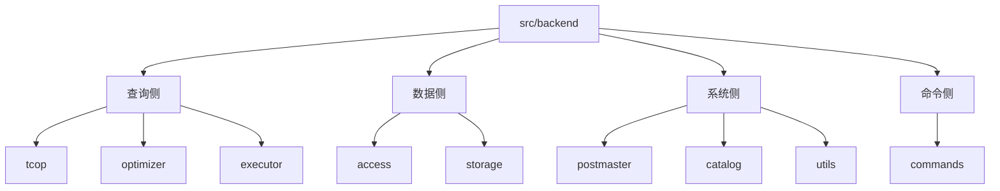
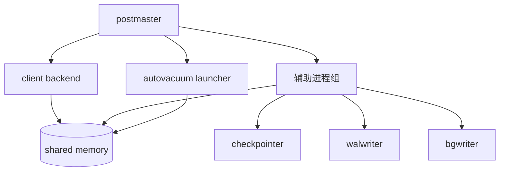
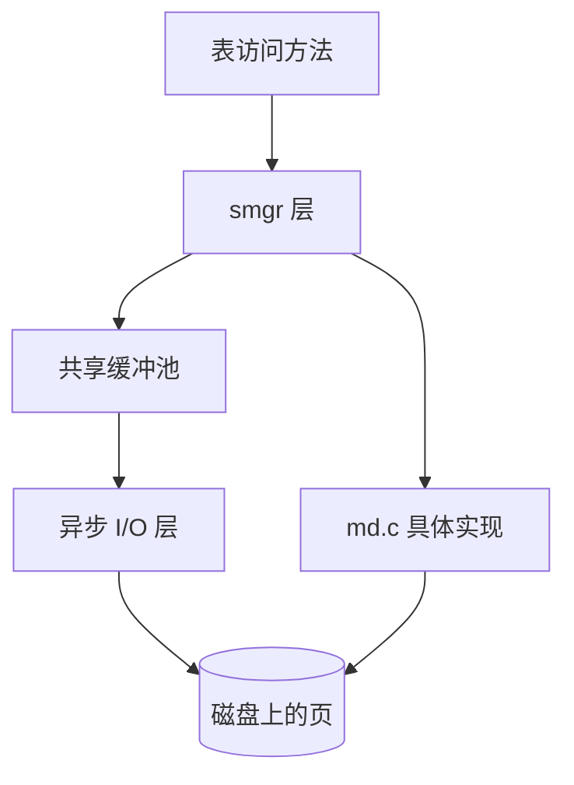

# PostgreSQL 19 整体架构

| 编写人 | 编写内容 | 编写时间 |
| --- | --- | --- |
| growdu | 以 PostgreSQL 19 源码为线索：进程模型、进程之间的通信、共享内存的登记方式、一条 SQL 的完整流程、存储与 MVCC 的骨架，附源码入口 | 2026-11-24 |

> **一句话答案**：PostgreSQL 19 的骨架十年没变——**一个 postmaster 加一群子进程，
> 状态全放在共享内存里**；
> 进程之间靠信号与共享内存结构说话，
> 一条 SQL 依次过 parse、analyze、rewrite、plan、execute 五站。
> 这一版动的是共享内存的登记方式与异步 I/O，
> 并发、持久性与扩展在第二篇。

## 本文解决什么

三个问题：

1. 这个内核由哪些进程组成，它们之间怎么说话；
2. 一条 SQL 从解析到返回要穿过哪些文件；
3. 哪些结构是十年不动的骨架，哪些是 19 改过的登记方式。

读完这篇你应该能做完三件事：在 `pg_stat_activity` 里认出每一种后台进程；
对着 `EXPLAIN` 说出一条查询依次经过哪几个阶段；
打开 `src/include/storage/subsystemlist.h`，知道服务器里到底有哪几块共享内存。

本文的版本基准是 PostgreSQL 19，源码取自 `REL_19_STABLE` 分支，
发布说明的落款日期是 2026-11-19（`doc/src/sgml/release-19.sgml`）。

边界也划在这里：**只讲骨架，不展开单个机制的细节**——
并发、锁、WAL 的内部实现与扩展的接法留给
[第二篇](./postgresql19-concurrency-persistence-extension.md)，
索引与执行留给后面的阶段。
这一篇的定位是「地图加坐标」：告诉你每一块在哪个文件、哪个函数，
以及怎么在跑起来的实例上看见它。

## 先看一眼源码树

读源码的第一步不是打开某个 `.c` 文件，是先知道**哪扇门通往哪一间屋子**。
PostgreSQL 的目录划分本身就是一份架构说明——它按「职责」切，而不是按「功能」切。

顶层只有一层：`src/backend/`（内核）、`src/include/`（头文件）、`src/bin/`（命令行程序）、
`src/interfaces/`（libpq）、`src/common/`、`src/port/`（平台适配）、`src/test/`、`contrib/`、`doc/`。
`src/backend/` 下的每个子目录对应一块明确职责，目录名基本就是职责名：

| 目录 | 管什么 | 读它的时候在找什么 |
| --- | --- | --- |
| `postmaster/` | 进程的生命周期 | 谁 fork 谁、谁在什么状态下被拉起来 |
| `tcop/` | 与客户端说话的协议层 | 一条 SQL 从哪进来、结果从哪出去 |
| `optimizer/` | 优化器 | 怎么把一棵查询树变成一棵计划树 |
| `executor/` | 执行器 | 计划树上的节点怎么把元组拉上来 |
| `parser/` | 语法与语义分析 | 原始 SQL 怎么变成解析树 |
| `rewrite/` | 重写 | 视图、规则、约束怎么被展开 |
| `access/` | 存储访问方法 | heap、索引、各类索引的实现都在这 |
| `storage/` | 页、文件、缓冲池、I/O | 磁盘与内存之间的搬运 |
| `catalog/` | 系统目录 | `pg_class` 这些表怎么存怎么读 |
| `commands/` | 一条条 DDL | `CREATE TABLE` 的实现文件 |
| `utils/` | 缓存、内存、统计、错误 | 全局设施的落点 |
| `replication/` | 复制 | 物理复制与逻辑复制 |
| `partitioning/` | 分区 | 分区裁剪与分区路由 |

`src/include/` 与 `src/backend/` 一一对应：头文件放结构体定义与函数声明，
实现文件放代码。找某个结构体长什么样，搜 `src/include/`；
找某段逻辑怎么跑的，搜 `src/backend/`。

上图把这几块按「谁调用谁」摆了一遍：



几条实用经验：

- **一个进程一个文件**。`src/backend/postmaster/` 下几乎一个文件对应一类后台进程：
  `checkpointer.c`、`bgwriter.c`、`walwriter.c`、`pgarch.c`、`autovacuum.c`、
  `startup.c`、`syslogger.c`、`walsummarizer.c`。
  想找「checkpoint 是谁做的」，直接进 `checkpointer.c`，不用在二十万行里搜。
- **一条命令一个文件**。`src/backend/commands/` 下 `tablecmds.c`、`indexcmds.c`、
  `vacuum.c`、`repack.c`、`extension.c` 各管一条命令。
- **全局设施集中在 `utils/`**。缓存看 `utils/cache/`，内存上下文看 `utils/mmgr/`，
  统计看 `utils/activity/`，GUC 看 `utils/misc/guc_parameters.dat`。
- **存储访问方法与存储机制是两层**。`access/` 管「怎么按逻辑访问一张表」，
  `storage/` 管「页怎么在磁盘与内存之间流动」。19 新增的异步 I/O 全在 `storage/aio/`。

按这个地图读，跨目录追一条调用链的效率会高很多：
从 `tcop/postgres.c` 出发，往下是 `parser/`，往旁边是 `optimizer/`，
再往下是 `executor/`，最底下落在 `access/` 与 `storage/`。

## 骨架：一个 postmaster 和它的孩子们

PostgreSQL 不是一组微服务，而是**一个 postmaster 加若干子进程**。
状态全放在共享内存里，进程之间不互相调用，只靠信号和共享内存结构说话。

这个选择是历史的结果：Unix 1979 年的进程模型被继承到了 2026 年。
好处是崩溃隔离——一个 backend 段错误不会带走整个实例；
代价是**进程间通信要走内核**，共享内存与信号量是绕不开的两件工具。

### 进程类型表写在代码里

进程类型表不在文档里，在 `src/include/postmaster/proctypelist.h` 第 34 行往下：
18 条 `PG_PROCTYPE(...)`，每条给出五个字段——枚举名、类别、描述、主函数入口、是否挂共享内存。

| 枚举 | 类别 | 描述 | 入口函数 | 挂共享内存 |
| --- | --- | --- | --- | --- |
| `B_ARCHIVER` | archiver | archiver | `PgArchiverMain` | 是 |
| `B_AUTOVAC_LAUNCHER` | autovacuum | autovacuum launcher | `AutoVacLauncherMain` | 是 |
| `B_AUTOVAC_WORKER` | autovacuum | autovacuum worker | `AutoVacWorkerMain` | 是 |
| `B_BACKEND` | backend | client backend | `BackendMain` | 是 |
| `B_BG_WORKER` | bgworker | background worker | `BackgroundWorkerMain` | 是 |
| `B_BG_WRITER` | bgwriter | background writer | `BackgroundWriterMain` | 是 |
| `B_CHECKPOINTER` | checkpointer | checkpointer | `CheckpointerMain` | 是 |
| `B_DEAD_END_BACKEND` | backend | dead-end client backend | `BackendMain` | 是 |
| `B_INVALID` | postmaster | unrecognized | — | 否 |
| `B_IO_WORKER` | ioworker | io worker | `IoWorkerMain` | 是 |
| `B_LOGGER` | syslogger | syslogger | `SysLoggerMain` | 否 |
| `B_SLOTSYNC_WORKER` | slotsyncworker | slotsync worker | `ReplSlotSyncWorkerMain` | 是 |
| `B_STANDALONE_BACKEND` | backend | standalone backend | — | 否 |
| `B_STARTUP` | startup | startup | `StartupProcessMain` | 是 |
| `B_WAL_RECEIVER` | walreceiver | walreceiver | `WalReceiverMain` | 是 |
| `B_WAL_SENDER` | walsender | walsender | — | 是 |
| `B_WAL_SUMMARIZER` | walsummarizer | wal summarizer | `WalSummarizerMain` | 是 |
| `B_WAL_WRITER` | walwriter | walwriter | `WalWriterMain` | 是 |

描述那一列就是 `pg_stat_activity.backend_type` 的取值——
`src/backend/utils/init/miscinit.c` 第 264 行的 `GetBackendTypeDesc()` 把它取出来。
所以那张表不是分类学，是**你在生产环境能直接看到的名字表**。

注意 `B_INVALID` 与 `B_STANDALONE_BACKEND` 的入口函数是 `NULL`：
它们不是被 postmaster fork 出来的，而是 postmaster 自己扮演的角色。

### 启动次序本身就是职责说明

拉起它们的是 `src/backend/postmaster/postmaster.c` 第 496 行的 `PostmasterMain()`。
启动次序不是随便排的，它说明了每类进程的依赖：

| 顺序 | 进程 | 代码位置 | 为什么在这时候起 |
| --- | --- | --- | --- |
| 1 | I/O worker | `maybe_start_io_workers()` 第 1396 行 | 注释写的是「保证启动期间能读盘」 |
| 2 | checkpointer | 第 1400 行 | 注释写的是「让它们帮着做恢复」 |
| 3 | bgwriter | 第 1402 行 | 同上 |
| 4 | startup | 第 1407 行 | 真正读 WAL 做恢复的那一个 |

checkpointer 与 bgwriter 必须比 startup 先在，因为恢复过程要靠它们。

进入正常运行之后，状态机里才按需补齐其余的：
walwriter 只在 `pmState == PM_RUN` 时起（第 3373 行），
autovacuum launcher（第 3384 行）、archiver（第 3397 行）、
slotsync worker（第 3410 行）、wal summarizer（第 3442 行）依次跟上。

这个形状画出来是这样（省略按需拉起的那几个）：



三类辅助进程（checkpointer、bgwriter、walwriter）在图里被归成一组，
因为它们的共同点是**都不接受客户端连接**，只在内部干活。

### postmaster 自己是个状态机

postmaster 的行为可以用一个枚举概括：`PMState`，
定义在 `src/backend/postmaster/postmaster.c` 第 336 行往下，一共 13 个状态。

| 状态 | 含义 |
| --- | --- |
| `PM_INIT` | postmaster 正在启动 |
| `PM_STARTUP` | 等 startup 子进程 |
| `PM_RECOVERY` | 在做归档恢复 |
| `PM_HOT_STANDBY` | 热备模式 |
| `PM_RUN` | 正常「数据库活着」的状态 |
| `PM_STOP_BACKENDS` | 需要把剩下的 backend 停掉 |
| `PM_WAIT_BACKENDS` | 等活着的 backend 退出 |
| `PM_WAIT_XLOG_SHUTDOWN` | 等 checkpointer 做关机 checkpoint |
| `PM_WAIT_XLOG_ARCHIVAL` | 等 archiver 与 walsender 收尾 |
| `PM_WAIT_IO_WORKERS` | 等 I/O worker 退出 |
| `PM_WAIT_CHECKPOINTER` | 等 checkpointer 退出 |
| `PM_WAIT_DEAD_END` | 等 dead-end 子进程退出 |
| `PM_NO_CHILDREN` | 重要的子进程都退完了 |

启动那条路是这样走的：


中间两个状态是可选的：正常启动跳过 `PM_RECOVERY` 与 `PM_HOT_STANDBY`，
需要恢复时才走 `PM_RECOVERY`，是备库时才走 `PM_HOT_STANDBY`。
代码里有一段注释专门解释这个设计：**崩溃恢复 = 先停机再启动**，
所以恢复路径和启动路径共用一套代码。

每一次状态转移都经过 `UpdatePMState()`（第 3317 行），
它会打一条 `DEBUG1` 日志：`updating PMState from %s to %s`。
想在日志里看清实例经历了什么，把 `log_min_messages` 调到 `debug1` 就能看到。

停机那条路更长，一步一步等：


这条路的设计原则是**先让客户端走，再让数据落盘**：
先把 backend 停掉（否则没法做关机 checkpoint），
再让 checkpointer 写一个关机 checkpoint，
然后等归档与 walsender 收尾，最后才轮到 I/O worker 与 checkpointer 自己退出。

### 三种停机，对应三个信号

`pg_ctl` 的三种模式其实只是「发哪个信号」的区别，
映射写在 `src/bin/pg_ctl/pg_ctl.c` 第 2046 行的 `set_mode()` 里：

| `pg_ctl -m` | 信号 | 语义 | 代码位置 |
| --- | --- | --- | --- |
| smart | `SIGTERM` | 等所有客户端断开再关 | `pg_ctl.c` 第 2049 行 |
| fast | `SIGINT` | 直接关，但要做干净的关库 | `pg_ctl.c` 第 2054 行 |
| immediate | `SIGQUIT` | 不做完整关库，重启时要恢复 | `pg_ctl.c` 第 2059 行 |

默认是 fast（`pg_ctl.c` 第 80 行的 `shutdown_mode = FAST_MODE`）。
smart 的语义是「等客户端自己走」，所以它只是把 `connsAllowed` 置成 false，
postmaster 仍然停在 `PM_RUN`。

源码注释写得很清楚：「在 smart 关库期间，我们限制新连接，
但状态仍是 `PM_RUN` 或 `PM_HOT_STANDBY`」。

immediate 则是真不收拾：`SIGQUIT` 打给所有子进程，
5 之后（`SIGKILL_CHILDREN_AFTER_SECS`）还没走的直接 `SIGKILL`。

三种模式撞在一起时，**最狠的那个赢**：
关库级别是整数，`NoShutdown=0`、`SmartShutdown=1`、`FastShutdown=2`、`ImmediateShutdown=3`
（`postmaster.c` 第 284 行往下），每条路径都写成 `if (Shutdown >= X) break;`。

### 信号只置标志，动作留给主循环

19 改过信号处理的形状：**OS 信号处理函数只做一件事——置一个布尔标志，
然后 `SetLatch(MyLatch)`**。真正的动作在主循环里做。

`handle_pm_shutdown_request_signal()`（`postmaster.c` 第 2074 行）就是这么写的：

- `SIGTERM` → `pending_pm_shutdown_request = true`；
- `SIGINT` → 额外置 `pending_pm_fast_shutdown_request`；
- `SIGQUIT` → 额外置 `pending_pm_immediate_shutdown_request`。

主循环 `ServerLoop()`（第 1676 行）在 `WaitEventSetWait()` 返回后，
无条件地按这个顺序检查四个标志（第 1713 行往下）：
关库请求、重载请求、子进程退出、pmsignal。
源码在第 1706 行有一段注释解释为什么关库与重载要无条件处理：
「即使没看到 `WL_LATCH_SET` 也要处理，这样关库与重载请求就有高优先级」。

这个设计的好处是：**信号处理函数永远不做可能阻塞的事**，
所以它不会在持有锁的时候被打断，也不会因为慢而丢信号。
读源码时如果发现某个 handler 里只有一行 `SetLatch`，不用怀疑——这是故意的。

另外两个信号各管一摊：
`SIGHUP` 触发配置重载（重读 `postgresql.conf`、`pg_hba.conf`、`pg_ident.conf`，
并把 `SIGHUP` 转发给子进程），`SIGUSR1` 是 pmsignal 通道——
子进程用它通知 postmaster「我这边准备好了」，`pg_ctl` 也用它提示 postmaster
去看日志轮转文件与提升文件。

pmsignal 的种类是一个枚举 `PMSignalReason`
（`src/include/storage/pmsignal.h` 第 33 行往下），共 11 个：

| 枚举 | 什么时候发 |
| --- | --- |
| `PMSIGNAL_RECOVERY_STARTED` | 恢复开始 |
| `PMSIGNAL_RECOVERY_CONSISTENT` | 恢复到一致点 |
| `PMSIGNAL_BEGIN_HOT_STANDBY` | 进入热备状态 |
| `PMSIGNAL_IO_WORKER_GROW` | 要增减异步 I/O worker |
| `PMSIGNAL_BACKGROUND_WORKER_CHANGE` | 后台 worker 的状态变了 |
| `PMSIGNAL_START_AUTOVAC_LAUNCHER` | 该起 autovacuum launcher 了 |
| `PMSIGNAL_START_AUTOVAC_WORKER` | 该起 autovacuum worker 了 |
| `PMSIGNAL_START_WALRECEIVER` | 该起 walreceiver 了 |
| `PMSIGNAL_ROTATE_LOGFILE` | 该轮转日志文件了 |
| `PMSIGNAL_ADVANCE_STATE_MACHINE` | 推进状态机 |
| `PMSIGNAL_XLOG_IS_SHUTDOWN` | WAL 已经关干净了 |

## 进程之间怎么说话

多进程模型带来一个问题：**进程之间怎么通信**。
PostgreSQL 的答案分两半：**共享内存装状态，信号与 latch 传通知**。

这一节讲的是骨架——有哪些机制、各自解决什么问题、代码在哪儿。
每个机制的实现细节留给后面的阶段。

### 共享内存：主区域

postmaster 启动时创建一块共享内存，所有进程映射同一块。
创建入口是 `src/backend/storage/ipc/ipci.c` 第 120 行的
`CreateSharedMemoryAndSemaphores()`。

共享内存区开头有一个统一的头 `PGShmemHeader`
（`src/include/storage/pg_shmem.h` 第 29 行）：

| 字段 | 含义 |
| --- | --- |
| `magic` | 固定值 679834894，用来认出这是 PostgreSQL 的共享内存 |
| `creatorPID` | 创建者的 pid |
| `totalsize` | 整段的大小 |
| `content_offset` | 数据区的起始偏移 |
| `dsm_control` | 动态共享内存控制段的句柄 |
| `device` / `inode` | 数据目录所在的设备与 inode |

后两个字段是为了防止**误用**：有人把共享内存指向了错误的地方，
内核可以核对设备号与 inode 号，发现不是这个数据目录的，就拒绝使用。

底层用什么机制创建，取决于 `shared_memory_type`
（`src/backend/utils/misc/guc_parameters.dat` 第 2749 行，默认 `DEFAULT_SHARED_MEMORY_TYPE`）：

SysV 共享内存、POSIX 共享内存、匿名映射（`mmap`），Windows 上还有别的。
`src/backend/port/` 下的 `sysv_shmem.c`、`posix_sema.c`、`sysv_sema.c` 就是这些实现。

拿到共享内存之后，往里面放东西有两种方式。

**第一种是固定结构**：`ShmemInitStruct()`
（`src/backend/storage/ipc/shmem.c` 第 1114 行）——
第一个进程调用时分配并初始化，后来者拿到同一个指针。
典型用途是缓冲池、系统目录缓存这类大小固定的结构。

**第二种是哈希表**：`ShmemInitHash()`
（`src/backend/storage/ipc/shmem_hash.c` 第 117 行）——
在共享内存里建一张哈希表。典型用途是各类缓存：
关系缓存、系统目录缓存、统计信息。

扩展要往共享内存里加东西，得先申请空间：
`RequestAddinShmemSpace()`（`ipci.c` 第 45 行）。
**这个函数只能在 postmaster 启动阶段调用**——
共享内存区的大小在那时就定死了。

### 动态共享内存：DSM

固定结构不够用怎么办？比如并行查询要在几个进程之间传一批数据，
数量事先不知道。

这就是 **DSM（dynamic shared memory）**。
`src/include/storage/dsm.h` 第 34 行的 `dsm_create()` 造一段，
第 35 行的 `dsm_attach()` 让别的进程接上同一段。
它有句柄机制，所以「谁在用哪一段」是可查的。

`pg_dshmem` 是一个系统视图，列出当前实例里所有的 DSM 段。
19 的 `pg_stash_advice` 就是靠 DSM + dshash 存 advice 的——
写 advice 的进程和读 advice 的规划器进程可能完全是两个进程。

DSM 与主共享内存区是两回事：主区在 postmaster 启动时一次性分配，
DSM 可以在运行期随时创建与销毁。

### Latch：等一个事件

有了共享内存，还需要**唤醒机制**——一个进程写完数据，另一个正睡着在等它。

PostgreSQL 的等待原语叫 **latch**，实现在 `src/backend/storage/ipc/latch.c`：

| 函数 | 行号 | 干什么 |
| --- | --- | --- |
| `InitLatch()` | 第 63 行 | 初始化 |
| `WaitLatch()` | 第 172 行 | 等 latch 被 set，同时等别的 fd 事件 |
| `SetLatch()` | 第 290 行 | 唤醒 |
| `ResetLatch()` | 第 374 行 | 复位 |

`WaitLatch()` 的特别之处是它**不只等 latch**：
它可以同时等一组文件描述符上就绪——这正是 `waiteventset.c` 那套机制的基础。

在本文前面讲过的 postmaster 信号处理里已经见过这个模式：
信号处理函数只置标志，然后 `SetLatch(MyLatch)` 唤醒主循环。
**「置标志 + 敲 latch」是整个内核里最常用的通知模式**，
读代码时看到这两个动作，就知道是「通知某个后台循环来处理」。

### 信号通道：两种

信号有两套，用途完全不同。

**pmsignal** 是发给 postmaster 的。
种类是枚举 `PMSignalReason`（`src/include/storage/pmsignal.h` 第 33 行往下），
前面讲 postmaster 状态机时已经列过。
子进程用它告诉 postmaster「恢复做完了」「该起 autovacuum 了」。

**procsignal** 是发给普通 backend 的。
枚举 `ProcSignalReason` 在 `src/include/storage/procsignal.h` 第 32 行往下：

| 原因 | 干什么 |
| --- | --- |
| `PROCSIG_CATCHUP_INTERRUPT` | 打断共享失效的追赶 |
| `PROCSIG_NOTIFY_INTERRUPT` | listen/notify 有动静 |
| `PROCSIG_PARALLEL_MESSAGE` | 并行 backend 之间传消息 |
| `PROCSIG_PARALLEL_APPLY_MESSAGE` | 并行 apply worker 之间传消息 |
| `PROCSIG_BARRIER` | 全局屏障 |
| `PROCSIG_LOG_MEMORY_CONTEXT` | 让某个 backend 打印内存上下文 |
| `PROCSIG_SLOTSYNC_MESSAGE` | 让槽同步停下来 |
| `PROCSIG_REPACK_MESSAGE` | repack worker 之间传消息 |
| `PROCSIG_RECOVERY_CONFLICT` | 恢复冲突 |

`PROCSIG_REPACK_MESSAGE` 是 19 新加的——REPACK 的主进程与 worker 之间用它通信。

两套信号的区别在**方向**：pmsignal 收件人永远是 postmaster，
procsignal 收件人是任意 backend。发送函数分别是
`SendPostmasterSignal()` 与 `SendProcSignal()`（`procsignal.h` 第 69 行）。

## 共享内存是怎么被登记的

共享内存要放的东西不止一处，各子系统都要分一块。
19 把这件事的做法整个换了一遍——从「每个子系统写两对函数」改成「每个子系统交一张登记表」。
这一节讲这张登记表，因为它决定了扩展要怎么申请自己的共享内存。

### 旧做法：两对函数

早年的做法是每个子系统提供两个函数：
`ShmemSize` 报自己要多大的空间，`ShmemInit` 负责把这块空间初始化。
postmaster 按顺序问一遍，算出总大小，
创建共享内存段，然后再按顺序让各个子系统初始化。

这个做法的问题在扩展上：第三方库想加一块共享内存，
只能去挂 `shmem_request_hook`（声明在 `src/include/miscadmin.h` 第 540 行）
与 `shmem_startup_hook`（`src/include/storage/ipc.h` 第 22 行）两个钩子，
一个负责申请空间，一个负责在段建好之后初始化。

两边的调用时机必须严格配对，顺序错了就是启动失败。

### 新做法：三张结构体 + 一张登记表

19 的做法是把「要什么」与「怎么给」分开表达。
三张结构体都在 `src/include/storage/shmem.h`：

| 结构体 | 行号 | 装什么 |
| --- | --- | --- |
| `ShmemStructOpts` | 第 39 行 | 一块固定结构：名字、大小、对齐、指针 |
| `ShmemHashOpts` | 第 76 行 | 一张共享哈希表：底层结构 + 名字 + 元素数 + 哈希参数 |
| `ShmemCallbacks` | 第 117 行 | 一个子系统的登记项：申请回调、初始化回调、挂接回调 |

`ShmemCallbacks` 的三个回调分工明确：
`request_fn` 在算共享内存总大小时被调用，报告需要多少空间；
`init_fn` 在共享内存段建好之后被调用，负责把这块区域用起来；
`attach_fn` 在别的进程挂上这段共享内存时被调用。

`ShmemRequestStruct()` 与 `ShmemRequestHash()` 是两个带具名参数的宏
（`src/include/storage/shmem.h` 第 176 行往下）。

底下分别是 `ShmemRequestStructWithOpts()`（`src/backend/storage/ipc/shmem.c` 第 325 行）
与 `ShmemRequestHashWithOpts()`（`src/backend/storage/ipc/shmem_hash.c` 第 44 行）。

内部还有一个统一的入口 `ShmemRequestInternal()`（`shmem.c` 第 346 行），
它做三件事：校验名字与大小、按名字查重、登记到全局目录。
查重这一点值得记一下：**同一个名字登记两次会直接报错**，
所以共享内存的名字实际上是全局唯一的命名空间。

### 全局目录：ShmemIndex

所有登记项最终记在一张表里，这张表叫 `ShmemIndex`
（`src/backend/storage/ipc/shmem.c` 第 260 行）。
它本身也在共享内存里，由一把 `LWLock` 保护——
`ShmemIndexLock` 宏在 `shmem.c` 第 244 行。

`ShmemIndex` 的类型有三个取值，定义在 `src/include/storage/shmem_internal.h` 第 20 行：
`SHMEM_KIND_STRUCT`（固定结构）、`SHMEM_KIND_HASH`（哈希表）、
`SHMEM_KIND_SLRU`（分页日志的固定区域）。

登记完之后的流程是：`ShmemCallRequestCallbacks()`（`shmem.c` 第 1082 行）
遍历所有已登记的子系统逐个问大小。

`ShmemGetRequestedSize()`（`shmem.c` 第 399 行）汇总，
`ShmemInitRequested()`（`shmem.c` 第 432 行）负责真正分配，
`ShmemAttachRequested()`（`shmem.c` 第 477 行）负责让后来者挂上。

### 内置子系统有 43 个

想知道哪些子系统占共享内存，看一个文件就够了：
`src/include/storage/subsystemlist.h`，第 28 行往下是一串
`PG_SHMEM_SUBSYSTEM(...)` 宏调用。

这个列表的顺序就是初始化顺序，前几个是：

| 子系统 | 行号 | 占用什么 |
| --- | --- | --- |
| `LWLockCallbacks` | 第 28 行 | 轻量锁本身 |
| `dsm_shmem_callbacks` | 第 30 行 | 动态共享内存 |
| `DSMRegistryShmemCallbacks` | 第 31 行 | DSM 注册表 |
| `VarsupShmemCallbacks` | 第 34 行 | 事务 id 状态 |
| `XLOGShmemCallbacks` | 第 35 行 | WAL 控制信息 |
| `CLOGShmemCallbacks` | 第 38 行 | 事务结局位图 |
| `BufferManagerShmemCallbacks` | 第 42 行 | 缓冲池 |
| `LockManagerShmemCallbacks` | 第 47 行 | 重量级锁表 |
| `ProcArrayShmemCallbacks` | 第 54 行 | 后端进程数组 |
| `CheckpointerShmemCallbacks` | 第 65 行 | checkpoint 状态 |
| `ReplicationSlotsShmemCallbacks` | 第 67 行 | 复制槽 |
| `WalSndShmemCallbacks` | 第 69 行 | WAL 发送端状态 |
| `AioShmemCallbacks` | 第 89 行 | 异步 I/O |

到第 89 行为止一共 43 个子系统。
**读这个文件比读任何架构文档都快**——它就是一张「服务器里有什么」的清单。

### 老接口还在，但降级了

`ShmemInitStruct()`（`shmem.c` 第 1114 行）与
`ShmemInitHash()`（`shmem_hash.c` 第 117 行）都还在，
源码注释里明写了这是「为了兼容扩展保留的旧接口，新代码请用 `ShmemRequestStruct()`」。

更重要的是：**PG19 内置子系统已经不再调用这两个函数**。
全树唯一一处 `ShmemInitStruct()` 的调用在 `shmem_hash.c` 第 136 行，
是旧版 `ShmemInitHash()` 自己的内部实现。
换句话说，内置代码全部迁到了新机制，老接口只服务第三方扩展。

迁移第三方扩展时的做法是：注册一张 `ShmemCallbacks`，
用 `RegisterShmemCallbacks()`（`shmem.c` 第 924 行）挂上，
把 `request_fn` 指向原来算大小的函数、`init_fn` 指向原来初始化的函数。

一个例外是 `SHMEM_CALLBACKS_ALLOW_AFTER_STARTUP`
（`src/include/storage/shmem.h` 第 162 行）这个标志：
默认情况下，启动阶段之后还想登记共享内存会直接报错，
只有显式带上这个标志才允许。

### DSM 注册表：不用申请也能用

上一节说过 DSM 可以在运行期创建。
但扩展要用 DSM，往往还需要一个「按名字找段」的目录，
否则调用方与提供方得私下约定句柄怎么传。

`src/backend/storage/ipc/dsm_registry.c` 就是干这个的。
文件开头的注释写得很直白：
它提供了一种让库使用共享内存而**不必在启动时通过 `shmem_request_hook` 申请**的办法。

内部是一个 dshash 表加一个 dsa 区域，装在
`DSMRegistryCtxStruct`（`dsm_registry.c` 第 53 行）里。
初始化函数是 `init_dsm_registry()`（`dsm_registry.c` 第 148 行），
它拿 `DSMRegistryLock` 的排他锁，建表或者挂接已有的表。

对外的三个取用函数是 `GetNamedDSMSegment()`（第 190 行）、
`GetNamedDSA()`（第 279 行）、`GetNamedDSHash()`（第 360 行）——
按名字拿到一段 DSM、一个 dsa 区域或一张 dshash 表。

查当前实例里都有哪些注册项，用视图 `pg_dsm_registry_allocations`
（`src/backend/catalog/system_views.sql` 第 703 行）。

### 共享哈希表：两种做法

19 里「共享哈希表」有两种形式，取决于要不要动态大小。

**固定大小的**走 `ShmemRequestHash()`：区域在启动时一次分配好，
元素个数固定，用普通的 dynahash 接口操作。
内建的共享哈希表有五张：

| 名字 | 位置 |
| --- | --- |
| `LOCK hash` | `src/backend/storage/lmgr/lock.c` 第 464 行 |
| `PROCLOCK hash` | `lock.c` 第 476 行 |
| `Shared Buffer Lookup Table` | `src/backend/storage/buffer/buf_table.c` 第 64 行 |
| `PREDICATELOCKTARGET hash` | `src/backend/storage/lmgr/predicate.c` 第 1131 行 |
| `WaitEventCustom hash by name` | `src/backend/utils/activity/wait_event.c` 第 124 行 |

注意 PG19 把 `ShmemHashLookup()`、`ShmemHashInsert()`、`ShmemHashDelete()`
这三个函数**删掉了**。

共享哈希表现在就是一张普通的 `HTAB`，
用 `HASH_FIND`、`HASH_ENTER`、`HASH_REMOVE` 这些标准接口操作。
`lock.c` 第 655 行的 `HASH_FIND`、第 925 行的 `HASH_ENTER` 就是例子。

**动态大小的**走 dshash。头文件在 `src/include/lib/dshash.h`
（注意不在 `storage/` 下面）。主要接口：

| 函数 | 行号 | 作用 |
| --- | --- | --- |
| `dshash_create()` | 第 84 行 | 建一张动态共享哈希表 |
| `dshash_attach()` | 第 87 行 | 挂上已有的表 |
| `dshash_find()` | 第 99 行 | 按 key 找一条 |
| `dshash_find_or_insert()` | 第 109 行 | 找不到就插 |
| `dshash_delete_key()` | 第 104 行 | 按 key 删 |
| `dshash_seq_init()` | 第 113 行 | 顺序扫描的初始化 |

dshash 建在 dsa 区域之上，dsa 是一段可增长、可切段的共享内存。
「一段共享内存可以按需增长」这件事在 19 里被用得很广——
统计信息就用它：统计条目本身放在 dsa 里，
共享内存里只放一个 `dsa_pointer body` 指针指过去
（`src/include/utils/pgstat_internal.h` 第 144 行），
这样条目本身可以是变长的。

### 内存上下文：三层结构

上一节末尾提到了内存上下文，这里补一个 19 的变化。

`MemoryContextData` 定义在 `src/include/nodes/memnodes.h` 第 117 行，
关键字段是 `type`、`parent`、`firstchild`、`nextchild`、
`name`、`ident`、`mem_allocated`、`methods`、`reset_cbs`。

19 删掉了老的 `MemoryContextType` 枚举，
上下文的种类现在由 `NodeTag` 标识。四种实现是：

| 种类 | 构造函数 | 位置 |
| --- | --- | --- |
| `AllocSetContext` | `AllocSetContextCreateInternal()` | `src/backend/utils/mmgr/aset.c` 第 385 行 |
| `SlabContext` | `SlabContextCreate()` | `src/backend/utils/mmgr/slab.c` 第 322 行 |
| `BumpContext` | `BumpContextCreate()` | `src/backend/utils/mmgr/bump.c` 第 133 行 |
| `GenerationContext` | `GenerationContextCreate()` | `src/backend/utils/mmgr/generation.c` 第 162 行 |

`AllocSet` 是默认的，它按块（chunk）分配；
`Slab` 把同样大小的对象放在一起；
`Bump` 只分配不释放，用完整个上下文一起扔；
`Generation` 面向「反复重建同样形状的对象」的场景。

上下文树的好处前面说过：回收是 O(1) 的。
19 里多了一个回调机制 `MemoryContextRegisterResetCallback()`
（`src/backend/utils/mmgr/mcxt.c` 第 585 行）——

上下文复位或删除时要跑的回调。
它的实现细节值得看：把回调从链表头弹出再调用
（`mcxt.c` 第 646 行往下），这样回调里报错也不会导致同一个回调被调两次。

`MemoryContextSwitchTo()` 在 19 里变成了 `static inline`
（`src/include/utils/palloc.h` 第 136 行），以前是一个跨文件的函数调用。
这类改动在源码里不显眼，但对读代码的人是件好事。

## 一条 SQL 从解析到返回的完整流程

这一节是全文最长的一段。骨架只有一句话：
**协议层收语句 → 解析 → 分析 → 重写 → 优化 → 执行 → 结果回去**。
但每一站都有固定的入口文件，记住这些坐标比记住流程图有用。

### 两种协议，两种走法

客户端与服务器之间有两种交互方式，PostgreSQL 两种都支持。

**简单查询协议**是一次发一句话、拿一批结果。
入口是 `src/backend/tcop/postgres.c` 第 1029 行的 `exec_simple_query()`：
开事务、解析出原始语句列表、逐条往下交、提交事务、返回结果。

**扩展查询协议**把「解析」与「执行」拆开，可以反复带着参数执行同一句话：
`Parse` → `Bind` → `Execute` → `Sync`。

| 消息 | 入口 | 文件与行号 | 干什么 |
| --- | --- | --- | --- |
| Parse | `exec_parse_message()` | `src/backend/tcop/postgres.c` 第 1406 行 | 把 SQL 变成一个 prepared statement |
| Bind | `exec_bind_message()` | 同上第 1640 行 | 把 prepared statement 绑到一个 portal 上，填参数 |
| Execute | `exec_execute_message()` | 同上第 2126 行 | 跑这个 portal，取结果 |
| Describe | `exec_describe_statement_message()` | 同上第 2645 行 | 问服务器这条语句会返回什么形状 |

参数化查询走扩展协议，是 libpq 与多数驱动默认的做法。
区别不只是快慢——简单协议每条语句都要重新解析，
扩展协议把解析结果留在服务器端，可以复用。

### Portal：把「一句话」变成「一个能跑的东西」

扩展协议需要一个中间对象，这就是 **Portal**。
`src/include/utils/portal.h` 第 91 行起的 `PortalStrategy` 枚举列了五种策略：

| 策略 | 含义 | 能不能中途暂停 |
| --- | --- | --- |
| `PORTAL_ONE_SELECT` | 一条 SELECT，边算边给 | 能 |
| `PORTAL_ONE_RETURNING` | 带 `RETURNING` 的写操作 | 不能 |
| `PORTAL_ONE_MOD_WITH` | 带写 CTE 的查询 | 不能 |
| `PORTAL_UTIL_SELECT` | `EXPLAIN`、`SHOW` 这类工具语句 | 不能 |
| `PORTAL_MULTI_QUERY` | 其余全部情况 | 不能 |

能暂停的那一种之所以特殊，是因为 `RETURNING` 与写 CTE 要触发触发器，
触发器代码处理不了「跑到一半停下来」。

Portal 的状态机在同一个头文件里，`PortalStatus` 六个值：
`PORTAL_NEW` → `PORTAL_DEFINED` → `PORTAL_READY` → `PORTAL_ACTIVE` → `PORTAL_DONE`，
出错时进 `PORTAL_FAILED`。从 `ACTIVE` 退回 `READY` 是允许的——
那正是游标中途取一半的场景。

`src/backend/tcop/pquery.c` 里是它的三个动作：
`PortalStart()`（第 434 行）把语句变成可运行的计划，
`PortalRun()`（第 685 行）跑它，`PortalRunMulti()`（第 1186 行）跑多语句的情况。

### 五站，每站一个坐标

这是最该记住的一张表：

| 站 | 做什么 | 入口 | 文件与行号 |
| --- | --- | --- | --- |
| 解析 | 文本 → 语法树 | `gram.y` 生成的解析器 | `src/backend/parser/` |
| 分析 | 语法树 → 查询树 | `parse_analyze_fixedparams()` | `src/backend/parser/analyze.c` 第 120 行 |
| 重写 | 展开视图、规则、约束 | `pg_analyze_and_rewrite_fixedparams()` | `src/backend/tcop/postgres.c` 第 682 行 |
| 计划 | 查询树 → 计划树 | `standard_planner()` | `src/backend/optimizer/plan/planner.c` 第 357 行 |
| 执行 | 计划树 → 元组流 | `ExecutorStart()` / `ExecutorRun()` | `src/backend/executor/execMain.c` 第 124 / 308 行 |

带参数时换一条路：`parse_analyze_varparams()`（`analyze.c` 第 160 行）与
`pg_analyze_and_rewrite_varparams()`（`postgres.c` 第 721 行），
两条路最后都汇到 `parse_analyze_withcb()`（`analyze.c` 第 201 行）。


「分析」这一站还留了一个给扩展用的钩子：`post_parse_analyze_hook`。
装上它就能在语义分析刚结束、还没进优化器的时候把查询树拦下来改一遍——
这是很多 SQL 改写类扩展的入口。

### 优化器：从查询树到计划树

优化器的入口是 `standard_planner()`（`planner.c` 第 357 行），
它建一个 `PlannerInfo`，然后交给 `query_planner()`
（`src/backend/optimizer/plan/planmain.c` 第 54 行）。

里面分两大块：

- **路径层**（`src/backend/optimizer/path/`）：为每个关系算访问路径，
  再算连接顺序。`make_one_rel()`（`allpaths.c` 第 183 行）建出关系节点，
  `set_rel_pathlist()`（第 520 行）为它挂上各种访问方式。
- **代价层**（`src/backend/optimizer/path/costsize.c`）：给每条路径算代价，
  然后在 `pathnode.c` 的 `add_path()` 里做取舍。

搜索空间有上限，超了就换成启发式：
`join_collapse_limit` 与 `from_collapse_limit` 控制连接枚举的规模，
超过阈值就走 `src/backend/optimizer/geqo/geqo_main.c` 第 75 行的 `geqo()`，
那是遗传算法。

并行不是执行器的特殊分支，而是**路径层的一种路径**：
`generate_useful_gather_paths()`（`allpaths.c` 第 3396 行）
在算路径的时候就把「并行扫描 + Gather」这条路径算进去。

### 执行器：拉的不是推

执行器是**需求驱动**的：上层节点想要元组时才向下层节点要。
`src/backend/executor/README` 开头就写明了这一点：
计划树是一棵「按需拉取元组的处理树」，每个节点要么产出下一个元组，
要么返回 NULL 表示没有了；不是叶子扫描节点的节点自己去调子节点要输入。

`ExecutorStart()` 先调 `InitPlan()`，后者对计划树根节点调 `ExecInitNode()`，
一路递归下去，建起一棵**形状相同的 PlanState 树**。

这套机制在 `src/backend/executor/execProcnode.c` 顶部的注释里，
用一个嵌套循环连接的例子讲得很清楚。

之后 `ExecutorRun()` 调 `ExecutePlan()`，反复对树顶调 `ExecProcNode()`，
每次调用沿着树往下走到扫描节点取一行。

节点类型都放在 `src/backend/executor/` 目录下，文件名带 `node` 前缀。

`nodeSeqscan.c`、`nodeIndexscan.c`、`nodeNestloop.c`、`nodeHashjoin.c`、
`nodeMergejoin.c`、`nodeAgg.c`、`nodeSort.c`、`nodeGather.c`、`nodeModifyTable.c`。

19 的 `src/backend/executor/` 下有 43 个 `node*.c` 文件，
也就是 43 种「怎么把元组拉上来」的策略。

生命周期的四个动作在 `src/backend/executor/execMain.c`：

| 动作 | 函数 | 行号 | 时机 |
| --- | --- | --- | --- |
| 起步 | `ExecutorStart()` / `standard_ExecutorStart()` | 第 124 / 143 行 | 计划建好之后 |
| 跑 | `ExecutorRun()` | 第 308 行 | 真正取数据 |
| 收尾 | `ExecutorFinish()` | 第 417 行 | 跑完之后清理 |
| 拆掉 | `ExecutorEnd()` | 第 477 行 | 释放资源 |

`InitPlan()`（第 847 行）负责建 PlanState 树，`ExecutePlan()`（第 1687 行）是真正跑起来的那段。

### EXPLAIN：把计划摆出来看

`src/backend/commands/explain.c` 里的 `ExplainOnePlan()` 是入口，
`ExplainOneQuery()` 把查询与计划一起交给它。
最常用的形式是 `EXPLAIN (ANALYZE, BUFFERS)`，
它会真的执行一遍，并把每层的耗时与缓冲区命中报出来。

`contrib/auto_explain/` 是另一个选择：它不改变语句，
而是在后台按 `auto_explain.log_min_duration` 门槛自动记录慢语句的计划。
适合生产环境——不能要求每条慢查询都有人手动加 `EXPLAIN`。

## 存储与内存：页、缓冲池与异步 I/O

存储这一层的骨架是三样东西：**磁盘上的页、内存里的缓冲池、两者之间的搬运**。
PostgreSQL 19 动的正是第三样。

### 一个关系在磁盘上是什么

先回答「一张表在磁盘上长什么样」。答案是：**一个文件（有时几个），
由固定大小的页拼起来**。

定位一个关系靠三元组 `RelFileLocator`
（`src/include/storage/relfilelocator.h` 第 58 行）：
表空间 oid、数据库 oid、关系编号。
注意它**不含数据库名也不含表名**——名字在 `pg_class` 里，
物理位置在 `RelFileLocator` 里，两者是分开存的。

一个关系不只有一个文件，而是若干个 **fork**。
枚举 `ForkNumber` 在 `src/include/common/relpath.h` 第 59 行往下，
四个值对应的名字在 `src/common/relpath.c` 第 33 行的数组里：

| fork | 名字 | 装什么 |
| --- | --- | --- |
| `MAIN_FORKNUM` | `main` | 表数据本身 |
| `FSM_FORKNUM` | `fsm` | 每页还剩多少空间 |
| `VISIBILITYMAP_FORKNUM` | `vm` | 每页是不是全部可见 |
| `INIT_FORKNUM` | `init` | 初始化时用的空文件 |

所以一张普通表在磁盘上是 `base/<dbOid>/<relNumber>` 这个主文件；
只有需要空闲空间图或可见性图时，才会多出 `_fsm` 与 `_vm` 两个文件。
超过 1 GB 之后按段切分成 `.1`、`.2`。

建表时真正落文件的是 `RelationCreateStorage()`
（`src/backend/catalog/storage.c` 第 122 行），它拿 `RelFileLocator` 建出主 fork。

### 页：8 KB 的最小单位

页是存储层的基本单位，编译期定死。
`BLCKSZ` 的可选值写在 `configure.ac` 第 252 行往下（1 KB 到 32 KB 的 2 的幂），
默认是 8192。

每个页的开头是一段固定的头 `PageHeaderData`
（`src/include/storage/bufpage.h` 第 184 行），字段不多但每个都有用：

| 字段 | 作用 |
| --- | --- |
| `pd_lsn` | 这一页最后一次改动对应的 WAL 位置 |
| `pd_checksum` | 页校验和 |
| `pd_flags` | 标志位 |
| `pd_lower` | 空闲空间区的起点（line pointer 数组的末尾） |
| `pd_upper` | 空闲空间区的终点（堆数据区的末尾） |
| `pd_special` | 特殊区起点（索引页放在这里） |
| `pd_pagesize_version` | 页大小与页布局版本号 |
| `pd_prune_xid` | 本页最老的可清理事务 id |
| `pd_linp[]` | line pointer 数组 |

`pd_lower` 与 `pd_upper` 之间那一条就是**空闲空间**，
堆页的数据从 `pd_upper` 往下长，line pointer 从 `pd_lower` 往上长。
两条线相遇，这一页就满了。

`pd_flags` 里的 `PD_ALL_VISIBLE` 值得单独说：
它是可见性图的缓存形式——这一页上的所有元组对所有快照都可见，
于是扫描时可以整页跳过。

`pd_linp` 是 **line pointer 数组**，每个元素是 `ItemIdData`
（`src/include/storage/itemid.h` 第 25 行），指向页里的一个元组。
四种状态定义在第 38 行往下：

| 标志 | 含义 |
| --- | --- |
| `LP_UNUSED` | 没在用 |
| `LP_NORMAL` | 正常指向一个元组 |
| `LP_REDIRECT` | HOT 更新的重定向指向 |
| `LP_DEAD` | 已死，可能还有空间没回收 |

这套设计是 PostgreSQL 存储层的核心：**元组可以搬家，line pointer 不动**。
更新一行时，新版本写在同页的别处，line pointer 改指向新版本，
旧版本变成 dead 等待清理。这避免了「行一旦写出去就不能动」的约束。

### 缓冲池：共享内存里的一批页

`shared_buffers` 是实例最重要的一个参数，
默认 16384 块（`src/backend/utils/misc/guc_parameters.dat` 第 2721 行），
按 8 KB 算就是 128 MB。它的上下文是 `PGC_POSTMASTER`——**改了必须重启**。

`Buffer` 这个类型一直是一个整数编号（`src/include/storage/buf.h` 第 23 行），
不是页结构体的指针。
从 PG18 开始变的是另一个名字：页描述符从 `BufferDescriptor` 改叫 `BufferDesc`。

编号转成描述符靠 `src/include/storage/buf_internals.h` 第 421 行的
`GetBufferDescriptor()`。

反向的 `BufferDescriptorGetBuffer()` 在第 433 行。

真正的页信息在 `BufferDesc`（第 326 行）里，
其中 `BufferTag tag`（第 332 行）记录这个页属于哪个关系的哪个 fork 的哪一块，
`buf_id`（第 338 行）是它在共享数组里的下标。

所有读页都从 `ReadBuffer()` 进
（`src/backend/storage/buffer/bufmgr.c` 第 883 行），
通用实现是 `ReadBuffer_common()`（第 1280 行）。
它拿到的是**页在缓冲池里的引用**，不是页的内容副本——
所以页必须被 pin 住（加 pin 计数）才能安全使用。

读页有几种模式，枚举 `ReadBufferMode` 在 `src/include/storage/bufmgr.h` 第 46 行往下：

| 模式 | 行为 |
| --- | --- |
| `RBM_NORMAL` | 正常读 |
| `RBM_ZERO_AND_LOCK` | 不读磁盘，返回全零页并加锁，调用者自己填 |
| `RBM_ZERO_AND_CLEANUP_LOCK` | 同上，但用 cleanup 模式加锁 |
| `RBM_ZERO_ON_ERROR` | 读，但出错时返回全零页而不是报错 |
| `RBM_NORMAL_NO_LOG` | 正常读，但 WAL 重放时不记为无效页 |

`RBM_ZERO_AND_LOCK` 与 `RBM_ZERO_ON_ERROR` 是扩展初始化新页时用的：
前者保证拿到的是干净的空页，后者保证读失败不会中断整个操作。

缓冲池满了要淘汰，PostgreSQL 用的是 **clock sweep**——
一个环形指针扫过去，扫到的页如果没被 pin 住、也没被别的进程标记要保留，就踢掉。
所以「谁在占着缓冲池」永远是查性能问题的第一件事。

### smgr 层：关系与文件的中间层

表访问方法下面不是直接调 `read()`，中间隔着一层 **smgr**
（`src/backend/storage/smgr/smgr.c`）。它管的是「一个关系的某个 fork 的某一块」。

| smgr 函数 | 位置 | 干什么 |
| --- | --- | --- |
| `smgrread()` | `src/include/storage/smgr.h` 第 124 行 | 读一块（内联，交给 `smgrreadv`） |
| `smgrreadv()` | `src/backend/storage/smgr/smgr.c` 第 721 行 | 读多块 |
| `smgrwrite()` | `src/include/storage/smgr.h` 第 131 行 | 写一块（内联，交给 `smgrwritev`） |
| `smgrwritev()` | `src/backend/storage/smgr/smgr.c` 第 791 行 | 写多块 |
| `smgrnblocks()` | 同上第 819 行 | 有多少块 |
| `smgrnblocks_cached()` | 同上第 847 行 | 走缓存的块数 |
| `smgrextend()` | 同上第 620 行 | 追加新块 |
| `smgrtruncate()` | 同上第 875 行 | 截断 |
| `smgrcreate()` | 同上第 481 行 | 建文件 |
| `smgrclose()` | 同上第 374 行 | 关文件 |

单块与多块各有一套，是 PG19 的一个特点：
`smgrread()` 与 `smgrwrite()` 现在只是 `smgrreadv()` / `smgrwritev()` 的内联包装，
把一块的调用变成多块调用。

smgr 下面是具体的实现，磁带式的那个是 `md.c`。

`mdopen()`（第 714 行）、`mdextend()`（第 488 行）、`mdprefetch()`（第 748 行）、
`mdreadv()`（第 859 行）、`mdwritev()`（第 1071 行）、`mdnblocks()`（第 1235 行）。

19 还多了一个 `mdstartreadv()`（第 997 行）——**异步版的读**，
它返回一个 `PgAioHandle` 而不是同步返回数据。

再往下才是操作系统调用，`src/include/storage/fd.h` 里：
`FileRead()`（第 225 行，内联包装）、`FileReadV()`（第 138 行）、
`FileWrite()`（第 237 行）、`FileWriteV()`（第 139 行）、
`FileStartReadV()`（第 140 行，异步版）、`FileSync()`（第 141 行）。

分层的意义是**换后端不用改上层**：
表访问方法只认 smgr 的接口，smgr 之下的实现可以换。
19 新增的异步 I/O 就插在 fd 层附近——上层的接口没变，底下换了搬运方式。



### 异步 I/O：19 在这一层动得最多

`src/backend/storage/aio/` 是一个全新目录，文件分工如下：

| 文件 | 干什么 |
| --- | --- |
| `aio.c`、`aio_init.c`、`aio_io.c` | 异步 I/O 的骨架与发起路径 |
| `aio_target.c` | 目标（要读哪一块、读到哪里） |
| `aio_callback.c` | 完成回调 |
| `aio_funcs.c` | 对外的辅助函数 |
| `method_sync.c` | 同步兜底实现 |
| `method_worker.c` | 用后台 worker 进程做 I/O |
| `method_io_uring.c` | 用 Linux io_uring 做 I/O |
| `read_stream.c` | 顺序读的一层抽象 |

目录里还有一份 `README.md`（425 行），把动机讲得很清楚：
在异步 I/O 出现之前，PostgreSQL 靠操作系统来隐藏同步 I/O 的成本，
这对预取与可控回写都不够友好；
而像 `fdatasync()` 这种操作，操作系统是藏不住的，
**WAL 写入尤其吃亏**。

方法本身在 `src/include/storage/aio.h` 第 32 行的枚举 `IoMethod`：

| 值 | 含义 |
| --- | --- |
| `IOMETHOD_SYNC` | 同步，老办法 |
| `IOMETHOD_WORKER` | 交给一组后台 worker 进程 |
| `IOMETHOD_IO_URING` | 用 io_uring |

`IOMETHOD_IO_URING` 是条件编译的：只有定义了 `USE_LIBURING`
且不是 `EXEC_BACKEND` 时才存在（第 26 行的 `#ifdef`）。
默认是 `#define DEFAULT_IO_METHOD IOMETHOD_WORKER`（第 42 行）。

参数是一组 GUC，全在 `src/backend/utils/misc/guc_parameters.dat`：

| 参数 | 行号 | 上下文 | 默认 | 意思 |
| --- | --- | --- | --- | --- |
| `io_method` | 第 1410 行 | `PGC_POSTMASTER` | worker | 选哪种实现 |
| `io_max_concurrency` | 第 1392 行 | `PGC_POSTMASTER` | -1 | 同时在飞的 I/O 上限，最大 1024 |
| `io_max_workers` | 第 1402 行 | `PGC_SIGHUP` | 8 | worker 进程上限 |
| `io_min_workers` | 第 1418 行 | `PGC_SIGHUP` | 2 | worker 进程下限 |
| `io_worker_idle_timeout` | 第 1426 行 | `PGC_SIGHUP` | 60000 ms | 空闲多久收缩 |
| `io_worker_launch_interval` | 第 1435 行 | `PGC_SIGHUP` | 100 ms | 多久检查一次要不要补 worker |

这组参数的形状说明了设计意图：**worker 数量不是定死的，而是按负载伸缩**。
不够就补（每 100 毫秒检查一次），多了就等空闲超时收缩。
而且 `io_max_workers` / `io_min_workers` 都是 `PGC_SIGHUP`——
**不重启就能调**。

`io_max_concurrency` 默认 -1，意思是「按 `shared_buffers` 与最大进程数推算」，
这是最省事的选择，也是唯一能自动适配不同机器的选择。

## MVCC 与 WAL：两份元数据

并发控制靠两份元数据撑起来：**每个元组头里的两个事务 id**，
和 **一份记录事务结局的表**。持久化靠第三样东西：WAL。

### 每个元组头里带着两个 id

堆元组的头是 `HeapTupleHeader`（`src/include/access/htup_details.h`），
里面最要紧的是四个字段：

| 字段 | 含义 |
| --- | --- |
| `t_xmin` | 插入这一行的事务 id |
| `t_xmax` | 删除或更新这一行的事务 id（没有则是 0） |
| `t_cid` | 同一事务里的第几条命令 |
| `t_ctid` | 这一行的下一个版本的指针 |

`t_ctid` 是链式的：更新一行时，新版本写在别处，
**旧版本的 `t_ctid` 指向新版本**，新版本的 `t_ctid` 指向自己。
顺着 `t_ctid` 就能走出一行的完整历史。

这就是 MVCC 的全部秘密：**行永远不被原地改写**。
读的时候不看当前内容，而是问「在我这个快照下，这一行可见吗」。

### 事务状态：谁提交了、谁回滚了

判断可见性需要知道每个事务的结局。这份信息存在 **CLOG**（commit log）里，
实现在 `src/backend/access/transam/clog.c`。

CLOG 是一组分页的位图，每页放固定数量的事务状态，
状态本身在共享内存里（`CLOGShmemBuffers()`，第 772 行），
满了就刷到磁盘上的 CLOG 文件。
写状态的入口是 `TransactionIdSetTreeStatus()`（第 192 行）——
注意是「树」，因为一个事务可以有子事务。

19 里有一处位置变了，值得记一下：
`TransactionIdDidCommit()` 与 `TransactionIdDidAbort()`
现在在 `src/backend/access/transam/transam.c`

（第 126 行与第 188 行），底层取状态的 `TransactionLogFetch()` 在第 52 行。
「一个事务是不是正在进行中」则搬到了
`src/backend/storage/ipc/procarray.c` 第 1393 行的 `TransactionIdIsInProgress()`。

### 快照：我的世界从哪一刻开始

快照定义在 `src/include/utils/snapshot.h` 第 148 行往下，
核心是四个字段：

| 字段 | 含义 |
| --- | --- |
| `xmin` | 比它小的事务 id 一定对我可见 |
| `xmax` | 比它大的事务 id 一定对我不可见 |
| `xip[]` | 中间那些还没结束的事务 id 的数组 |
| `xcnt` | `xip` 的长度 |

判断规则因此很简单：**id 小于 `xmin` 的已提交事务可见，
id 大于等于 `xmax` 的不可见，夹在中间的查 `xip`**。
不在 `xip` 里说明那个事务已经结束，那就去问 CLOG 它是提交还是回滚。

拿快照的入口是 `GetTransactionSnapshot()`（`src/backend/utils/time/snapmgr.c` 第 272 行），
压栈用 `PushActiveSnapshot()`（第 682 行），
登记用 `RegisterSnapshot()`（第 824 行）。

隔离级别就是「快照什么时候取」的区别。
判定宏在 `src/include/access/xact.h` 第 52 行：

```c
#define IsolationUsesXactSnapshot() (XactIsoLevel >= XACT_REPEATABLE_READ)
```

也就是说：**可重复读与可串行化在事务内只取一次快照，
读已提交每条语句都取一次**。
可串行化还要额外走 `GetSerializableTransactionSnapshot()`（`snapmgr.c` 第 320 行附近），
因为它需要在快照外面包一层冲突检测。

### 可见性判断在哪儿做

真正逐行判断的是 `src/backend/access/heap/heapam_visibility.c`：

| 函数 | 行号 | 用来干什么 |
| --- | --- | --- |
| `HeapTupleSatisfiesMVCC()` | 第 939 行 | 普通可见性检查 |
| `HeapTupleSatisfiesUpdate()` | 第 511 行 | 能不能更新这一行 |
| `HeapTupleSatisfiesDirty()` | 第 759 行 | 只看「脏」的快照（读己之写） |
| `HeapTupleSatisfiesMVCCBatch()` | 第 1692 行 | 批量版本，可见性图用 |

这四个函数是 MVCC 的核心，但**它们的实现细节留给后面的阶段**。
这一篇只需要记住：每一行数据的可见性，都是查快照加查 CLOG 得出来的。

### WAL：先写日志，再改数据

持久化靠 WAL（write-ahead log）：**改数据之前先把「要改成什么」写进日志**。
崩溃恢复时重放日志，把数据补到一致状态。

WAL 的记录格式定义在 `src/include/access/xlogrecord.h` 第 41 行的 `XLogRecord`：

| 字段 | 含义 |
| --- | --- |
| `xl_tot_len` | 整条记录的总长度 |
| `xl_xid` | 产生这条记录的事务 id |
| `xl_prev` | 上一条记录的位置 |
| `xl_info` | 标志位 |
| `xl_rmid` | 哪个资源管理器产生的 |
| `xl_crc` | 校验和 |

记录后面跟着块头与数据——改动的页通过 `XLogRecordBlockHeader` 引用，
数据通过 `XLogRecordDataHeader` 引用。

「哪个资源管理器」是 WAL 的分发机制。
资源管理器（resource manager）清单在 `src/include/access/rmgrlist.h`，
一共 22 条，每条给出 redo 函数、describe 函数与 identify 函数：

| rmgr | 名字 | 管什么 |
| --- | --- | --- |
| `RM_XLOG_ID` | XLOG | WAL 自身的记录 |
| `RM_XACT_ID` | Transaction | 事务提交与回滚 |
| `RM_SMGR_ID` | Storage | 关系文件的变化 |
| `RM_CLOG_ID` | CLOG | 事务状态的变化 |
| `RM_HEAP_ID` / `RM_HEAP2_ID` | Heap / Heap2 | 堆页的改动 |
| `RM_BTREE_ID` | Btree | B 树索引 |
| `RM_GIN_ID` / `RM_GIST_ID` / `RM_SPGIST_ID` / `RM_BRIN_ID` / `RM_HASH_ID` | 各索引 | 各类索引的改动 |
| `RM_SEQ_ID` | Sequence | 序列 |
| `RM_MULTIXACT_ID` | MultiXact | 多事务 id |
| `RM_COMMIT_TS_ID` | CommitTs | 提交时间戳 |
| `RM_GENERIC_ID` | Generic | 通用 WAL 接口 |

WAL 文件按段切分，默认 16 MB——
`DEFAULT_XLOG_SEG_SIZE` 定义在 `src/include/pg_config_manual.h` 第 20 行。

### 一条记录怎么落下去

写一条 WAL 记录分几步，入口在 `src/backend/access/transam/xloginsert.c`：

1. `XLogBeginInsert()`（第 153 行）——开一条记录的头；
2. `XLogRegisterData()`（第 372 行）——挂上这块数据；
3. `XLogInsert()`（第 482 行）——分配 LSN 并做合法性检查；
4. `XLogInsertRecord()`（`src/backend/access/transam/xlog.c` 第 784 行）——真正写进 WAL 缓冲区。

写进缓冲区之后还不算落盘。刷盘有两条路：

- **后台刷**：`src/backend/postmaster/walwriter.c` 第 90 行的 `WalWriterMain()`
  循环调 `XLogBackgroundFlush()`（第 250 行），把 WAL 缓冲区里的内容写进 WAL 文件。
- **同步刷**：`src/backend/access/transam/xlog.c` 第 2808 行的 `XLogFlush()`，
  等到指定 LSN 落盘为止。

`XLogFlush()` 等多久，取决于 `synchronous_commit` 这个参数
（`src/backend/utils/misc/guc_parameters.dat` 第 2968 行，默认 `on`）：

| 取值 | 语义 |
| --- | --- |
| `on` | 提交前等 WAL 落盘，也等同步备库确认 |
| `remote_apply` | 等备库**应用**完 |
| `remote_write` | 等备库**写完** |
| `local` | 只等本地落盘 |
| `off` | 不等，后果自负 |

等备库那部分在 `src/backend/replication/syncrep.c` 第 149 行的
`SyncRepWaitForLSN()`——它等的是**同步备库列表里的某一个**确认到某个 LSN。

这条链路上最容易被误解的是：**WAL 落盘不等于数据落盘**。
数据页可以还留在缓冲池里脏着，只要 WAL 已经落盘，崩溃后就能重放出来。
这也是为什么 PostgreSQL 敢让 bgwriter 慢慢刷脏页——
**先落 WAL，数据就永远丢不了**。

## 怎么验证

上面每一章的结论都能落到一个跑得起来的查询上。
下面按本文的顺序走一遍：骨架、共享内存、五站、页与缓冲池、MVCC 与 WAL。

### 骨架：活着的是哪些进程

```sql
select backend_type, count(*) from pg_stat_activity
group by 1 order by 2 desc;
```

`backend_type` 的取值就是「进程类型表」那张表的第三列——
`src/include/postmaster/proctypelist.h` 里每一条 `PG_PROCTYPE` 的 description。
它是编译期写死的字符串，不是运行时的自由发挥。

想对着源码核一遍条数：

```bash
grep -c "^PG_PROCTYPE" src/include/postmaster/proctypelist.h
```

### 共享内存：登记表摊开的样子

19 之后共享内存是「登记表 + 回调」，
`pg_shmem_allocations` 这个视图直接把登记表摊开：

```sql
select name, off, size, allocated_size
from pg_shmem_allocations
order by off;
```

四列分别是这块共享内存的名字、它在共享内存段里的偏移、
申请的大小、实际分配的字节数。
`name` 就是各子系统交上来那张 `ShmemCallbacks` 里的名字——
`LWLock`、`BufferPool`、`LockManager` 都在里头，
跟 `subsystemlist.h` 那张表对得上。

这个视图要 `pg_read_all_stats` 角色或者超级用户权限。

### 内存上下文：三层结构展开的样子

```sql
select name, ident, type, level, path, total_bytes, used_bytes
from pg_backend_memory_contexts
where level <= 2
order by level, total_bytes desc;
```

`level` 就是本文说的层数：0 是 `TopMemoryContext`，
1 是各后端的 `BackendContext`，2 是 `MessageContext`——
一条查询要用的临时内存挂在这一层上，查询结束整层释放。

`path` 给出从根走到当前节点的路径，一眼看出谁挂在谁下面；
`total_bytes` 与 `used_bytes` 一起看，
就知道这块上下文里有多少是碎片。

### 五站：plan 与 execute 的分界

```sql
explain (analyze, verbose, buffers)
select * from pg_class where relname = 'pg_class';
```

输出末尾的 `Planning Time` 与 `Execution Time`
（`src/backend/commands/explain.c` 第 636 行与第 686 行）
把「优化器那几站」与「执行器那几站」的时间分开了。

解析、分析、重写发生在规划之前，不单独计时——
它们都算在 `Planning Time` 这一个桶里。

### 页与缓冲池：8 KB 是真的

```sql
show block_size;
show shared_buffers;
select relname, relpages, reltuples from pg_class where relname = 'pg_class';
select pg_relation_filepath('pg_class');
```

`block_size` 的值就是 8192——8 KB 一页，这是磁盘 I/O 的最小单位。
`pg_relation_filepath()` 给出关系在数据目录里的相对路径，
形如 `base/<数据库 oid>/<relfilenode>`，后面跟 fork 名。
`relpages` 是关系的页数（估算值），
`pg_relation_size()` 给出的才是实际字节数。

缓冲池里到底装着谁，要装 contrib 里的 `pg_buffercache`：

```sql
create extension pg_buffercache;
select count(*) from pg_buffercache;
select bufferid, relfilenode, relblocknumber, isdirty, usagecount
from pg_buffercache limit 10;
```

`relblocknumber` 就是「第几页」，跟上面的 `relpages` 对得上；
`isdirty` 说的是这一块是不是还没落盘。

### MVCC：元组头里的两个 id

```sql
create table t (i int);
insert into t values (1), (2);
select ctid, xmin, xmax, t.* from t;
```

`xmin` 与 `xmax` 就是元组头里的两个事务 id——
`src/include/access/htup_details.h` 第 122 行的 `HeapTupleFields`：
`t_xmin` 是插入它的事务，`t_xmax` 是删它或者锁它的事务。
刚插进去的行 `xmax` 是 0，还没有事务给它写过结局。

`ctid` 是物理位置，格式是 `(页号, 页内偏移)`。

看自己这一笔事务的快照：

```sql
select txid_current_snapshot();
```

返回的 `xmin:xmax:xip_list` 就是「哪些事务在我拿快照时已经结束、
哪些还活着」的答案。

### WAL：当前的坐标与最近的 checkpoint

```sql
select pg_current_wal_lsn();
select checkpoint_lsn, redo_lsn, redo_wal_file, timeline_id, checkpoint_time
from pg_control_checkpoint();
```

`pg_current_wal_lsn()` 是当前的写入位置。
`pg_control_checkpoint()` 给出最近一次 checkpoint 的
`checkpoint_lsn` 与 `redo_lsn`——恢复就从 `redo_lsn` 开始重放。

两个 LSN 之间的差，就是「上一次 checkpoint 之后又写了多少 WAL」。

## 小结

这一篇画的是骨架，三句话能收住：

- PostgreSQL 是多进程模型：一个 postmaster 加一群子进程，
  状态全放在共享内存里，进程之间靠信号与共享结构说话；
- 一条 SQL 依次过 parse、analyze、rewrite、plan、execute 五站，
  每站都有明确的入口文件；
- 磁盘上的最小单位是 8 KB 的页，MVCC 的元数据在 `transam/`，
  WAL 走的是「先落日志，数据就丢不了」这条路。

共享内存那一节的登记表是这一版最值得记的东西：
`src/include/storage/subsystemlist.h` 列了 43 个内置子系统，
读它比读任何架构文档都快。

骨架之外的部分在
[第二篇](./postgresql19-concurrency-persistence-extension.md)：
三层锁、WAL 的坐标、复制两条路、扩展的几个口子。

下一阶段是 L2「存储引擎：页、文件与内存」——
从这一篇的 `PageHeaderData` 往下走，把页、fork 与缓冲池的细节摊开。
