# PostgreSQL 19 的模块、进程与扩展

| 编写人 | 编写内容 | 编写时间 |
| --- | --- | --- |
| growdu | 以 PostgreSQL 19 源码为线索：内核的模块划分、多进程模型的进程清单与启动次序、进程之间的通信方式，以及三层扩展点与知名扩展 | 2026-11-25 |

> **一句话答案**：PostgreSQL 19 是一个**目录驱动的多进程系统**——
> 内核按职责切成二十八个目录，运行时由一个 `postmaster` 带出十七种子进程，
> 进程之间的状态与消息走共享内存和信号；
> 而它能被改写，靠的是「系统目录 + 可加载模块 + 后台工作进程」这三个挂载点。

## 本文解决什么

三个问题：

1. 内核分成哪些大模块，每块管什么；
2. 运行时有几种进程，每种进程干什么、能有几个；
3. 想给 PostgreSQL 加功能，代码挂在哪一层。

读完这篇应该能做完三件事：对着 `src/backend/` 的目录名说出它归哪一块；
在 `pg_stat_activity` 里认出每一种后台进程；
说清一个扩展从 `.control` 文件到系统目录的落地过程。

版本基准是 PostgreSQL 19，源码取自 `REL_19_STABLE` 分支，
发布说明的落款日期是 2026-11-19（`doc/src/sgml/release-19.sgml`）。
文里出现的文件与行号都对着这棵树核过。

边界也划在这里：**只讲结构，不展开单个机制的内部实现**——
锁怎么加锁、WAL 怎么落盘、MVCC 怎么判断可见性，各归后面的阶段。

## 源码树：先知道哪扇门通往哪间屋子

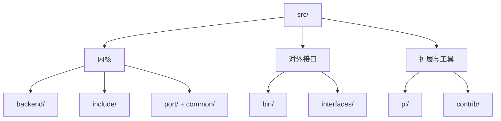

顶层只分三摊。`src/backend/` 是内核本体，`src/include/` 是它的头文件，
`src/port/` 与 `src/common/` 是跨平台的底子。

`src/bin/` 放命令行程序（`psql`、`pg_dump`、`pg_ctl` 共 21 个），
`src/interfaces/` 放客户端库（`libpq` 与 `ecpg`，
19 还多了一个可选的 `libpq-oauth` 模块，实现 OAuth 的设备授权流程）。

`src/pl/` 放过程语言（`plpgsql`、`plpython`、`plperl`、`tcl`），
`contrib/` 放官方随源码一起发的扩展。

读源码的第一步不是打开某个 `.c` 文件，是先知道**哪扇门通往哪一间屋子**。
`src/backend/` 下的目录名基本就是职责名，这是一份现成的架构说明。

## 内核的七块

`src/backend/` 一共 28 个子目录，`.c` 与 `.h` 加起来 116 万行。
按职责归一归，是七块：

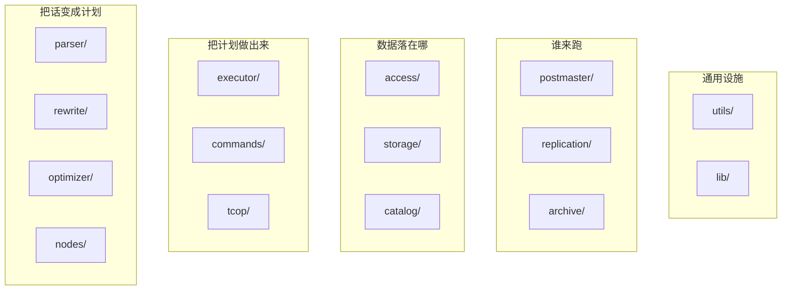

| 这一块 | 管什么 | 代码量（行） |
| --- | --- | --- |
| 请求进来 | `parser/` 语法与语义分析、`rewrite/` 改写规则、`optimizer/` 优化器、`nodes/` 结点结构 | 163 828 |
| 把计划做出来 | `executor/` 执行器、`commands/` DDL 与实用命令、`tcop/` 与客户端的流式协议 | 206 996 |
| 数据落在哪 | `access/` 各种访问方法、`storage/` 缓冲池与 WAL、`catalog/` 系统目录、`partitioning/` 分区 | 289 998 |
| 谁来跑 | `postmaster/` 进程管理、`replication/` 复制、`archive/` 归档 | 67 881 |
| 通用设施 | `utils/` 内存、锁、共享内存、进程，`lib/` 内部客户端库，`port/` 平台适配 | 305 688 |
| 剩下的 | `libpq/` 服务端侧客户端库、`snowball/` 词干提取、`tsearch/` 全文检索、`regex/` 正则、`statistics/` 扩展统计、`jit/` LLVM 编译、`foreign/` 外部表接口、`backup/` 备份、`bootstrap/` 引导、`main/` 入口、`po/` 翻译 | 127 081 |

最大的三块是 `utils/`（297 115 行）、`access/`（165 968 行）和
`commands/`（114 136 行）。这三块加起来占内核的 49.7%，
说明 PostgreSQL 的大部分复杂度不在「执行一条 SQL」，
而在**内存管理、锁管理、和把 SQL 变成一串系统目录改动**这三件事上。

一个具体的例子：`access/` 这一块下面有 `heap/`、`nbtree/`、`hash/`、`gist/`、
`spgist/`、`brin/`、`gin/` 七个访问方法——一个是堆表，六个是索引。

外加 `table/`（表访问方法的抽象层）、`index/`（索引的通用代码）
和 `transam/`（事务与可见性）。
换句话说，「PostgreSQL 支持哪些索引」这个问题的答案就在一个目录里。

## 一条 SELECT 穿过哪些模块


一条 `SELECT` 从 socket 进来，到结果发回去，中间是五站。
每一站对应一个目录：

| 站 | 干什么 | 代码在哪 |
| --- | --- | --- |
| parse | 字符串变成语法树 | `src/backend/parser/gram.y` 生成的解析器 |
| analyze | 语法树变成带类型和表信息的查询树 | `src/backend/parser/analyze.c` |
| rewrite | 视图、规则展开成等价的查询树 | `src/backend/rewrite/` |
| plan | 查询树变成执行计划 | `src/backend/optimizer/`，产出入 `src/backend/nodes/` |
| execute | 执行计划跑起来 | `src/backend/executor/execMain.c` |

前四站都还在「想」阶段，第五站才真的碰数据。
`EXPLAIN` 之所以能只给计划不给结果，就是因为它在第四站和第五站之间停住了。

这条链上还有一处容易看漏：`commands/`（114 136 行）不在这五站里，
但 `CREATE TABLE`、`ALTER TABLE`、`CREATE INDEX` 全走它。
换句话说，**DDL 不是 SQL 的特例，它是另一条路**——
一路进 `parser/`，一路进 `commands/`。

## 多进程：为什么不是一个进程

PostgreSQL 不是「一个大进程加线程」的模型，是**一个父进程加一群子进程**的模型。
理由很直接：任何一个客户端会话都可能跑很久、可能崩、可能占很多内存，
把它跟别的会话塞进同一个进程，崩一个就崩全部。

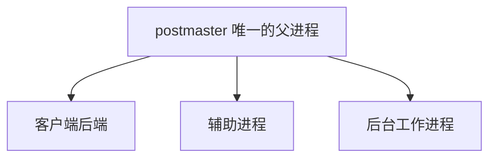

`postmaster` 是唯一的父进程。它自己**不执行任何 SQL**，
只做三件事：接受连接、fork 子进程、盯着子进程有没有死。
所有别的进程都是它的孩子。

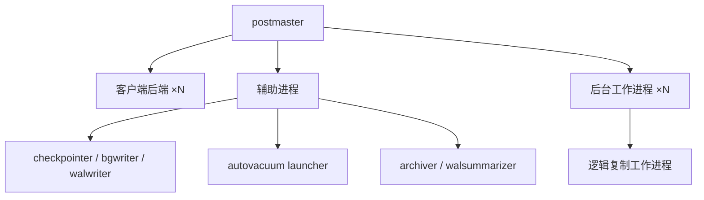

这三类进程的分工在源码里有明确的位置。
客户端后端在 `src/backend/postmaster/launch_backend.c` 里 fork，
辅助进程在 `src/backend/postmaster/` 下各有一个文件。

辅助进程的文件分别是 `checkpointer.c`、`bgwriter.c`、`walwriter.c`、
`pgarch.c`、`walsummarizer.c`。
后台工作进程统一走 `src/backend/postmaster/bgworker.c`。

`postmaster` 也不允许子进程直接崩掉整个实例。
子进程退出后，`postmaster` 读它的退出码：退出码 0 是正常退出（记日志、可能重启它），
非 0 是异常退出（记日志、必要时触发崩溃恢复）。
唯一会拉整个实例下线的，是共享内存被破坏这类没法自愈的故障。

这个取舍是有代价的：进程之间不能像线程那样直接读对方的栈，
能用的只有共享内存和信号。
换来的是隔离——一个会话崩了、内存泄漏了、被 OOM 杀了，都影响不到别的会话。

PostgreSQL 选隔离而不是选线程，理由在负载的形状上：
一个跑三小时的报表和一个跑三毫秒的点查，
放在同一个进程里，谁也受不了谁。

## 进程种类：各自干什么

进程类型在代码里有两张表。`src/include/postmaster/proctypelist.h` 列了 18 条
`PG_PROCTYPE` 宏，标明每个进程归到哪一类；
`src/include/miscadmin.h:340` 的 `BackendType` 枚举给出运行时的类型常量。

| 进程 | 类型常量 | 干什么 | 数量 |
| --- | --- | --- | --- |
| 客户端后端 | `B_BACKEND` | 一个连接一个进程，跑 SQL、跑事务、发结果 | `max_connections` |
| 空后端 | `B_DEAD_END_BACKEND` | 连上了但没有数据库可连的后端 | 随连接数 |
| 独立后端 | `B_STANDALONE_BACKEND` | 不在 `postmaster` 下跑的单机后端 | 1 |
| 自动清理启动器 | `B_AUTOVAC_LAUNCHER` | 决定什么时候该起清理进程 | 1 |
| 自动清理进程 | `B_AUTOVAC_WORKER` | 回收死元组、更新统计信息 | `autovacuum_max_workers` |
| 后台工作进程 | `B_BG_WORKER` | 扩展注册的常驻进程 | `max_worker_processes` |
| WAL 发送进程 | `B_WAL_SENDER` | 把 WAL 推给备库或逻辑订阅者 | `max_wal_senders` |
| 槽同步进程 | `B_SLOTSYNC_WORKER` | 在主备之间同步复制槽的状态 | 1 |
| 归档进程 | `B_ARCHIVER` | 把写满的 WAL 段搬到归档目录 | 1 |
| 后台写进程 | `B_BG_WRITER` | 把脏页刷回磁盘 | 1 |
| 检查点进程 | `B_CHECKPOINTER` | 执行 checkpoint | 1 |
| I/O 进程 | `B_IO_WORKER` | 承担异步 I/O | ≤ 32 |
| 启动进程 | `B_STARTUP` | 崩溃恢复与归档恢复 | 1 |
| WAL 接收进程 | `B_WAL_RECEIVER` | 备库这一侧接收 WAL | 1 |
| WAL 汇总进程 | `B_WAL_SUMMARIZER` | 给 WAL 生成摘要，供增量备份用 | 1 |
| WAL 写进程 | `B_WAL_WRITER` | 把 WAL 缓冲刷到磁盘 | 1 |
| 系统日志进程 | `B_LOGGER` | 收集各进程日志写到文件 | 1 |

十八条 `PG_PROCTYPE` 里有一条不是进程：`B_INVALID` 是枚举的第 0 项，
表示「这个进程还没认领类型」。所以真正跑得起来的类型是十七种，
就是上面这张表。

这十七种之外还有两类「借来的」进程，它们不单独占一行类型常量：

**并行工作进程**（parallel worker）算 `B_BACKEND` 的一种用法。
一条查询里并行扫描时，主后端会拉起若干个并行进程一起算。

在 19 里它们的启动方式变了：走 `RegisterDynamicBackgroundWorker`
（`src/backend/access/transam/parallel.c:630`），
登记的 `bgw_type` 是 `"parallel worker"`。

**逻辑复制工作进程**也是后台工作进程的一种，
`bgw_type` 有两种老的：`"logical replication apply worker"` 和
`"logical replication parallel worker"`。

19 又加了两种：`"logical replication sequencesync worker"`
和 `"logical replication tablesync worker"`。

这四种名字的登记处在
`src/backend/replication/logical/launcher.c:518` 往下——518、526、536、545 四处。

看进程时有个坑：`pg_stat_activity` 的 `backend_type` 列，
对 `B_BG_WORKER` 显示的是 `bgw_type` 里注册的那个字符串
（`src/backend/utils/adt/pgstatfuncs.c:606`），
不是 `BackendType` 的枚举名。

所以那一列里会出现 `parallel worker`、`REPACK decoding worker`
这样的自定义名字——它们都不是 `BackendType` 里的那一类。

## 进程是怎么被拉起来的

`postmaster` 自己是个状态机，定义在 `src/backend/postmaster/postmaster.c:336`。
它有 13 个状态。下图是主干路径，停机那一段还有几个等子进程退出的状态，图里省略了：

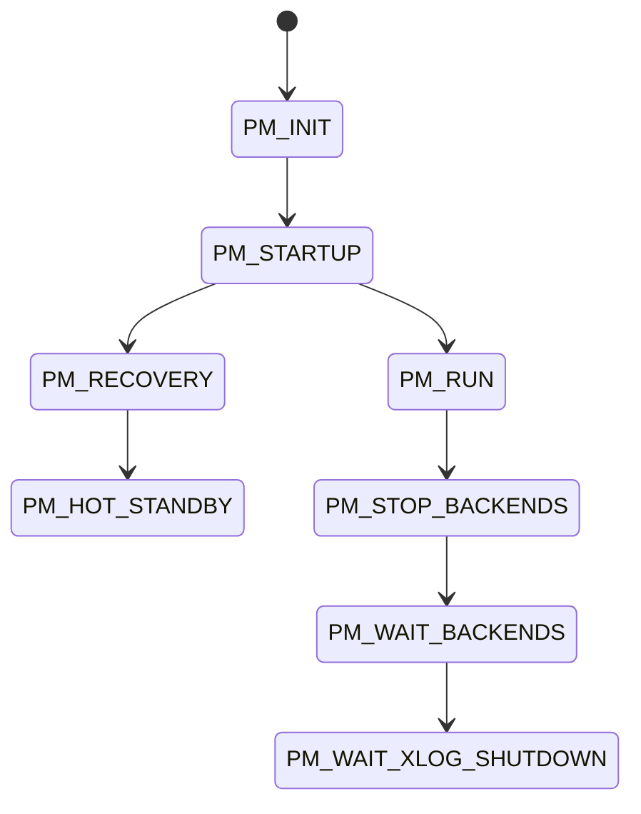

`PM_INIT` 是初始化，`PM_STARTUP` 之后启动进程去读控制文件、做恢复，
恢复完进 `PM_RUN`（正常跑）或 `PM_HOT_STANDBY`（备库）。
停机则按 `PM_STOP_BACKENDS` → `PM_WAIT_BACKENDS` → `PM_WAIT_XLOG_SHUTDOWN` 一步步退。

进程数目是算出来的，不是猜的。`src/backend/utils/init/postinit.c:566` 的
`InitializeMaxBackends()` 给出这个公式：

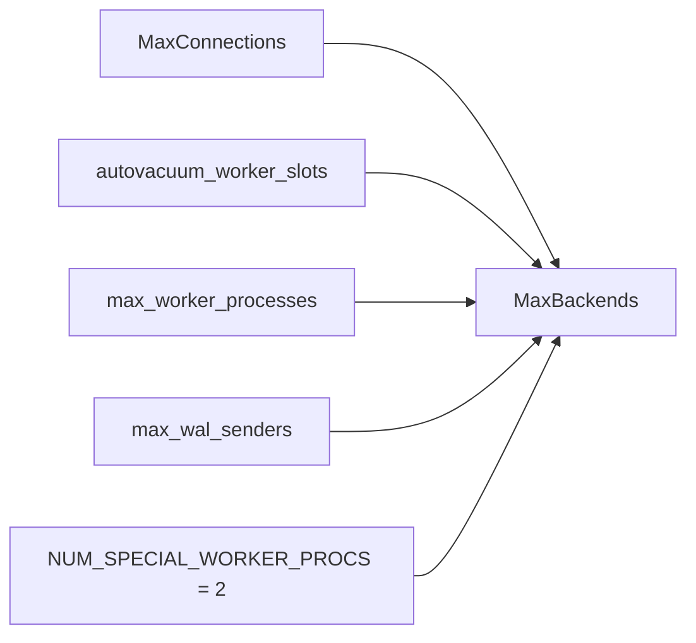

`NUM_SPECIAL_WORKER_PROCS` 是 2（`src/include/storage/proc.h:520`），
指的是自动清理启动器和槽同步进程——它们是完整的后端，能跑事务，但全局只有一个。

`MaxBackends` 的上限是 `MAX_BACKENDS`，即 `2^18 - 1 = 262 143`
（`src/include/storage/procnumber.h:39`）。

`src/backend/postmaster/pmchild.c` 里还有一张槽位表，
规定每种进程类型最多能同时有几个。
其中客户端后端的槽位是 `2 × (max_connections + max_wal_senders)`——
留一倍是因为一个连接可能要拉起一个并行工作进程。

## 进程之间怎么说话

进程之间不能直接读对方的内存，所以 PostgreSQL 把「要共享的东西」全放进共享内存，
进程之间只传**信号**和**共享内存里的指针**。

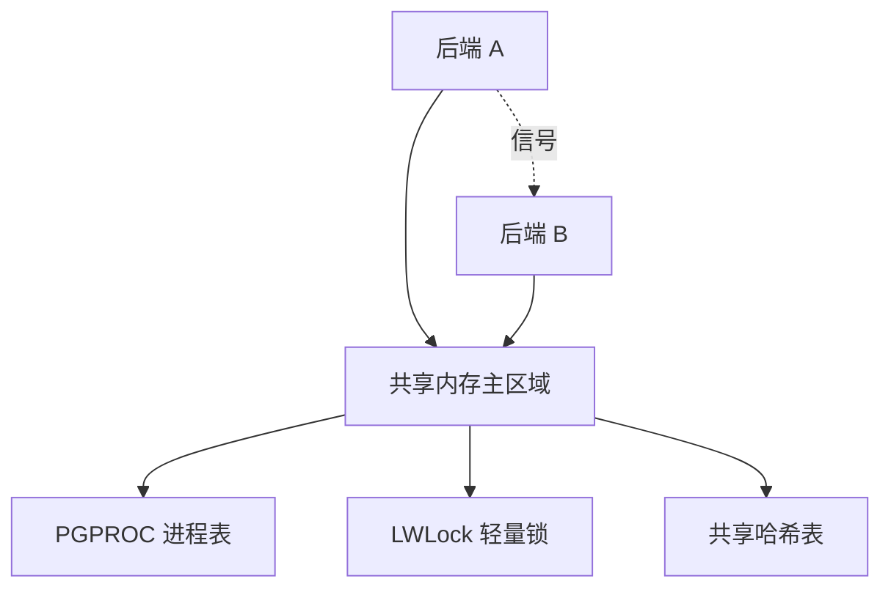

共享内存主区域里有三样最要紧的东西：

- **PGPROC 数组**：每个进程一个条目，记着它的锁状态、事务状态、子事务状态。
  别的进程要看这些信息，直接读数组，不用发消息。
- **轻量锁（LWLock）**：共享内存上的自旋锁与信号量，用来保护上面那些共享结构。
- **共享哈希表**：需要放大量可共享数据时用的，比如复制槽、锁表、统计信息。

这些结构不是谁想加就加的。`src/include/storage/subsystemlist.h` 里有一张登记表，
列了 **43 个**内置的共享内存子系统，每个都要在启动时申请自己那块空间。
扩展想加自己的，也得走同一套登记流程。

除了主区域，还有**动态共享内存（DSM）**：一段按需创建、用完就扔的共享内存。
并行查询把它当数据通道，19 的 `REPACK CONCURRENTLY` 也用它来传消息。

等待分两种：**Latch** 是等某个事件（「锁拿到了」「WAL 写完了」），
**信号**是打断一个正在睡的进程（取消查询、要求退出）。
两者的区别在 `src/include/storage/latch.h` 与 `src/backend/postmaster/interrupt.c` 里。

## 怎么验证

进程模型是可以直接看见的。下面几组命令对着任意一个跑着的实例都能跑。

看有哪些进程在跑，以及各自在等什么：

```sql
SELECT backend_type, state, wait_event_type, wait_event, count(*)
FROM pg_stat_activity
GROUP BY 1, 2, 3, 4
ORDER BY 1;
```

进程数目上限由这几个参数决定：

```sql
SELECT name, setting FROM pg_settings
WHERE name IN ('max_connections', 'autovacuum_max_workers',
               'max_worker_processes', 'max_wal_senders',
               'max_parallel_workers', 'io_max_workers');
```

剩下的行就是后台工作进程自己登记的类型名——并行进程、逻辑复制进程都在这里：

```sql
SELECT backend_type, pid, state, query
FROM pg_stat_activity
WHERE backend_type NOT IN ('client backend', 'background writer',
                           'checkpointer', 'walwriter', 'archiver',
                           'autovacuum launcher', 'autovacuum worker',
                           'walreceiver', 'walsummarizer', 'startup',
                           'io worker', 'slot sync worker', 'syslogger')
ORDER BY backend_type, pid;
```

在操作系统层面看，进程之间是父子关系，`postmaster` 是所有进程的父进程：

```console
$ ps -o pid,ppid,stat,args -C postgres
    PID  PPID STAT COMMAND
  2141     1 Ss   /usr/lib/postgresql/19/bin/postgres
  2153  2141 Ss   postgres: checkpointer
  2154  2141 Ss   postgres: background writer
  2155  2141 Ss   postgres: walwriter
  2156  2141 Ss   postgres: autovacuum launcher
  2160  2141 Ss   postgres: logical replication launcher
```

看共享内存里登记了哪些子系统——43 个内置的，加扩展登记的：

```sql
SELECT name, size FROM pg_shmem_allocations ORDER BY name;
```

校验代码与文档的说法对不对得上，可以直接查源码树：

```console
$ grep -c "^PG_SHMEM_SUBSYSTEM" src/include/storage/subsystemlist.h
43
$ grep -c "^PG_PROCTYPE" src/include/postmaster/proctypelist.h
18
```

## 扩展点：代码挂在哪一层

PostgreSQL 能被改写，是因为它的运行**由系统目录驱动**：
类型、函数、访问方法、索引、操作符，全都是目录里的行，
而目录本身是普通表，用户可以改。文档里那句「catalog-driven」说的就是这件事。

这里有一个贯穿全文的取舍：目录驱动意味着「加功能」要动系统目录，
而不是改代码。好处是不改内核也能加类型、索引、函数；
代价是扩展的能力被限制在下面这三个挂载点里——
想挂在这三点之外的东西，就得改内核本身。

在这件事之上，有三个层次可以挂代码。

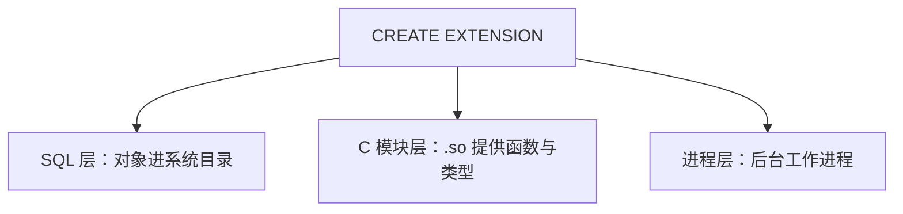

### SQL 层：把一批对象打成一个包

`CREATE EXTENSION` 不是「执行一段 SQL」，它是**按一个清单安装一个包**。
一个扩展包由两类文件组成：

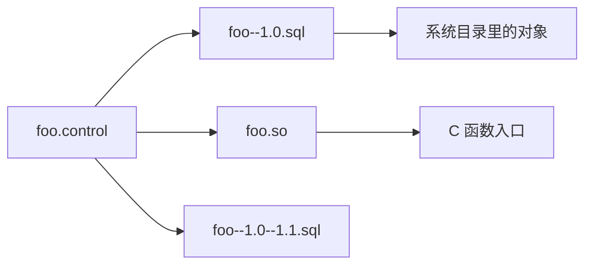

`.control` 文件是清单，格式跟 `postgresql.conf` 一样，一行一个 `键 = 值`：

```
comment = 'example extension'
default_version = '1.1'
module_pathname = '$libdir/foo'
relocatable = true
requires = 'hstore'
superuser = true
```

`foo--1.0.sql` 是安装脚本，`foo--1.0--1.1.sql` 是升级脚本。
`module_pathname` 会被替换进 SQL 脚本里的 `MODULE_PATHNAME`，
这样脚本里就不用写死 `.so` 的名字。

装完之后，扩展在 `pg_extension` 里占一行
（`src/include/catalog/pg_extension.h`），
记着名字、版本、属主、所在 schema、能不能换 schema。
能看的视图是 `pg_available_extensions` 和 `pg_available_extension_versions`。

`CREATE EXTENSION` 的实现入口在 `src/backend/commands/extension.c:2279`。

### C 模块层：写一个能加载的共享库

C 语言的扩展编译成一个共享库，进程在需要时把它加载进来。
每个共享库必须带一个魔数声明，否则 PostgreSQL 拒绝加载：

```c
PG_MODULE_MAGIC;
```

这个宏在 `src/include/fmgr.h:530`，展开成一份结构体，
里面记着 PostgreSQL 的版本号和编译期的关键参数。
加载时的检查就是比对这份数据——版本对不上就报错，不加载。

这是扩展与内核之间的一道防呆门：编译器 ABI 变了，
老扩展不会被悄悄加载成错的东西，而是当场报一个明确的错。

取舍很清楚：宁可加载失败，也不要加载成错的东西。
代价是每次跨大版本升级，所有扩展都得跟着重新编译一遍。

### 进程层：注册一个后台工作进程

扩展还可以注册**常驻进程**。
`src/include/postmaster/bgworker.h` 里的 `BackgroundWorker` 结构体描述一个进程：
叫什么、什么时候启动、崩了要不要重启、从哪个库的哪个函数进去。

注册有两条路：

- `RegisterBackgroundWorker()`：在 `shared_preload_libraries` 里调，
  服务器启动时进程就在；
- `RegisterDynamicBackgroundWorker()`：运行时从普通后端调，
  进程立刻被拉起来。

第三种是**动态共享内存加消息队列**，两个进程之间传数据用。
19 的 `REPACK CONCURRENTLY` 就是这么干的：

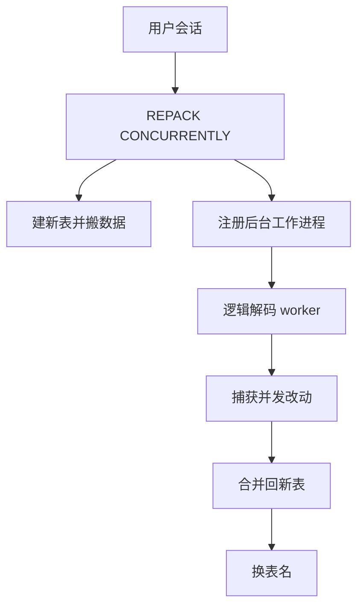

那个解码 worker 的入口是 `RepackWorkerMain`
（`src/backend/commands/repack_worker.c:59`），
它挂在动态共享内存段上，跟主会话用消息队列对话。
**内核自己用上了扩展的那套接口**——这是判断「扩展机制是不是真的」的最好试金石。

### contrib 里有什么

`contrib/` 下有 61 个目录，其中 49 个带 `.control` 文件——
一共 55 个 `.control` 文件（`spi/` 一个目录里就放了 4 个），
也就是 55 个可以直接 `CREATE EXTENSION` 装的官方扩展。
按用途分，大致是这么几类：

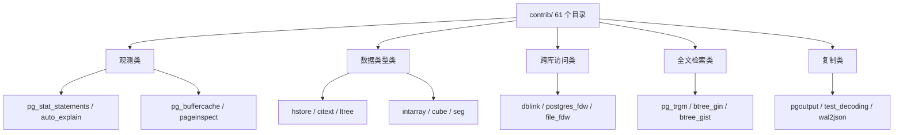

`pg_stat_statements` 是最常被装的一个：把每条 SQL 的执行次数和耗时记下来。
`pageinspect` 与 `pg_buffercache` 是排查「数据到底长什么样」的工具。
`hstore` 与 `jsonb` 配合存半结构化字段，`ltree` 存层级路径。
`postgres_fdw` 让一个库查另一个库，`dblink` 更直接，在会话里开一条远程连接。

## 知名第三方扩展

`contrib/` 之外，社区还有一批自己长起来的扩展。
按「解决什么问题」分，比按名字背一遍有用：

| 方向 | 代表 | 解决什么 |
| --- | --- | --- |
| 地理空间 | PostGIS | 几何类型、空间索引、投影变换 |
| 向量检索 | pgvector | 向量类型与近似最近邻索引 |
| 时序 | TimescaleDB | 按时间分块、超表、压缩、连续聚合 |
| 分布式 | Citus | 把一张大表横着切成多个节点 |
| 定时任务 | pg_cron | 用 SQL 表达式定时跑语句 |
| 审计 | pgaudit | 把所有语句按类别写进日志 |
| 逻辑复制 | pglogical | 带冲突处理与双向复制的逻辑复制 |
| 迁移 | pg_repack | 在线重整表，回收膨胀空间 |
| 分区路由 | pg_partman | 自动建分区、归档老分区 |
| 机器学习 | MADlib | SQL 里的统计与机器学习算法 |

装这些扩展之前有一件事必须做：**核对它支持的 PostgreSQL 大版本**。
扩展跟内核共用同一套 C 接口，跨大版本升级时 `.so` 要跟着重新编译。
19 是个刚发布的大版本，刚装上去的扩展大概率还没有针对它的构建。

## PostgreSQL 19 这次动了什么

PostgreSQL 19 这一版的几处改动，正好落在前面讲的三块上。

**扩展这块**：新增了两个官方扩展。
`pg_plan_advice` 用来稳定并控制优化器的决策，
`pg_stash_advice` 用来把针对某个 query id 的建议预先存好、自动生效。

**进程这块**：`io_workers` 这个变量被删了，
换成 `io_min_workers`、`io_max_workers`、`io_worker_idle_timeout`、
`io_worker_launch_interval` 四个新的。
`io_method = worker` 时，I/O 进程池由服务器自己按需伸缩。

**SQL 这块**：多了 `REPACK` 命令，
可以在不阻塞读写的前提下重整表并回收空间——
这是 19 之前要靠 `pg_repack` 扩展才能做的事，现在进了内核。
配套的还有 `WAIT` 命令，让备库上的会话等到「自己写的已经可见」为止；
以及逻辑复制对序列表的复制。

**复制这块**：`wal_level` 设成 `replica` 时，
逻辑复制可以不再重启就打开。

## 小结与延伸

这一篇给的是地图。三块各收一句：

**模块**：内核按职责切成 28 个目录，归成七块。
最大的三块是 `utils/`、`access/`、`commands/`——
内存、锁、和「把 SQL 变成目录改动」占了内核一半以上的代码。

**进程**：一个 `postmaster` 加十七种子进程。
客户端后端跑 SQL，辅助进程管磁盘与 WAL，后台工作进程是扩展的地盘。
并行工作进程与逻辑复制进程都借用了后台工作进程这套接口。

**扩展**：三个挂载点——系统目录（SQL 层）、
可加载模块（C 层，带 `PG_MODULE_MAGIC` 版本门）、
后台工作进程（进程层）。
`contrib/` 有 55 个官方扩展，社区还有 PostGIS、pgvector、TimescaleDB 这一批。

下一篇往下拆一层：**行锁是怎么加上去的**——
从 `LockAcquire()` 进 `ProcSleep()`，到等待队列怎么排、
死锁检测怎么在 `DeadLockCheck()` 里跑完一圈。
锁有三级（表级、行级、页级），但加锁的入口只有一个，
从那儿往下读，能看清 PostgreSQL 的并发控制到底长什么样。

想自己核对的话，源码树拿 `REL_19_STABLE` 分支，
关键入口是这几个：

| 想知道的 | 打开这个文件 |
| --- | --- |
| 进程有哪些 | `src/include/postmaster/proctypelist.h` |
| 进程类型常量 | `src/include/miscadmin.h` |
| 进程怎么被拉起来 | `src/backend/postmaster/postmaster.c` |
| 进程数目怎么算 | `src/backend/utils/init/postinit.c` |
| 共享内存登记了啥 | `src/include/storage/subsystemlist.h` |
| 扩展怎么装 | `src/backend/commands/extension.c` |
| 后台进程接口 | `src/include/postmaster/bgworker.h` |
