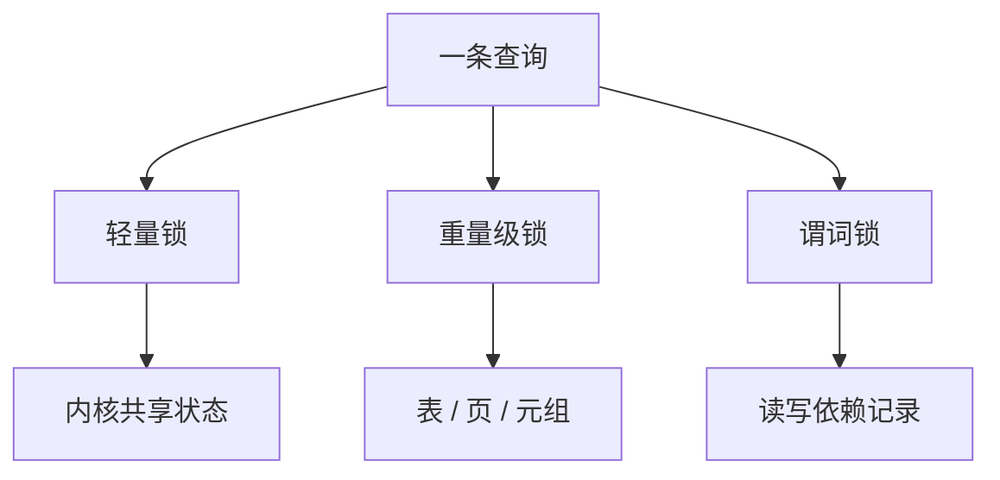
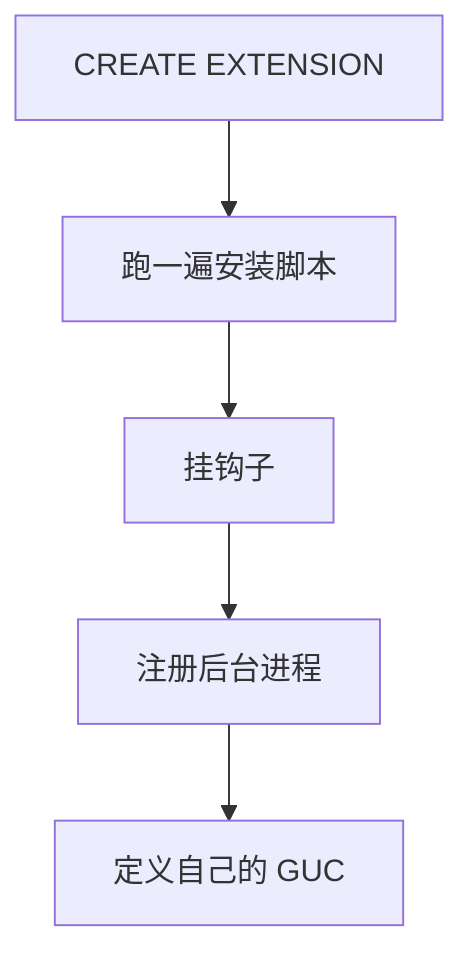

# PostgreSQL 19 的并发、持久性与扩展

| 编写人 | 编写内容 | 编写时间 |
| --- | --- | --- |
| growdu | 三层锁的分工、WAL 段与 checkpoint 的坐标、物理与逻辑复制两条路、扩展接进内核的几个口子，以及这一版的五个方向，附源码入口与可复现的验证命令 | 2026-11-24 |

> **一句话答案**：PostgreSQL 19 把并发拆成**三层互不干扰的锁**——
> 轻量锁管内核，重量级锁管对象，谓词锁管读写依赖；
> 把持久性钉在 **WAL 的坐标**上，一个 LSN 就是一个事务的全部；
> 把扩展留成一组**约定**，不是插件市场；
> 这一版真正在动的是五件事：运维动作从停机改成在线、
> 逻辑复制不再需要重启、备库上有了 `WAIT` 命令、
> 优化器从「自己猜」变成「可以被告知」、autovacuum 有了优先级。

## 本文解决什么

这一篇接着[第一篇](./postgresql19-architecture.md)往下走。
第一篇画的是骨架：谁在跑、状态放在哪、一条 SQL 怎么走完。
这一篇拆的是三块会「出事」的地方：

1. **并发**：两个事务撞在一起时，谁让谁，为什么这么让；
2. **持久**：写下去的数据什么时候算数，崩了之后怎么捡回来；
3. **扩展**：内核留了哪些口子，第三方怎么接进去。

读完这篇你应该能做完三件事：
在 `pg_locks` 里认出每一行锁是谁在等谁；
对着一个 LSN 算出它落在哪个 WAL 段的哪个偏移；
写出一个 `.control` 文件，让自己的扩展在 `pg_stat_activity` 里露脸。

本文的版本基准与第一篇相同：PostgreSQL 19，源码取自 `REL_19_STABLE` 分支。
读法也一样——**每条结论都给源码入口，或者给能直接跑的命令**。

边界划在这里：**讲清楚每块的结构与坐标，不逐行讲实现**。
索引结构、计划节点的选择、缓冲池淘汰算法这些留给后面的阶段；
并发与 WAL 的更细一层的展开（隔离级别的完整语义、
冲突检测的代价、归档与复制的运维）也留给后面的阶段。

## 并发控制：三层锁

PostgreSQL 的并发控制有三层，各管一段：
**轻量锁**管内核内部的互斥，**重量级锁**管用户可见的资源，
**谓词锁**管可串行化隔离下的读写冲突。

三层不是同一个东西的三种叫法——
它们的粒度、等待方式、在 `pg_stat_activity` 里报的名字都不一样。

三层的分工画出来是这样：



### 第一层：轻量锁

轻量锁（LWLock）是内核自己用的互斥量。
它不跟用户可见的表、行打交道，只保护内核里的共享状态。

结构体很小，定义在 `src/include/storage/lwlock.h` 第 41 行：

| 字段 | 行号 | 含义 |
| --- | --- | --- |
| `tranche` | 第 43 行 | 这把锁属于哪一组 |
| `state` | 第 44 行 | 共享/排他持有者的状态，打包成一个 32 位原子量 |
| `waiters` | 第 45 行 | 等待这把锁的进程链表 |

编译成 `LOCK_DEBUG` 时还会多两个字段：
等待者个数（`nwaiters`）与上一个排他持有者（`owner`）。

加锁的三个入口在 `src/backend/storage/lmgr/lwlock.c`：

| 函数 | 行号 | 语义 |
| --- | --- | --- |
| `LWLockAcquire()` | 第 1150 行 | 阻塞式加锁，拿到了返回 true |
| `LWLockConditionalAcquire()` | 第 1321 行 | 试一下，拿不到就返回 false，无副作用 |
| `LWLockAcquireOrWait()` | 第 1378 行 | 拿到就拿；拿不到就等到它被放掉，返回 false 且不持有 |

第三个的语义有点绕，注释里自己说「a bit funky」：
锁现在是空的，就按给的模式拿走并返回 true；
锁不空，就一直等到它被释放，然后返回 false——
**这把锁并没有拿到**。

它的唯一用途是 `WALWriteLock`：
一个后端在刷 WAL 时会顺手把别的后端的提交记录也刷出去，
那些后端醒来发现记录已经落盘，直接返回就行，不必真的拿到锁。

`LWLockRelease()` 在第 1767 行。
模式只有三个，枚举在 `lwlock.h` 第 102 行往下：
`LW_EXCLUSIVE`、`LW_SHARED`，
还有一个 `LW_WAIT_UNTIL_FREE`——
它是给 `PGPROC->lwWaitMode` 用的，注释里明写了不能传给 `LWLockAcquire()`。

**轻量锁不会做死锁检测**。
它必须按固定的顺序拿，代码里靠约定保证；
拿错了顺序，表现是整机卡住，而不是报一个死锁错误。

拿锁的等待也走统一的等待队列机制：
`LWLockAcquire()` 内部先试一次（`LWLockAttemptLock()`），
拿不到才进 `LW_LWLOCK__` 相关的等待路径，
并且在 `lwlock.c` 第 693 行调 `pgstat_report_wait_start(PG_WAIT_LWLOCK | lock->tranche)` 上报等待事件。

### tranche：锁的分组

轻量锁成组存在，一组叫一个 **tranche**。
`src/backend/storage/lmgr/lwlock.c` 第 120 行往下的注释把 tranche 分成三类：

1. `lwlocklist.h` 里逐个命名的锁，每把锁自成一组；
2. 内置的组锁，比如缓冲池映射、锁管理器；
3. 扩展通过 `RequestNamedLWLockTranche()`（第 620 行）要的组。

命名清单在 `src/include/storage/lwlocklist.h`：
`PG_LWLOCK(...)` 有 45 条，`PG_LWLOCKTRANCHE(...)` 有 42 条。

这些编号不是连续的——
比如 `PG_LWLOCK(2, OidGen)` 之后是 `PG_LWLOCK(3, XidGen)`，
中间跳过的号留给组锁的 tranche。
最大的编号是 57，所以 `NUM_INDIVIDUAL_LWLOCKS` 是 58。

这个宏不是手写的，
由 `src/backend/storage/lmgr/generate-lwlocknames.pl` 生成到 `lwlocknames.h`：

脚本读 `lwlocklist.h` 与 `wait_event_names.txt`，
一边生成 `#define <名字>Lock (&MainLWLockArray[<编号>].lock)`，
一边**交叉核对两份清单是否一致**——
两份对不上，编译就停。

共享内存里的布局由 `LWLockShmemInit()`（第 445 行）定：

| 区段 | 分区数 | 常量位置 |
| --- | --- | --- |
| 逐个命名的锁 | 58 个槽位，各成一组 | `lwlocknames.h` 生成 |
| 缓冲池映射 | 128 | `lwlock.h` 第 83 行 |
| 锁管理器 | 16 | `lwlock.h` 第 87 行 |
| 谓词锁管理器 | 16 | `lwlock.h` 第 91 行 |
| 扩展要的组 | 每组自己报数 | `lwlock.c` 第 620 行 |

分区的意义是**减少锁竞争**：
缓冲池映射分成 128 份，不同的进程哈希到不同的分区上，
两个进程访问不同页时不会互相挡。

扩展要加自己的组，两步：
先用 `LWLockNewTrancheId()`（第 562 行）要一个组号，
再用 `RequestNamedLWLockTranche()`（第 620 行）报名字与把数。

组号从 100 起（`LWTRANCHE_FIRST_USER_DEFINED`，`lwlock.h` 第 172 行），
最多 256 个（`MAX_USER_DEFINED_TRANCHES`，`lwlock.c` 第 170 行）。

拿到组号之后，用 `GetNamedLWLockTranche()`（第 522 行）取那组锁的数组，
再逐把 `LWLockInitialize()`（第 670 行）打上组号。

### 第二层：重量级锁

重量级锁就是 SQL 里那些 `LOCK TABLE`、`ALTER TABLE` 背后的东西。

它由三样东西定义：

- **锁标签**（`LOCKTAG`，`src/include/storage/locktag.h` 第 64 行）——
  锁的是哪个对象；
- **锁模式**（`LOCKMODE`，`src/include/storage/lockdefs.h`）——
  要什么程度的排他；
- **冲突表**——两种模式能不能共存。

锁标签的类型是一个枚举（`locktag.h` 第 36 行往下），
一共 12 种：

| 类型 | 锁的是什么 |
| --- | --- |
| `LOCKTAG_RELATION` | 整个关系 |
| `LOCKTAG_RELATION_EXTEND` | 扩展关系文件的权利 |
| `LOCKTAG_DATABASE_FROZEN_IDS` | `pg_database.datfrozenxid` |
| `LOCKTAG_PAGE` | 关系里的某一页 |
| `LOCKTAG_TUPLE` | 某个物理元组 |
| `LOCKTAG_TRANSACTION` | 一个事务 |
| `LOCKTAG_VIRTUALTRANSACTION` | 一个虚拟事务 |
| `LOCKTAG_SPECULATIVE_TOKEN` | 推测插入的 xid 与 token |
| `LOCKTAG_OBJECT` | 非关系的数据对象 |
| `LOCKTAG_USERLOCK` | 留给旧的用户锁代码 |
| `LOCKTAG_ADVISORY` | 咨询锁 |
| `LOCKTAG_APPLY_TRANSACTION` | 逻辑复制订阅端正在应用的事务 |

最后一个 `LOCKTAG_APPLY_TRANSACTION` 是这一版新增的类型：
它让逻辑复制订阅端能对「正在应用的那个事务」加锁，
订阅端的推进因此不会和别的操作打架。

### 八个模式与冲突表

模式一共八个，定义在 `src/include/storage/lockdefs.h`：

| 模式 | 值 | 谁在用 |
| --- | --- | --- |
| `AccessShareLock` | 1 | SELECT |
| `RowShareLock` | 2 | SELECT FOR UPDATE / FOR SHARE |
| `RowExclusiveLock` | 3 | INSERT / UPDATE / DELETE |
| `ShareUpdateExclusiveLock` | 4 | VACUUM、ANALYZE、CREATE INDEX CONCURRENTLY |
| `ShareLock` | 5 | CREATE INDEX（不带 CONCURRENTLY） |
| `ShareRowExclusiveLock` | 6 | 像 EXCLUSIVE，但放行 ROW SHARE |
| `ExclusiveLock` | 7 | 挡住 ROW SHARE 与 SELECT FOR UPDATE |
| `AccessExclusiveLock` | 8 | ALTER TABLE、DROP TABLE、VACUUM FULL |

两两能不能共存，答案在一张位掩码表里：
`LockConflicts[]`（`src/backend/storage/lmgr/lock.c` 第 68 行）。
每一行是这个模式与哪些模式冲突，
表的前面还留了一行 `0`，对应 `NoLock`（`lockdefs.h` 第 34 行）。
`AccessExclusiveLock` 那一行八个位全开——它跟谁都不共存。

模式的名字另有一张表 `lock_mode_names[]`（第 111 行），
`pg_locks` 里看到的字符串就是从这里来的。

判定在 `LockAcquireExtended()`（第 865 行）里：
先查表，第 1134 行是 `lockMethodTable->conflictTab[lockmode] & lock->waitMask`；
表里没写的组合（比如带 `lockmethodid` 的用户锁），
交给 `LockCheckConflicts()`（第 1569 行）细查。

不冲突就 `GrantLock()`（第 1143 行）直接给，
冲突就 `JoinWaitQueue()`（第 1152 行）排队。

### 三张哈希表

重量级锁的数据分三处放：

| 表 | 在哪 | 装什么 |
| --- | --- | --- |
| `LOCK hash` | `lock.c` 第 464 行 | 全局的锁对象，按标签查 |
| `PROCLOCK hash` | `lock.c` 第 476 行 | 进程持有的锁 |
| `LOCALLOCK hash` | `lock.c` 第 513 行 | 本后端自己的锁，**不在共享内存里** |

前两张在共享内存，分区数都是 `NUM_LOCK_PARTITIONS`（16）；
第三张是每个后端各建一份的本地表，
`hash_create()` 的名字就叫 `"LOCALLOCK hash"`（第 513 行）。

三者的分工是：
`LOCK` 记录「这个对象上有哪些锁」，
`PROCLOCK` 记录「这个进程持有哪些锁」，
`LOCALLOCK` 记录「我这次事务申请过什么、申请了几次」——
所以同一个后端可以重复加同一把锁而只算一次。

### 等待与死锁检测

排队等锁的路径是：
`JoinWaitQueue()`（`src/backend/storage/lmgr/proc.c` 第 1176 行）
→ `ProcSleep()`（第 1345 行）→ `WaitLatch()`（第 1491 行）。

`ProcSleep()` 不是死等，它每隔一会儿醒一次做两件事：
处理来自网络的消息，以及**检查死锁**。

死锁检查的入口是 `DeadLockCheck()`
（`src/backend/storage/lmgr/deadlock.c` 第 220 行），
在 `proc.c` 第 1900 行被调用。
它画一张「谁在等谁」的等待图，找环。

找到环之后按 `DeadLockState` 分类
（`src/include/storage/lock.h` 第 339 行往下）：

| 状态 | 含义 |
| --- | --- |
| `DS_NOT_YET_CHECKED` | 还没检查过 |
| `DS_NO_DEADLOCK` | 没有死锁 |
| `DS_SOFT_DEADLOCK` | 软死锁，靠重排队列能解开 |
| `DS_HARD_DEADLOCK` | 硬死锁，只能中止一个事务 |
| `DS_BLOCKED_BY_AUTOVACUUM` | 没有死锁，是被 autovacuum 挡住的 |

**软死锁与硬死锁的差别**在要不要动手：
软死锁只需要重排等待队列，
硬死锁必须杀掉某个正在运行的事务。

### 表锁：从 LOCK TABLE 走一遍

把 `LOCK TABLE t IN ACCESS EXCLUSIVE MODE` 从语法到等待走一遍：

1. 语法规则在 `src/backend/parser/gram.y` 第 12741 行，
   `ACCESS EXCLUSIVE` 映射到 `AccessExclusiveLock`；
2. `LockTableCommand()`（`src/backend/commands/lockcmds.c` 第 41 行）
   调 `RangeVarGetRelidExtended()`；
3. `RangeVarGetRelidExtended()`
   （`src/backend/catalog/namespace.c` 第 442 行）
   在第 593 行调 `LockRelationOid()`；
4. `LockRelationOid()`（`src/backend/storage/lmgr/lmgr.c` 第 107 行）
   调 `LockAcquireExtended()`；
5. 进冲突表判定，不冲突就拿到，冲突就排队等。

带 `NOWAIT` 走的是另一条：
`ConditionalLockRelationOid()`（`lmgr.c` 第 151 行）
把 `dontWait` 置成 true，拿不到立刻返回 false。

DDL 拿的是同一把锁：
`CREATE TABLE` 在 `src/backend/catalog/heap.c` 第 1587 行
显式拿 `AccessExclusiveLock`，
那里的注释解释了原因——
别的会话在事务提交前扫不到这个新表，
所以一直拿着不碍事，但必须由这一处统一拿，
免得各调用方拿的模式与时机不一致。

`ALTER TABLE` 的锁级别由 `AlterTableGetLockLevel()`
（`src/backend/commands/tablecmds.c` 第 4654 行）逐个子命令决定，
默认从 `ShareUpdateExclusiveLock` 起步（`tablecmds.c` 第 4660 行）。

### 第三层：谓词锁

前两层管的是「谁在什么时候能拿到什么」。
但可串行化隔离要防的是另一种情况：
两个事务**都没有冲突地各自读了对方要写的东西**，写下去就串不起来了。

谓词锁（SIREAD 锁）就是记这件事的：
它**不阻塞任何人**，只是把「我读过这里」记下来，
等到真出现危险组合时报错回滚。

代码在 `src/backend/storage/lmgr/predicate.c`。
三个粒度各有一个入口：

| 函数 | 行号 | 粒度 |
| --- | --- | --- |
| `PredicateLockRelation()` | 第 2505 行 | 整个关系 |
| `PredicateLockPage()` | 第 2528 行 | 一页 |
| `PredicateLockTID()` | 第 2550 行 | 一行 |

底下真正登记的是 `PredicateLockAcquire()`（第 2446 行，静态函数），
它先问 `PredicateLockExists()`（第 1974 行）
有没有更粗的锁已经覆盖了，
没有才调 `CreatePredicateLock()`（第 2382 行）建一个。

**谓词锁没有开关参数**。
它由隔离级别打开：`XACT_SERIALIZABLE`（`src/include/access/xact.h` 第 39 行），
判定用 `IsolationIsSerializable()`（同文件第 53 行）。

控制规模的是三个上限参数：
`max_pred_locks_per_transaction`、`max_pred_locks_per_relation`、
`max_pred_locks_per_page`。

谓词锁在共享内存里占五块
（`predicate.c` 第 1131 到 1209 行）：
`PREDICATELOCKTARGET hash`、`PREDICATELOCK hash`、`PredXactList`、
`SERIALIZABLEXID hash`、`RWConflictPool`。

其中 `RWConflictPool` 装的是**读写冲突**——
一个事务读过的集合与另一个事务写过的集合的交集。
冲突检测靠它，出问题时报的就是序列化失败。

### 三层怎么一起看

三层在 `pg_stat_activity` 里的区分靠 `wait_event_type`：
轻量锁是 `LWLock`，重量级锁是 `Lock`
（`src/backend/utils/activity/wait_event.c` 第 370 行往下那个 switch，
`PG_WAIT_LWLOCK` 与 `PG_WAIT_LOCK` 两个分支）。

重量级锁还能在 `pg_locks` 里查到细节——
视图定义在 `src/backend/catalog/system_views.sql` 第 439 行，
数据由 `pg_lock_status()`（`src/backend/utils/adt/lockfuncs.c` 第 93 行）填，
一共 16 列（`NUM_LOCK_STATUS_COLUMNS`，同文件第 66 行）。

谓词锁也在这个视图里，但 `mode` 固定写成 `SIReadLock`
（`lockfuncs.c` 第 433 行），好和真锁区分开。

想知道某个会话被谁挡住了，用 `pg_blocking_pids()`
（`lockfuncs.c` 第 467 行）。
它区分**硬挡**与**软挡**：
硬挡是持有冲突锁的人，软挡是排在前面等待的人——
后者并没有持锁，只是插队。
并行查询里还要看组 leader，规则写在函数注释里（第 447 行往下）。

## WAL 的文件布局、checkpoint 与恢复

前面讲过 WAL 的记录格式与落盘路径。
这一节讲 WAL 在磁盘上长什么样，以及服务器怎么从 WAL 里回到一致状态。

### WAL 段：16 MB 一段

WAL 文件是按段切的，默认一段 16 MB。
`DEFAULT_XLOG_SEG_SIZE` 定义在 `src/include/pg_config_manual.h` 第 20 行，
运行时的实际值放在 `wal_segment_size` 全局变量里
（`src/backend/access/transam/xlog.c` 第 148 行）。

段大小的意义在于：**WAL 记录不能跨段**。
一条记录如果比一段还长，PostgreSQL 会拒绝写入并报错。
段大小的另一个作用是归档的单位——备库需要的是整段。

段文件名的生成函数是 `XLogFileName()`
（声明在 `src/include/access/xlog_internal.h` 第 165 行），
参数是时间线 id、段号与段大小。
时间线 id 出现在文件名里，是为了让「分叉之后的 WAL」与「分叉之前的 WAL」
在文件系统上天然分开。

对应的目录是数据目录下的 `pg_wal`。
里面除了当前的段，还有归档进来的段——归档的目的地默认就在同一个目录下。

### LSN 与文件位置的换算

**LSN**（log sequence number）是 WAL 里的逻辑位置。
它是一个 64 位数，写法是 `高 32 位/低 32 位`，比如 `0/0306EE20`。

一个 LSN 对应磁盘上的哪个位置，需要两步换算：
先用 `XLByteToSeg()` 算出这是第几段
（宏定义在 `src/include/access/xlog_internal.h` 第 116 行），
再用 `XLogSegNoOffsetToRecPtr()` 算出段内偏移。
这两个换算的调用点在 `xlog.c` 第 1930 行与第 1976 行。

反过来，段内偏移也能算出来：`XLogSegmentOffset()`。
`xlog.c` 里有十几处用它，其中第 1229 行那个判断最典型——
**偏移为 0 说明这条记录正好是某一段的第一条**。

`XLogSegmentOffset()` 的第二个参数是段大小而不是写死的 16 MB，
所以改 `wal_segment_size` 之后整套换算仍然成立。

### 读取 WAL 的两层

读 WAL 有两层，一层是「读页」，一层是「读记录」。

**读页**是把一个段文件的一部分读进内存。
**读记录**是在页里找出一条完整的记录。

记录层的入口是 `XLogReadRecord()`
（`src/backend/access/transam/xlogreader.c` 第 394 行），
它做的是校验：`xl_crc` 对不上就报「记录损坏」，
`xl_tot_len` 对不上也报错。
`XLogReadRecordAlloc()`（第 443 行）是它的分配版本，
多了一步按记录长度申请内存。

跳过一条记录找下一条的入口是 `XLogFindNextRecord()`（第 1404 行）——
恢复时如果遇到一条不认识的记录，就靠它往前走。

读记录用的状态结构叫 `XLogReaderState`，
里面记着当前读到哪个段、哪个位置、哪些段已经验证过。

### checkpoint：把脏页写盘并记一个坐标

checkpoint 做两件事：
**把当前所有脏页写进数据文件**，以及
**在 WAL 里写一条 checkpoint 记录**，记下这次的位置。

入口是 `CreateCheckPoint()`（`xlog.c` 第 7048 行），
真正干活的是 `CheckPointGuts()`（第 7680 行）。
checkpoint 记录本身用 `XLogInsert(RM_XLOG_ID, XLOG_CHECKPOINT_REDO)` 写入
（`xlog.c` 第 7230 行）。

**检查点记录里有 redo 坐标**。
这个坐标的意思是：崩溃恢复时，重放 WAL 到这个位置就够了，
再往前的变更都已经在数据文件里了。
它也是 `pg_control` 文件里 `checkPoint` 字段的值
（`src/include/catalog/pg_control.h` 第 134 行）。

`pg_control` 文件本身是 `ControlFileData` 结构
（`pg_control.h` 第 105 行），开头几个字段是：

| 字段 | 行号 | 含义 |
| --- | --- | --- |
| `system_identifier` | 第 111 行 | 系统唯一标识，防止把别的实例的 WAL 拿过来用 |
| `pg_control_version` | 第 126 行 | `pg_control` 自身的格式版本 |
| `catalog_version_no` | 第 127 行 | 系统目录的格式版本 |
| `state` | 第 132 行 | 数据库状态 |
| `time` | 第 133 行 | 上次更新 `pg_control` 的时间 |
| `checkPoint` | 第 134 行 | 最近一次 checkpoint 记录的位置 |

`system_identifier` 的作用值得单说：
它是一个 UUID 样的标识，**防止把 A 实例的 WAL 目录接到 B 实例上**。
接错的时候服务器会拒绝启动，而不是产生一个损坏的数据目录。

### checkpoint 什么时候发生

触发 checkpoint 的方式有三种：

**超时**。`CheckPointTimeout` 默认 300 秒，
定义在 `src/backend/postmaster/checkpointer.c` 第 167 行。
`CheckPointWarning` 默认 30 秒（第 168 行），
它是「快要超时了」的提醒阈值——日志里会打出
「checkpoint 正在写，预计多久完成」这类信息，
写系统负载高的时候这条日志很有用。

**写满 WAL**。当 WAL 写过的量超过 `max_wal_size` 的设定值时触发。

**手动**。`CHECKPOINT` 命令，入口是 `ExecCheckpoint()`
（`checkpointer.c` 第 1006 行），它调的是
`CreateCheckPoint(flags | CHECKPOINT_FAST)`（第 1084 行）。

`CHECKPOINT_FAST` 这个标志的语义是「不等所有后台写进程把脏页写完」。
普通 checkpoint 会等写进程把该写的页都写出去，
所以慢的查询不会因为 checkpoint 被取消；
`CHECKPOINT` 命令则是「现在就做，别等了」。

还有 `CheckPointCompletionTarget`，默认 0.9
（`checkpointer.c` 第 169 行）：
checkpoint 进程会按这个比例分配时间，
在超时之前把工作做完，而不是做一半被打断。

### 恢复：startup 进程

崩溃之后重启，服务器不是从头重放所有 WAL，
而是从 `pg_control` 里记的 checkpoint 坐标开始。

启动进程是 `StartupProcessMain()`
（`src/backend/postmaster/startup.c` 第 216 行），
它只在「需要恢复」时才存在——正常启动时它立刻退出。

恢复的三个主要入口：

| 函数 | 位置 | 干什么 |
| --- | --- | --- |
| `InitWalRecovery()` | `src/backend/access/transam/xlogrecovery.c` 第 456 行 | 读 `pg_control`，定下从哪开始重放 |
| `PerformWalRecovery()` | 同上第 1620 行 | 真正重放 |
| `ReadCheckpointRecord()` | 同上第 4076 行 | 把 checkpoint 记录读出来 |

重放的单位是「一条 WAL 记录」。
每条记录都带一个资源管理器 id（`xl_rmid`），
处理它的函数叫 **redo 函数**。
22 个资源管理器各自带一个 redo 函数，
定义在 `src/include/access/rmgrlist.h`。

`xlog.c` 第 803 行那一处是分派点：
判断 `rechdr->xl_rmid == RM_XLOG_ID`，
是的话走 WAL 自己的处理，不是的话按 id 找到对应的 redo 函数。

**WAL 自己的记录也要 redo**，它们不是特例。

`XLOG_CHECKPOINT_REDO`、`XLOG_END_OF_RECOVERY`、`XLOG_NEXTOID`、
`XLOG_SWITCH`、`XLOG_RESTORE_POINT`、`XLOG_ASSIGN_LSN`——

这几个 info 类型的常量定义在 `src/include/catalog/pg_control.h` 第 72 到 83 行，
对应的插入点能在 `xlog.c` 里找到
（第 7230、7566、8200、8242、8262、8292 行）。

### 时间线：分叉的历史

时间线（timeline）是 PostgreSQL 处理「历史分叉」的方式。

正常情况下一条时间线就够了。
但有几种情况会分叉：
主库被提升（`pg_ctl promote`）、备库被提升、
或者用 `recovery_target_time` 恢复到某个时间点。

分叉之后，新时间线从分叉点开始写自己的 WAL 段，
段名里的时间线 id 与旧的不同，所以两段历史在文件系统上不冲突。
分叉点本身在旧时间线的最后一个段里，
由 `XLOG_RESTORE_POINT`（`xlog.c` 第 8262 行）标记。

**`pg_wal` 目录里的历史文件就是时间线**。
一份跑了很多年、切换过好几次的实例，
`pg_wal` 里往往有好几个时间线 id 的段文件。

### 归档：把 WAL 搬走

`pg_wal` 里的段会循环使用——旧的段被回收，
腾出空间给新段。**归档**就是在这之前把段复制到别处。

归档进程是 `PgArchiverMain()`（`src/backend/postmaster/pgarch.c` 第 221 行）。
它读 `archive_command` 这个参数，把段文件搬走。

归档的三个常见用途：

**备库拉取**。备库用 `restore_command` 从归档目录取段，
这是最基础的流复制之外的长距离复制手段。

**时间点恢复**。归档保留了完整的历史，
所以可以把实例恢复到任意一个已归档的时刻。

**跨机房容灾**。归档目录可以在另一个机房。

归档与复制的关系是：**复制传的是「正在写的」WAL，
归档留的是「已经写完的」WAL**。
两者互补：复制保证实时性，归档保证可回溯性。

### 三个参数的分工

| 参数 | 管什么 |
| --- | --- |
| `wal_level` | WAL 记录到什么详细程度：`minimal` / `replica` / `logical` |
| `max_wal_size` | 触发 checkpoint 的 WAL 总量阈值 |
| `archive_mode` | 要不要归档，以及归档到哪 |
| `wal_compression` | WAL 记录要不要压缩 |

`wal_level` 决定能不能用逻辑复制、能不能做 `pg_logicalinspect`。
从 `replica` 升到 `logical` 需要重启——
19 改进了这一点，`src/backend/replication/logical/logicalctl.c`
让逻辑解码可以动态开关，前文已经讲过。

`max_wal_size` 决定 checkpoint 的频率。
调大它能减少 checkpoint 次数，但会增加崩溃恢复的时间。
这是一个明确的取舍：**用恢复时间换运行时间**。

## 复制：物理与逻辑两条路

复制有两条完全不同的路。
**物理复制**传的是 WAL 段，备库原样重放；
**逻辑复制**传的是「这张表变了什么」这样的消息，订阅端自己应用。
这一节讲两条路各自的进程与机制。

### 物理复制的两个进程

物理复制靠两个进程。

两边的进程对上了：


**发送端**是 walsender。它是 backend 的一种，
入口是 `WalSndLoop()`（`src/backend/replication/walsender.c` 第 3065 行）。
它的循环做的事情是：
等客户端请求、维持流、发心跳。

真正把 WAL 发出去的是 `XLogSendPhysical()`（第 3379 行），
它从 WAL 缓冲区里取一段还没发过的字节，发到连接上。

备库的反馈走 `ProcessStandbyReplyMessage()`（第 2539 行），
备库会报告三个位置：

| 位置 | 含义 |
| --- | --- |
| `write_lsn` | 已经写到 WAL 文件 |
| `flush_lsn` | 已经刷盘 |
| `replay_lsn` | 已经重放 |

这三个位置的差值就是延迟。
主库上能通过 `pg_stat_replication` 看到它们——
视图定义在 `src/backend/catalog/system_views.sql` 第 967 行，
列出了 `sent_lsn`、`write_lsn`、`flush_lsn`、`replay_lsn`
以及对应的三个 lag。

**接收端**是 walreceiver。入口是 `WalReceiverMain()`
（`src/backend/replication/walreceiver.c` 第 155 行）。
它做的事：

`XLogWalRcvProcessMsg()`（第 923 行）处理收到的消息；
`XLogWalRcvWrite()`（第 994 行）把 WAL 写进本地的 WAL 文件；
`XLogWalRcvFlush()`（第 1095 行）按需刷盘；
`XLogWalRcvSendReply()`（第 1218 行）把上面那三个位置报回去。

walreceiver 写完 WAL 之后，startup 进程负责重放。
**这两个进程是分开的**：walreceiver 只管接收与落盘，
重放由 startup 进程做。这样重放慢的时候不会阻塞接收，
代价是 WAL 会在 `pg_wal` 里堆起来。

walreceiver 还会定期发**热备反馈**（hot standby feedback）：
`XLogWalRcvSendHSFeedback()`（第 1292 行）告诉主库
「我这边的最老 xmin 是多少，你可以安全回收比它更老的数据」。
这个机制让主库不会因为备库的存在而无限推迟 vacuum。

### 复制槽：钉住 WAL 的钉子

问题来了：主库要回收旧 WAL 段，但备库可能还没拉完。
**复制槽**就是解决这个问题的东西——它告诉主库
「这个位置之前的 WAL 先别删」。

槽的核心字段在 `src/include/replication/slot.h` 的
`ReplicationSlotPersistentData`（第 94 行往下）：

| 字段 | 含义 |
| --- | --- |
| `name` | 槽的名字 |
| `database` | 绑定的数据库；`InvalidOid` 表示物理槽 |
| `persistency` | 掉电后是否还在 |
| `xmin` | 槽需要保留的旧版本数据的界限 |
| `catalog_xmin` | 槽需要保留的旧系统目录数据的界限 |
| `restart_lsn` | 解码/复制需要从这个位置开始 |

有意思的是 **19 里物理槽与逻辑槽的分界是 `database` 字段**：
`database` 是 `InvalidOid` 就是物理槽，否则是逻辑槽。
这个判断在 `src/backend/replication/slotfuncs.c` 第 313 行往下，
系统视图就是照这个逻辑把 `slot_type` 算出来的。

创建与获取槽的函数是
`ReplicationSlotCreate()`（`src/backend/replication/slot.c` 第 378 行）
与 `ReplicationSlotAcquire()`（第 631 行）。

**槽是一个有代价的东西**。
一个没人用的逻辑槽会让主库一直保留 WAL，
磁盘会一直涨。19 给 `pg_replication_slots` 加了 `safe_wal_size` 列，
直接告诉你「这个槽还占着多少安全范围内的 WAL」。

还有一个专门给逻辑槽记账的视图 `pg_stat_replication_slots`
（`src/backend/catalog/system_views.sql` 第 1130 行）。
它的列分成两拨。
一拨是内存用量：`mem_exceeded_count`、`total_bytes`、`total_txns`。

另一拨是「流式下发」的统计：
`stream_txns`、`stream_count`、`stream_bytes`。
`mem_exceeded_count` 大于 0 说明解码时内存不够用，
改用流式把变更直接发给订阅端了。
这个视图只统计逻辑槽，物理槽被 WHERE 条件排除了。

### 逻辑复制：四个角色

逻辑复制把 WAL 翻译成表变更，涉及四个角色：

| 角色 | 进程 | 位置 |
| --- | --- | --- |
| 发布端 | 逻辑解码 + 输出插件 | `src/backend/replication/logical/logical.c` |
| 调度器 | apply launcher | `src/backend/replication/logical/launcher.c` 第 1207 行 |
| apply worker | 订阅端应用变更 | `src/backend/replication/logical/worker.c` 第 6080 行 |
| 表同步 worker | 初始数据拷贝 | `src/backend/replication/logical/tablesync.c` |

**发布端**用逻辑解码把 WAL 变成变更事件。
核心结构是 `LogicalDecodingContext`（`logical.c` 第 56 行），
里面装着 `ReorderBuffer`——一个重排序缓冲区。
重排序是必需的：WAL 里的事务是交错的，
而订阅端希望一个事务的变更连续出现，重排序缓冲区负责归拢。

输出插件是一个回调集合：开始、提交、回滚、准备事务等。
插件文件在 `src/backend/replication/logical/logical.c` 第 66 行往下，
每个回调都有一个包装函数。

内置的输出插件是 `pgoutput`（`src/backend/replication/pgoutput/pgoutput.c`），
它是逻辑复制默认用的。
`contrib/test_decoding/` 是另一个，用来调试——
它把变更打印成人类可读的文本。

**订阅端**读变更用 SQL 函数：
`pg_logical_slot_get_changes()`（`src/backend/replication/logical/logicalfuncs.c` 第 334 行）。
它把槽里的变更取出来，返回行记录。
`pg_logical_slot_peek_changes()` 是对应的「看一眼但不移走」版本。

### 逻辑复制的初始同步

订阅一开始，表里没有数据，要先拷贝一遍。
这一步由 **表同步 worker** 做，它是个独立的后台进程。

流程是：调度器为每个待同步的表起一个 worker，
worker 用 `COPY` 的方式把数据导过去，
同时记录一个位置，之后从那个位置开始接增量变更。

**这个「导数据 + 接增量」的过程要一致**，否则会漏数据。
PostgreSQL 用**导出快照**来保证：
同步开始时取一个快照，数据从这个快照里读，
同时记下这个快照对应的 LSN，之后从那儿开始接增量。

19 增加了**序列的同步**。
订阅端把要同步的序列登记在 `pg_subscription_rel` 这张表里，
代码在 `src/backend/replication/logical/sequencesync.c`。
序列的同步状态分 INIT 与 SYNCHRONIZED 两种，
`REFRESH SEQUENCES` 把状态打回 INIT，让它重来一遍。

调度器会定期扫这张表，为状态是 INIT 的序列起一个 sequencesync worker。
调度器的入口是 `ApplyLauncherMain()`（`launcher.c` 第 1207 行），
apply worker 的入口是 `ApplyWorkerMain()`（`worker.c` 第 6080 行）。

### 并行 apply

apply worker 可以并行工作。
`src/backend/replication/logical/applyparallelworker.c` 里有两处队列创建：
第 379 行是元组队列，第 387 行是错误队列。

**元组队列与错误队列分开**，是这里的设计要点：
一条消息处理出错，不应该把整条元组流搞乱。
元组流继续走，错误单独上报。

### 同步提交与延迟

主库提交一个事务时，可以要求备库确认。
`synchronous_commit` 的五个取值前面讲过，
其中 `remote_write`、`remote_apply`、`on` 都涉及等备库。

等的实现是 `SyncRepWaitForLSN()`
（`src/backend/replication/syncrep.c` 第 149 行），
它等的是**同步备库列表里的某一个**确认到某个 LSN。

同步备库列表用 `synchronous_standby_names` 指定，
可以写多个，第一个是优先的。
每个备库有一个 `sync_priority`（数字越小越优先）与一个 `sync_state`
（`async` / `quorum` / `potential` / `sync`），
这两个值在 `pg_stat_replication` 里能看到。

### 两条路的取舍

| | 物理复制 | 逻辑复制 |
| --- | --- | --- |
| 传什么 | WAL 段 | 表变更 |
| 能否跨版本 | 不能 | 能 |
| 能否只复制部分表 | 不能 | 能 |
| 能否改数据 | 不能 | 能（但有冲突问题） |
| 延迟 | 低 | 高 |
| 备库可读 | 是 | 否 |

一句话：**要低延迟、要备库可读、要能接管，选物理；
要跨大版本、要选择性复制、要改数据，选逻辑。**

19 的改进方向是让逻辑复制更少依赖重启
（`src/backend/replication/logical/logicalctl.c`），
并且给订阅端补上了序列同步。

## 19 在动的五个方向

`doc/src/sgml/release-19.sgml` 第 13 行的 Overview 一节列了七条重点。
这一节挑其中五条**在源码里形状最清楚**的看，其余留给后面的阶段。

### 一、运维动作从「停机」改成「在线」

以前这类操作要停机，现在可以在线做。
新的 `REPACK` 命令回收磁盘空间并重排表内容。
实现是 `src/backend/commands/repack.c`（由原来的 `cluster.c` 改名而来），
外加一个 `src/backend/commands/repack_worker.c`。

它其实是三条命令的统称。`src/include/nodes/parsenodes.h` 第 3992 行往下：

| 枚举 | 对应的老命令 |
| --- | --- |
| `REPACK_COMMAND_CLUSTER` | `CLUSTER` |
| `REPACK_COMMAND_REPACK` | `REPACK` |
| `REPACK_COMMAND_VACUUMFULL` | `VACUUM FULL` |

并发模式靠**逻辑解码**从 WAL 里捞出拷贝期间发生的变更：
主体阶段只拿 `SHARE UPDATE EXCLUSIVE` 锁，读写不阻塞；
`ACCESS EXCLUSIVE` 只在最后换文件的那一小段时间里拿。

进度视图有两个。`pg_stat_progress_repack`（`system_views.sql` 第 1349 行）
是新的；`pg_stat_progress_cluster`（第 1382 行）是兼容视图，
把 `REPACK` 换算成老的 `CLUSTER` 或 `VACUUM FULL` 名字。

九个阶段定义在视图的 `CASE` 里，一一对应：

| 编号 | 阶段 |
| --- | --- |
| 0 | initializing |
| 1 | seq scanning heap |
| 2 | index scanning heap |
| 3 | sorting tuples |
| 4 | writing new heap |
| 5 | catch-up |
| 6 | swapping relation files |
| 7 | rebuilding index |
| 8 | performing final cleanup |

代价要说明白：`REPACK` 会整表重写，磁盘空间与时间是实打实的开销。
**适用场景**是「表被反复更新或删除撑大了，而重建索引解决不了」；
**不建议**拿它当日常整理手段。

### 二、逻辑复制不再需要重启

`src/backend/replication/logical/logicalctl.c` 负责动态开关逻辑解码。
激活有两个条件：`wal_level='logical'` 时直接开着；
或者 `wal_level='replica'` 且存在有效的逻辑槽时，分两步把
「逻辑 WAL 写入」与「逻辑解码」打开。
关掉是异步的，由 checkpointer 收尾。

实际效果是：从 `replica` 升到能订阅的状态，不必再重启一次实例。

**注意** `effective_wal_level` 是只读的，它反映的是当前真正生效的级别，
不是 `wal_level` 里写的那个。这两个值不一致时，以 `effective_wal_level` 为准。

序列也能跟着复制了。`src/backend/replication/logical/sequencesync.c`
跟踪 `pg_subscription_rel` 里的序列。
新建订阅或刷新发布列表时，序列以 INIT 状态加入这张表；
`REFRESH SEQUENCES` 把状态重置回 INIT。

apply worker 定期扫这张表，为待同步的序列起一个 sequencesync worker。

### 三、`WAIT` 命令：备库上的「读己之写」

19 新增了一条 SQL 命令 `WAIT`，实现在 `src/backend/commands/wait.c`。
它解决一个具体问题：**在备库上执行写操作后立刻读，可能读不到**。
因为备库重放有延迟。

用法很简单：

```sql
WAIT FOR LSN '0/0306EE20'
  WITH (MODE 'standby_flush', TIMEOUT '100ms', NO_THROW);
```

四种模式对应四个等待点：

| 模式 | 等什么 | 只能在恢复期用 |
| --- | --- | --- |
| `standby_replay` | LSN 已在备库重放（应用到数据） | 是 |
| `standby_write` | WAL 已写到备库磁盘，但未必刷盘 | 是 |
| `standby_flush` | WAL 已在备库刷盘 | 是 |
| `primary_flush` | WAL 已在主库刷盘 | 否 |

默认模式是 `standby_replay`。不带 `TIMEOUT` 就一直等。
超时会报错，除非加了 `NO_THROW`——那时返回状态字符串而不是抛异常。
可能的返回值是 `success`、`timeout` 与 `not in recovery`。

命令入口是 `ExecWaitStmt()`（`wait.c` 第 66 行），
目标 LSN 的解析在第 50 行的 `WaitTargetLSN()`。

底层机制在 `src/backend/storage/ipc/waiteventset.c`：
`CreateWaitEventSet()`（第 365 行）、`AddWaitEventToSet()`（第 570 行）、
`WaitEventSetWait()`（第 1040 行）。

这套「一组事件 + 一起等」的机制比单独等一个 fd 更通用，
epoll、poll、kqueue、Windows 都有各自的后端。

**取舍**很清楚：`WAIT` 把「等备库」这件事从应用层的心跳轮询
变成了服务器内的一次等待，省掉了往返。

### 四、优化器可以被「告知」

19 新增了两个模块，作用是把「优化器算错了但我不打算改它的代价模型」
这件事变成可以配置的东西——也就是**可以告知**优化器该走哪条路。

`contrib/pg_plan_advice/` 是**可加载模块**，不是 SQL 扩展——
目录里没有 `.control` 文件，编译出来的是 `MODULE_big`。
加进 `shared_preload_libraries`，或者用 `LOAD 'pg_plan_advice'` 装上。

模块装好之后，`EXPLAIN (COSTS OFF, PLAN_ADVICE)` 会为选中的计划生成一段 advice。
advice 是一套小语言，形如 `SEQ_SCAN(foo) HASH_JOIN(bar@ss)`，
用来直接约束优化器的选择。

关系标识写成 `alias#occurrence/partition_schema.partition_name@plan_name`。
README 强调 round-trip 安全：从计划生成的 advice 喂回下一次规划，
能落回同一处、强制同一个决策。

`contrib/pg_stash_advice/` 是真正的 SQL 扩展（`CREATE EXTENSION pg_stash_advice`），
它把 advice **自动应用**：按 query id 把 advice 存进动态共享内存里的 dshash，
规划的时候查出来自动套上。模块本身也得在每个要生效的会话里加载。

两条路线的差别：**`pg_plan_advice` 是你手动生成 advice 再手动用**，
`pg_stash_advice` 是**按 query id 自动套用**。
后者要求模块在每个会话里都加载——这是它的使用成本。

**取舍**同样清楚：代价模型是通用启发式，advice 是针对具体查询的硬约束。
用多了就是把优化器变成一个可配置的规则引擎。

### 五、autovacuum 有了优先级

`doc/src/sgml/maintenance.sgml` 第 1082 行新增了「Autovacuum Prioritization」一节。

autovacuum 现在分两步挑活：**launcher 先挑数据库，worker 再在库内给表排序**。
launcher 优先挑有事务 id 或 multixact id 回卷风险的数据库，
否则挑最久没处理的；没有连接或自上次统计重置后没有活动的库会跳过，
除非有回卷风险。

排序用五个分量：transaction ID、multixact ID、vacuum、vacuum insert、analyze。
表分取的是这几个分量里的**最大值**，每个分量再乘一个权重 GUC
（`autovacuum_vacuum_score_weight` 这一组，默认都是 1.0）。

把权重全设成 0.0，就退回 19 之前的排序方式（`pg_class` 里的列表顺序）。
这一条设计得很克制——**默认行为不变**，想用新排序的人自己去调权重。

配套的是**索引的并行 vacuum**：`autovacuum_max_parallel_workers`
（`doc/src/sgml/config.sgml` 第 9842 行，默认 0）是全局上限，
表级的 `autovacuum_parallel_workers` 关系选项还要再压一道；
并行只发生在索引 vacuum 与索引清理这两个阶段，
并行度由支持并行的索引个数决定。

**坑**在这里：默认 0 意味着光开这个参数没用，还得记得调；
而且并行度是算出来的，不保证真能拉满——索引不支持并行 vacuum 时一个 worker 都不会有。

**验证**的办法是看 `pg_stat_activity` 里有没有 `backend_type` 为 `parallel worker` 的进程，
再看 `pg_stat_autovacuum_scores` 视图里的当前分数。

那个视图定义在 `system_views.sql` 第 798 行，
把总分 `score` 与五个分量分（`xid_score`、`mxid_score`、
`vacuum_score`、`vacuum_insert_score`、`analyze_score`）并排列出来。

另外还有 `do_vacuum`、`do_analyze`、`for_wraparound` 三个标志。

## 怎么验证

上面每条结论都能在源码里对得上，也能在跑起来的实例上看到。
下面这几组命令按顺序跑，结构就在眼前走一遍。

### 先看进程

`backend_type` 的取值就是「骨架」那一章那张表的描述列：

```sql
select pid, backend_type, state, wait_event_type, wait_event
from pg_stat_activity
order by backend_type, pid;
```

想确认 19 的异步 I/O 生效，看有没有 `io worker` 类型的进程：

```sql
select backend_type, count(*) from pg_stat_activity group by 1 order by 1;
```

### 看 I/O 方法与 worker 数量

```sql
show io_method;
select name, setting, unit, context
from pg_settings where name like 'io\_%' order by name;
```

`context` 那一列直接告诉你哪些参数要重启、哪些 `reload` 就行。
并行 worker 的数量上限由 `max_parallel_workers_per_gather` 决定，
它同样是 `context` 里能查到的参数之一。

### 看计划在哪一站落的

```sql
explain (analyze, buffers, verbose)
select * from pg_class limit 1;
```

`EXPLAIN` 的输出里，`Seq Scan`、`Index Scan`、`Nested Loop` 这些节点
对应的是「一条 SQL 从解析到返回」那一章讲的执行器节点类型；
`Planning Time` 与 `Execution Time` 分开，是优化器与执行器的分界。

### 看 19 新增的东西在不在

`pg_plan_advice` 是可加载模块，不在扩展列表里；
`pg_stash_advice` 才是 SQL 扩展：

```sql
select name, default_version from pg_available_extensions where name = 'pg_stash_advice';
select * from pg_stat_progress_repack;
select * from pg_stat_autovacuum_scores limit 5;
```

`pg_stat_io` 那一组视图能给出 I/O 的账：

```sql
select backend_type, object, context, reads, writes, read_time, write_time
from pg_stat_io where backend_type = 'io worker';
```

### 看装了哪些扩展

```sql
select e.extname, e.extversion, n.nspname as schema
from pg_extension e join pg_namespace n on n.oid = e.extnamespace
order by e.extname;
```

`pg_extension` 就是 `CREATE EXTENSION` 登记的地方，
`extversion` 是当前装的那一版。
可装但没装的扩展在 `pg_available_extensions` 里，
那里还有 `default_version` 一列。

### 看 postmaster 经历了什么

把日志级别调到 `debug1`，postmaster 的每一次状态转移都会打一行：

```
DEBUG:  updating PMState from PM_RUN to PM_STOP_BACKENDS
```

停机模式与信号的关系可以直接查源码：

```bash
grep -n "shutdown_mode = \|sig = SIG" src/bin/pg_ctl/pg_ctl.c
```

`postmaster.pid` 的八行格式，定义在 `src/include/utils/pidfile.h` 第 16 行往下。

### 对着源码查

在自己的 PostgreSQL 19 源码树上跑这几条：

```bash
grep -c "^PG_PROCTYPE" src/include/postmaster/proctypelist.h
grep -n "REPACK_COMMAND" src/include/nodes/parsenodes.h
grep -n "PM_" src/backend/postmaster/postmaster.c | head -20
git log --oneline --since=2025-01-01 -- src/backend/storage/aio/
```

**验证源码里某个数字的办法**：先找到它被定义的地方，
再找它被使用的地方，两边对得上才算数。
比如 18 个进程类型，`proctypelist.h` 里数一遍是 18，
`GetBackendTypeDesc()` 取的也是这一列——两边一致才算成立。

### 追一条调用链

追调用链时最有效的办法是**从下往上找入口**：
想知道 `EXPLAIN` 的输出来自哪里，就搜 `ExplainPrintPlan`；
想知道计划为什么这么选，就搜 `standard_planner`。

两个能直接省时间的技巧：

- **`grep -rn "函数名" src/`** 而不是只搜 `src/backend/`——
  声明在 `src/include/`，实现可能在任何目录。
- **看 `git log` 而不是猜**。想知道某块代码是什么时候进的，
  `git log --oneline -- <路径>` 比读代码快得多。

### 挂上调试器

想看某个函数被调用时的现场，gdb 是最直接的入口：

```bash
gdb -p <backend pid>
(gdb) break ReadBuffer
(gdb) continue
```

`EXPLAIN (ANALYZE)` 会在每个执行节点上停一下，
配合 `auto_explain` 可以在生产环境上采样慢语句的计划。

## 扩展点：内核留出来的门

前面各章讲的都是内核自己。
这一章讲另一面：**内核留了哪些口子，扩展怎么用它们**。

PostgreSQL 的扩展机制不靠插件市场，也不靠统一 ABI。
它是一组约定：扩展是一个共享库加一个 `.control` 文件，
装的时候跑一遍 SQL 脚本，
想要插手内核的地方就挂一个钩子。

一条扩展从装上到跑起来，大致是这四步：



### CREATE EXTENSION 做了什么

入口是 `CreateExtension()`
（`src/backend/commands/extension.c` 第 2279 行），
它由工具语句分派器调用（`src/backend/tcop/utility.c` 第 1579 行）。
真正干活的是 `CreateExtensionInternal()`（同文件第 1948 行）。

这个函数按顺序做四件事：

1. 找到扩展的控制文件；
2. 判断依赖的扩展装了没有；
3. 找到安装脚本；
4. 把脚本交给内部的 SQL 执行器跑一遍。

控制文件用 `ExtensionControlFile` 结构表示
（同文件第 88 行往下）。
文件本身用 **GUC 文件解析器**读——
`ParseConfigFp()`（第 757 行）。
也就是说扩展的控制文件与 `postgresql.conf` 是同一种格式。

文件名的寻找靠 `find_extension_control_filename()`
（第 597 行），它在 `extension_control_path` 这个 GUC
（`src/backend/utils/misc/guc_parameters.dat` 第 1069 行）指定的目录里找。

### 控制文件里的关键词

`.control` 文件的每个关键字在解析函数里对应一次 `strcmp`：

| 关键字 | 位置 | 含义 |
| --- | --- | --- |
| `directory` | 第 765 行 | 脚本所在的子目录 |
| `default_version` | 第 779 行 | 不指定版本时装哪一版 |
| `module_pathname` | 第 788 行 | 共享库路径，例如 `'$libdir/pg_stat_statements'` |
| `comment` | 第 791 行 | 一句话说明 |
| `schema` | 第 794 行 | 装到哪个 schema |
| `relocatable` | 第 799 行 | 能不能换 schema |
| `superuser` | 第 808 行 | 安装是不是需要超级用户 |
| `trusted` | 第 817 行 | 非超级用户能不能装 |
| `encoding` | 第 826 行 | 脚本文件的编码 |
| `requires` | 第 834 行 | 依赖哪些扩展 |
| `no_relocate` | 第 851 行 | 哪些对象不许换 schema |

写错关键字会得到一条明确的报错：
`unrecognized parameter "%s" in file "%s"`（第 862 行）。

有一处约束值得记：`schema` 与 `relocatable = true` 互斥
（第 869 行往下）。
道理很直白——既然允许搬家，就不能钉死在哪。

### 版本与脚本链

脚本的文件名规则由 `get_extension_script_filename()`
（第 660 行）拼出来：

```
<目录>/<扩展名>--<版本>.sql          安装脚本
<扩展名>--<起版本>--<止版本>.sql      升级脚本
```

版本图由 `get_ext_ver_list()`（第 1694 行）扫脚本目录得到，
`find_update_path()`（第 1800 行）在图上找升级路径。

**安装脚本不是按名字精确匹配的**。
`CreateExtensionInternal()` 先试 `<名>--<版本>.sql`（第 1996 行），
没有就退回去找一条可达的路径：先装一个基础版本，
再按顺序重放一串升级脚本（第 2001 行往下）。

这就是为什么 `pg_buffercache` 的 `default_version` 是 `1.7`，
而目录里最早只有 `--1.2.sql`，装起来却不报错。

找不到任何路径时报的错是：
`extension "%s" has no installation script nor update path for version "%s"`
（第 2022 行）。

装完之后的登记在 `pg_extension` 这张系统表里
（`src/include/catalog/pg_extension.h`），
核心字段是 `extname`、`extnamespace`、`extrelocatable`、`extversion`。

### 加载时机：三个 preload 层次

共享库什么时候被装进进程，有三个层次：

| 参数 | 位置 | 谁能用 | 什么时候生效 |
| --- | --- | --- | --- |
| `local_preload_libraries` | `guc_parameters.dat` 第 1611 行 | 普通用户 | 当前会话 |
| `session_preload_libraries` | 同上第 2704 行 | 超级用户 | 当前会话 |
| `shared_preload_libraries` | 同上第 2756 行 | 超级用户 | postmaster 启动时，全进程 |

只有 `shared_preload_libraries` 是 `PGC_POSTMASTER` 级别的，
改它必须重启。

真正干活的函数是 `process_shared_preload_libraries()`
（`src/backend/utils/init/miscinit.c` 第 1852 行），
postmaster 启动时调用一次（`src/backend/postmaster/postmaster.c` 第 935 行）。

真正把库加载进来的是 `load_file()`
（`src/backend/utils/fmgr/dfmgr.c` 第 149 行）。

`LOAD` 命令走的是同一条路：
`src/backend/tcop/utility.c` 第 845 行的 `case T_LoadStmt:`
直接调 `load_file()`。
这一版里没有单独的 `LoadCommand` 函数。

### 钩子：内核留的插口

想改内核行为，扩展挂钩子。
钩子变量的声明分散在各模块的头文件里——
这是 PG19 的一处变化，
过去它们集中在一个 `hook.h` 里，现在拆开了：

| 钩子 | 声明位置 | 调用位置 |
| --- | --- | --- |
| `ExecutorStart_hook` | `src/include/executor/executor.h` 第 78 行 | `execMain.c` 第 136 行 |
| `ExecutorRun_hook` | 同上第 84 行 | `execMain.c` 第 311 行 |
| `planner_hook` | `src/include/optimizer/planner.h` 第 33 行 | `planner.c` 第 344 行 |
| `ProcessUtility_hook` | `src/include/tcop/utility.h` 第 78 行 | `utility.c` 第 520 行 |

钩子的用法是套路化的：

```c
static planner_hook_type prev_planner_hook = NULL;

PlannedStmt *my_planner(Query *parse, ...)
{
    if (prev_planner_hook)
        return prev_planner_hook(parse, ...);
    return standard_planner(parse, ...);
}
```

装的时候把自己的函数指针赋进去，
同时把原来的存下来，这样别的扩展还能接在后面。

### 后台进程：自带一个常驻进程

扩展还能注册一个常驻后台进程。
结构体是 `BackgroundWorker`
（`src/include/postmaster/bgworker.h` 第 96 行），
入口函数的类型是 `bgworker_main_type`（第 79 行）。

标志位有四个：

| 标志 | 行号 | 含义 |
| --- | --- | --- |
| `BGWORKER_SHMEM_ACCESS` | 第 53 行 | 需要连共享内存 |
| `BGWORKER_BACKEND_DATABASE_CONNECTION` | 第 60 行 | 需要连数据库 |
| `BGWORKER_INTERRUPTIBLE` | 第 67 行 | 库被改动时可以退出 |
| `BGWORKER_CLASS_PARALLEL` | 第 75 行 | 并行查询内部专用，第三方不要用 |

后两个有依赖关系：
要连数据库必须先有 `SHMEM_ACCESS`，
要能被中断又必须先有前两个。

**启动时机只有三个**。
`BgWorkerStartTime` 枚举（`bgworker.h` 第 84 行往下）只有
`BgWorkerStart_PostmasterStart`、`BgWorkerStart_ConsistentState`、
`BgWorkerStart_RecoveryFinished` 三项。

注册有两个入口：

- `RegisterBackgroundWorker()`（第 122 行）——
  在 `shared_preload_libraries` 阶段调用，
  进程重启后自动再起来；
- `RegisterDynamicBackgroundWorker()`（第 125 行）——
  在运行中的后端里调用，
  由运行着的进程负责拉起来。

两者都必须有 postmaster 在，
`RegisterDynamicBackgroundWorker()` 在没有 postmaster 时直接返回失败
（`src/backend/postmaster/bgworker.c` 第 1075 行）。

`bgw_type` 留空时会自动取 `bgw_name`
（`bgworker.c` 第 721 行），
所以 `pg_stat_activity` 里看到的后台进程类型，
就是扩展自己起的那个名字。

### GUC：扩展自己的配置项

扩展要加配置项，用的是 `DefineCustom*Variable()` 一族：

| 函数 | 位置 |
| --- | --- |
| `DefineCustomBoolVariable()` | `src/backend/utils/misc/guc.c` 第 5049 行 |
| `DefineCustomIntVariable()` | 同上第 5073 行 |
| `DefineCustomStringVariable()` | 同上第 5129 行 |

内核自己的一批参数写在 `src/backend/utils/misc/guc_parameters.dat`，
这份文件有 439 条记录，
由 `gen_guc_tables.pl` 生成 `guc_tables.inc.c`。
编译期的开关是 `PGC_POSTMASTER` 还是别的，
决定了它什么时候能改。

改完的生效方式分七档，枚举在 `src/include/utils/guc.h` 第 71 行往下：

| 级别 | 什么时候能改 |
| --- | --- |
| `PGC_INTERNAL` | 改不了 |
| `PGC_POSTMASTER` | 只在 postmaster 启动时 |
| `PGC_SIGHUP` | 发 SIGHUP 时 |
| `PGC_SU_BACKEND` | 启动时、配置文件、SIGHUP；连接参数只有超级用户能用 |
| `PGC_BACKEND` | 同上，但连接参数不限制超级用户 |
| `PGC_SUSET` | 超级用户随时能改 |
| `PGC_USERSET` | 谁都能改 |

`pg_settings` 视图（`src/backend/catalog/system_views.sql` 第 646 行）
把这些信息摊平成一张表，
`context`、`vartype`、`source`、`pending_restart` 四列最常用。

`source` 这一列能回答一个常见问题：
**这个值到底是从哪来的**——
配置文件、命令行、环境变量、客户端、角色、数据库、会话，各是各的字符串。

### 观测：pg_stat_* 这一族

内核自带的统计视图全部定义在
`src/backend/catalog/system_views.sql` 一个文件里。
挑几个跟性能排查关系大的：

| 视图 | 位置 | 看什么 |
| --- | --- | --- |
| `pg_stat_activity` | 第 939 行 | 每个后端在干什么、等什么 |
| `pg_stat_io` | 第 1261 行 | 按后端类型分的 I/O |
| `pg_stat_bgwriter` | 第 1240 行 | 后台写进程的四个计数 |
| `pg_stat_checkpointer` | 第 1247 行 | checkpoint 的耗时与写盘 |
| `pg_stat_wal` | 第 1285 行 | WAL 的生成量 |
| `pg_wait_events` | 第 1535 行 | 等待事件的清单 |

`pg_stat_activity` 里最有用的一组列是
`state`（第 957 行）、`wait_event_type`（第 955 行）与 `wait_event`（第 956 行）。

`wait_event_type` 的取值只有十个，
由 `src/backend/utils/activity/wait_event.c` 第 370 行往下那个 switch 产生：

`LWLock`、`Lock`、`Buffer`、`Activity`、`Client`、`Extension`、`IPC`、`Timeout`、`IO`、`InjectionPoint`。

**等待事件的具体名字是生成出来的**，不是手写的：
源文件是 `src/backend/utils/activity/wait_event_names.txt`，
由 `generate-wait_event_types.pl` 变成 `src/include/utils/wait_event_types.h`。

`pg_stat_io` 按 `backend_type` 分组（第 1263 行），
所以后台进程的 I/O 也会单独列出来。

### contrib：官方带的那些扩展

仓库里自带一批扩展，放在 `contrib/` 下。
监控方向的有三个：

| 扩展 | 做什么 |
| --- | --- |
| `pg_stat_statements` | 统计每条 SQL 的执行次数与耗时 |
| `pg_buffercache` | 列出缓冲池里每一页的内容 |
| `pg_prewarm` | 提前把页读进缓冲池 |

`pg_stat_statements` 要装进 `shared_preload_libraries` 才生效，
它的 GUC 是 `pg_stat_statements.max`（默认 5000）、
`track`、`track_utility`、`track_planning`、`save`

（`contrib/pg_stat_statements/pg_stat_statements.c` 第 412 到 459 行）。
其中 `max` 是 `PGC_POSTMASTER`，其余多是 `PGC_SUSET`。

它还有一件别的扩展没有做的事：
`MarkGUCPrefixReserved("pg_stat_statements")`（第 469 行）——
把这个前缀占住，防止别的扩展用同一个名字。

`pg_buffercache` 没有自己的 GUC，
它提供的是一个函数 `pg_buffercache_pages()`
（`contrib/pg_buffercache/pg_buffercache--1.2.sql` 第 7 行）

和一个视图，视图的列直接对应 `BufferDesc` 的字段：
`bufferid`、`relfilenode`、`reldatabase`、`relforknumber`、
`relblocknumber`、`isdirty`、`usagecount`、`pinning_backends`。

`pg_prewarm` 提供 `pg_prewarm()` 函数与一个自动预热的后台进程
（`contrib/pg_prewarm/autoprewarm.c`）。

还有一件事值得单独说：
`pg_visibility` 这个扩展**没有视图**，
`pg_visibility(...)` 是一个函数
（`contrib/pg_visibility/pg_visibility--1.1.sql` 第 15 行），
用来查某一页是不是全可见、全冻结。

## 一份可以带走的清单

读完之后，下面这些是你应该能当场说出来的：

- PostgreSQL 是多进程模型：状态在共享内存，进程之间靠信号与共享内存结构通信；
- 进程类型表在 `src/include/postmaster/proctypelist.h`，共 18 条，
  描述列就是 `pg_stat_activity.backend_type` 的取值；
- postmaster 是个 13 状态的状态机，`pmState` 定义在 `postmaster.c` 第 336 行，
  每次转移都经 `UpdatePMState()` 并打一条 `DEBUG1` 日志；
- `pg_ctl` 的三种停机模式对应三个信号：smart = `SIGTERM`、fast = `SIGINT`、
  immediate = `SIGQUIT`；
- 信号处理函数只置标志，真正动作在主循环的四个 `process_pm_*()` 里；
- 19 的共享内存改成「登记表」：每个子系统交一张 `ShmemCallbacks`，
  内置的 43 个子系统列在 `src/include/storage/subsystemlist.h`；
- 一条 SQL 依次过 parse、analyze、rewrite、plan、execute 五站，每站入口文件各有其位；
- 扩展协议把解析与执行拆开，中间那个可运行的对象叫 Portal；
- 执行器是需求驱动的：上层向下层要元组，不是不停往下推；
- 磁盘上的最小单位是 8 KB 的页，一个关系有 main / fsm / vm 几个 fork；
- 19 的 I/O 是异步的，方法可选 sync / worker / io_uring，默认 worker，
  worker 数量按负载伸缩且 `reload` 就能调；
- MVCC 的元数据在 `src/backend/access/transam/`，快照在 `snapmgr.c`，
  事务结局的判定在 `transam.c`；
- 并发分三层：轻量锁管内核状态、重量级锁管用户可见的对象、
  谓词锁管可串行化下的读写依赖；
- 重量级锁有 8 个模式，能不能共存查 `lock.c` 第 68 行的 `LockConflicts[]`；
- 轻量锁不做死锁检测，重量级锁做，死锁分软硬两种；
- WAL 段默认 16 MB 一个，LSN 到文件位置要过 `XLByteToSeg()` 与
  `XLogSegNoOffsetToRecPtr()` 两步换算；
- WAL 落盘不等于数据落盘——**先落 WAL，数据就丢不了**；
- 复制有两条路：物理复制是 walsender 与 walreceiver 一对，
  逻辑复制是解码器加订阅端的四个角色；
- 19 的五个方向：REPACK 在线化、逻辑复制免重启、`WAIT` 命令、plan advice、
  autovacuum 优先级；
- 扩展靠 `.control` 文件加共享库接入内核，
  钩子变量分散在各模块的头文件里，后台进程用 `RegisterBackgroundWorker()` 注册；
- 上面每一条都能用 `pg_stat_activity`、`pg_settings`、`pg_stat_io`、
  `pg_stat_progress_repack` 验到。

## 这个阶段划下的边界

这两篇只画了骨架与坐标。下面这些**故意没展开**，
它们各自是后面阶段的主题：

| 主题 | 归到哪一阶段 | 这两篇摊到了什么程度 |
| --- | --- | --- |
| 页布局、fork、缓冲池淘汰 | L2 存储引擎 | 只说了 8 KB 的页与几个 fork 的名字 |
| 各类索引的内部结构、计划节点的选择 | L3 索引与查询执行 | 只说了优化器产出计划树这一步 |
| 锁的完整语义、隔离级别、冲突检测的代价 | L4 事务、MVCC 与并发 | 只说了三层锁的分工与冲突表 |
| checkpoint 的触发、归档与恢复的运维 | L5 WAL、checkpoint 与恢复 | 只说了段布局、坐标与恢复流程 |
| 备机切换、同步备库 | L6 复制与高可用 | 只说了 walsender 与 walreceiver 这一对 |
| 逻辑解码、订阅冲突处理 | L7 逻辑复制与流式 | 只说了四个角色与初始同步 |
| 扩展 API 的细节、性能剖析工具 | L8 扩展、性能与生态 | 只说了 `.control` 文件与几个接入口 |

**下一阶段**是 L2「存储引擎：页、文件与内存」——
从第一篇的 `PageHeaderData` 往下走，把页、fork 与缓冲池的细节摊开。

## 延伸阅读

- [架构总览](./_index.md) —— 这一阶段的目录页
- [PostgreSQL 目录页](../_index.md) —— 八个阶段的路线
- [PostgreSQL 19 整体架构](./postgresql19-architecture.md) —— 第一篇
- PostgreSQL 19 发布说明（源码树内）：`doc/src/sgml/release-19.sgml`
- PostgreSQL 19 官方文档：<https://www.postgresql.org/docs/19/release-19.html>
- PostgreSQL 官方文档「服务器进程」一节：
  <https://www.postgresql.org/docs/19/server-process.html>
