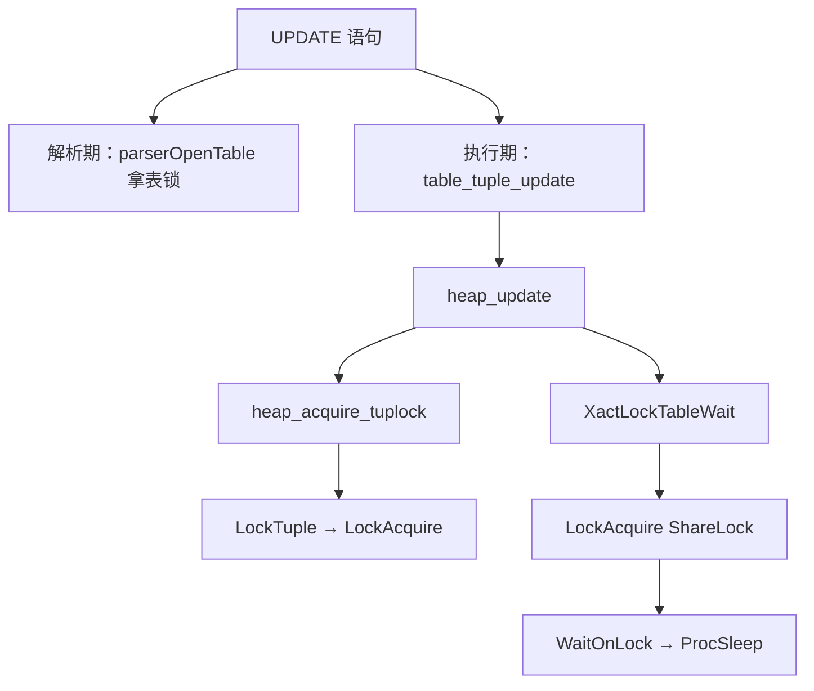
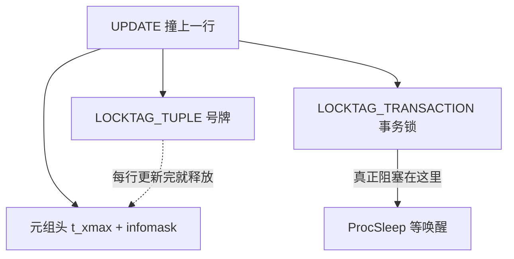
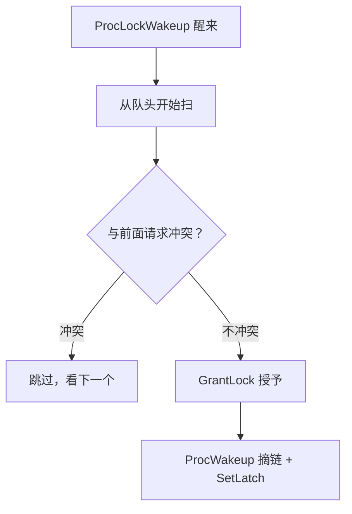
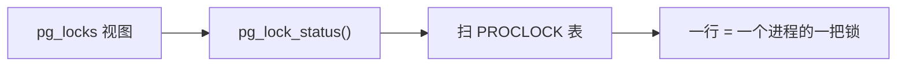

# 行锁：一次 UPDATE 加锁、等待与唤醒

| 编写人 | 编写内容 | 编写时间 |
| --- | --- | --- |
| growdu | 以 PostgreSQL 19 源码为线索：一次 UPDATE 在哪几步上加锁、「行锁」底下那三样东西各管什么、等待队列怎么排、死锁怎么被检出来 | 2026-11-25 |

> **一句话答案**：PostgreSQL 19 里的「行锁」不是一把锁，是三样——
> 元组头里的锁状态（真值）、`LOCKTAG_TUPLE` 的号牌（排队用）、
> `LOCKTAG_TRANSACTION` 的事务锁（真正阻塞的地方）。
> 一个 UPDATE 卡住时，`pg_locks` 里能看到的只有第三样。

## 本文解决什么

三个问题：

1. 一次 UPDATE 从语句到元组，中间在哪几步上加锁？
2. 「行锁」这个说法底下有几样东西，分别在哪一层？
3. 等待队列怎么排、死锁怎么被检出来、怎么在 `pg_locks` 里看出来？

读完这篇应该能做完三件事：照着调用链找到加锁的那几行源码；
说清 UPDATE 卡住时 `pg_locks` 里那行的 `locktype` 是什么；
解释为什么在 `pg_locks` 里找不到普通行锁。

版本基准是 PostgreSQL 19，源码取自 `REL_19_STABLE` 分支，
分支头是 `20d6f4a`（2026-11-24）。这棵树是活的分支，行号会随提交往前走，
所以这里把提交号也写出来，方便对着核。

边界也划在这里：**只讲行级这一层**。表级 heavyweight lock 只在需要对比时提一句；
MVCC 的可见性判断——`HeapTupleSatisfiesUpdate()` 怎么决定「这一行能不能改」——
归 L4 后面的稿子。

## 一个 UPDATE 从上往下走



表锁在**解析期**就拿好了。`src/backend/parser/parse_clause.c:205` 有一行
`parserOpenTable(pstate, relation, RowExclusiveLock)`，
它在 `setTargetTable()`（`parse_clause.c:178`）里——
语句还没开始执行，目标表就已经锁上了。

`parserOpenTable()` 的定义在 `src/backend/parser/parse_relation.c:1459`。
锁的是 `RowExclusiveLock`——别的会话能读能写，但不能改这个表的结构。

行锁在**执行期**才加。`src/backend/executor/nodeModifyTable.c:2345` 调
`table_tuple_update()`，进去以后是 `src/backend/access/heap/heapam.c:3284` 的
`heap_update()`。行锁不是执行器自己加的，是 `heap_update()` 里面加的。

要哪种行锁，由 `src/backend/executor/execMain.c:2567` 的
`ExecUpdateLockMode()` 决定。

判断只有一句：`bms_overlap(keyCols, updatedCols)`——键列和被改的列有重叠，
就给 `LockTupleExclusive`（`execMain.c:2582`）；
没重叠就给 `LockTupleNoKeyExclusive`（`execMain.c:2584`）。

键被改意味着这一行在索引里的位置也会变，所以锁得更重。

## 「行锁」是三样东西



说到「行锁」，PostgreSQL 19 的源码里对应三样不同的东西。
它们在一次 UPDATE 里前后脚出现，作用完全不一样：

| 东西 | 在哪 | 干什么 |
| --- | --- | --- |
| 元组头里的锁状态 | `t_xmax` 与 infomask 的几位 | **真值**：这一行现在归谁管，就写在这儿 |
| `LOCKTAG_TUPLE` 号牌 | 锁管理器（`LOCALLOCK` / `LOCK`） | **排队**：用完就放，不是长期持有的锁 |
| `LOCKTAG_TRANSACTION` 事务锁 | 锁管理器 | **阻塞**：对方事务不结束，你就走不了 |

三者的分工在源码注释里写得很直白。`src/backend/access/heap/heapam.c:3564` 起
有一段说明：准备睡之前要先拿元组锁，「建立我们在这行上的优先级」，
`LockTuple` 会在轮到我们时把我们放出去。

也就是说，号牌是排队用的，真值在元组头上，真正让人卡住的是第三样。

## 真值：元组头里的那几位

行锁状态记在元组头里。`src/include/access/htup_details.h:218` 起有几行定义：

```c
#define HEAP_XMAX_KEYSHR_LOCK	0x0010	/* xmax is a key-shared locker */
#define HEAP_XMAX_EXCL_LOCK		0x0040	/* xmax is exclusive locker */
#define HEAP_XMAX_LOCK_ONLY		0x0080	/* xmax, if valid, is only a locker */
#define HEAP_XMAX_SHR_LOCK		(HEAP_XMAX_EXCL_LOCK | HEAP_XMAX_KEYSHR_LOCK)
```

`t_xmax` 是「这一行现在归谁管」：可能是个锁持有者，也可能是个正在改它的事务。
infomask 的这几位说明是哪种：

- `HEAP_XMAX_LOCK_ONLY`：**只锁不改**。xmax 是个锁持有者，不是更新者。
- `HEAP_XMAX_EXCL_LOCK`、`HEAP_XMAX_SHR_LOCK`、`HEAP_XMAX_KEYSHR_LOCK`：
  独占、共享、只锁键。

`SELECT ... FOR UPDATE` 走的就是「只锁不改」那条路：
`heap_lock_tuple()`（`heapam.c:4762`）算出新 infomask，
在 `heapam.c:5374` 写回 `t_infomask`，在 `heapam.c:5378` 写 `t_xmax`。

**UPDATE 这条路不一样。** 改一行时，旧版本元组的 `t_xmax` 被写成更新者的事务号
（`heapam.c:4242`），这个 xid 写进去时不带 `HEAP_XMAX_LOCK_ONLY` 位——
它是更新者，不是「只锁不改」的锁持有者。这一行是「正在被改」。
别的 UPDATE 撞上来时，看的就是这个 `t_xmax` 加上事务的状态。

算这些位的函数是 `compute_new_xmax_infomask()`（`heapam.c:5536`）。
它的 switch 在 `heapam.c:5570` 起，按模式填位：

```c
case LockTupleNoKeyExclusive:
    new_xmax = add_to_xmax;
    new_infomask |= HEAP_XMAX_EXCL_LOCK;
    break;
```

这段是 `heap_lock_tuple()` 那条路（`is_update` 为假）。
UPDATE 那条路走 `heapam.c:5561` 起的 `is_update` 分支，不设 `HEAP_XMAX_EXCL_LOCK`。

## 号牌：LOCKTAG_TUPLE

号牌是 `src/backend/storage/lmgr/lmgr.c:562` 的 `LockTuple()` 拿的。
`heap_update()` 这边的调用经过一层宏：`heapam.c:170` 的 `LockTupleTuplock()`
把行锁模式翻译成 heavyweight 锁模式，再调 `LockTuple()`。

翻译用的表是同文件 `heapam.c:129` 起的 `tupleLockExtraInfo[]`：
`KeyShare` 对应 `AccessShareLock`，`Share` 对应 `RowShareLock`，
`NoKeyExclusive` 对应 `ExclusiveLock`，`Exclusive` 对应 `AccessExclusiveLock`。

`LockTuple()` 把元组位置打成一个 `LOCKTAG`，
调 `src/backend/storage/lmgr/lock.c:838` 的 `LockAcquire()`，进锁管理器排队。

这枚号牌有个容易被忽略的性质——`src/backend/access/heap/README.tuplock:191` 明说：

> LOCKTAG_TUPLE acquirers release it after each row, so the potential
> inconvenience is lower.

也就是说，每处理完一行就放掉。它不是「这一行被锁住了」的长期凭证，
只是排队时用的令牌。真正记录「这一行归谁管」的，是元组头。

号牌的作用是**定顺序**。两个事务都要改同一行时，谁先拿到号牌谁先走；
后来的那个拿着号牌等着，直到前面那个把行处理完、号牌被放掉。

## 阻塞点：对方事务的那把锁

真正让人卡住的，是对方事务的那把事务锁。
`src/backend/storage/lmgr/lmgr.c:663` 的 `XactLockTableWait()` 干这件事，
它在第 697 行上：

```c
(void) LockAcquire(&tag, ShareLock, false, false);
```

`tag` 是 `SET_LOCKTAG_TRANSACTION` 打出来的（`lmgr.c:695`），
锁的是**对方的事务号**，模式是 `ShareLock`。
后两个 `false` 是 `sessionLock` 和 `dontWait`（`lock.c:838` 的参数说明在
`lock.c:819` 起）——`dontWait=false` 才是要等的意思。

冲突从哪来？事务启动时会给自己记一把**独占**的事务锁：
`lmgr.c:622` 的 `XactLockTableInsert()` 在第 628 行用的是 `ExclusiveLock`。
共享与独占冲突，所以等的人拿不到。

这一步之后，如果锁拿不到，就进 `src/backend/storage/lmgr/lock.c:1972` 的
`WaitOnLock()`，再进 `src/backend/storage/lmgr/proc.c:1345` 的 `ProcSleep()`——
进程睡在 latch 上，等别人叫醒。

`heap_update()` 里调用它的位置是 `heapam.c:3689`：
先在第 3687 行拿号牌（`heap_acquire_tuplock()`，定义在 `heapam.c:5487`，
走 `LockWaitBlock` 分支），再在第 3689 行等对方的事务。

等的时候页的内容锁是放开的（`heapam.c:3686` 解锁，`heapam.c:3692` 再锁上），
所以等待期间不占着页。

等完之后还有一段复查（`heapam.c:3699`）：

```c
if (xmax_infomask_changed(oldtup.t_data->t_infomask, infomask) ||
    !TransactionIdEquals(xwait,
                         HeapTupleHeaderGetRawXmax(oldtup.t_data)))
    goto l2;
```

对方事务虽然结束了，但在这中间别人又改过这一行，
所以要检查 `xmax` 变没变，变了就 `goto l2` 从头再来一遍。

## 等待队列：冲突的按到达顺序

等待队列挂在每一把 heavyweight 锁上。`src/include/storage/lock.h:148`
的 `LOCK` 结构里有一个 `dclist_head waitProcs`，
每个进程的挂链点是 `src/include/storage/proc.h:311` 的 `PGPROC.waitLink`。

入队在 `src/backend/storage/lmgr/proc.c:1176` 的 `JoinWaitQueue()`。
默认规则是**加到队尾**。例外写在 `proc.c:1226` 起的注释里：

> Normally I should go at the end of the queue.  However, if I already
> hold locks that conflict with the request of any previous waiter, put
> myself in the queue just in front of the first such waiter.

也就是说：如果我已经持有这把锁上的某些锁，而队列里有个等待者的请求
与我持有的冲突，我会被插到那个等待者**前面**——不然我们俩必然互相等死。
插进去之后还有个特例：我的请求与插点之前的请求都不冲突的话，
当场就授予，连队都不用排。



唤醒走 `src/backend/storage/lmgr/proc.c:1813` 的 `ProcLockWakeup()`，
调用点有两处：`lock.c:1820`（锁被释放之后）与 `deadlock.c:272`
（软死锁重排队列之后）。挑人的规矩写在 `src/backend/storage/lmgr/README:384`：

> Each waiter is awoken if (a) its request does not conflict with
> already-granted locks, and (b) its request does not conflict with the
> requests of prior un-wakable waiters.  Rule (b) ensures that
> conflicting requests are granted in order of arrival.

所以队列**不是先进先出，也不是乱序**：互相冲突的请求按到达顺序授予；
不冲突的后来者可以先走。

## 死锁检测：只在超时的路上


死锁检测的触发路径很窄。`src/backend/storage/lmgr/proc.c:1951` 的
`CheckDeadLockAlert()` 是个信号处理器：死锁超时到了，它设上
`got_deadlock_timeout`，再 `SetLatch()` 把睡着的进程叫醒。

醒来的进程在 `proc.c:1495` 判定这个标志，
然后调 `proc.c:1860` 的 `CheckDeadLock()`，
再进 `src/backend/storage/lmgr/deadlock.c:220` 的 `DeadLockCheck()`。

**唤醒别人的那条路上不查死锁。** `ProcLockWakeup()` 授完锁就 `SetLatch()`，
不做死锁检测——只有超时这条路才查。

死锁检测找的是等待环，环里的边分两种：

- **硬边**：对方**已经持有**冲突锁（`deadlock.c:580` 扫 `PROCLOCK` 上的 `holdMask`）；
- **软边**：对方**排在前面**还没拿到（`deadlock.c:632` 起扫等待队列）。

`src/backend/storage/lmgr/deadlock.c:378` 的 `TestConfiguration()` 是分水岭：
环里软边数为 0 就是硬死锁，有软边就是软死锁。

硬死锁会一路走到 `deadlock.c:1133` 的 `ereport(ERROR, deadlock detected)`，
在报错之前先 `RemoveFromWaitQueue()`（`proc.c:1917`）把自己从队列里摘掉。

软死锁不报错：`deadlock.c:249` 起把队列重排一遍，
再 `ProcLockWakeup()`（`deadlock.c:272`）让其中一个先走。

## 怎么看：pg_locks 与阻塞关系

`pg_locks` 视图的定义在 `src/backend/catalog/system_views.sql:439`，
它就是 `pg_lock_status()` 的一层壳——实现在
`src/backend/utils/adt/lockfuncs.c:93`。

它扫的是 `PROCLOCK` 表（`src/backend/storage/lmgr/lock.c:3809` 的
`GetLockStatusData()`），粒度是「一个进程的一把锁」。
进程本地的 `LOCALLOCK` 不在里面。



**「这一行被锁住了」这件事，在 `pg_locks` 里看不到。**
`locktype = 'tuple'` 的那些行是号牌本身——每行更新完就释放，
不是「这一行被锁住了」的证据。

UPDATE 卡住的时候，真正出现在 `pg_locks` 里的是
`locktype = 'transactionid'`、`granted = false` 的那一行——
那才是它等的对方事务。

查阻塞关系用 `pg_blocking_pids()`
（`src/backend/utils/adt/lockfuncs.c:467`），
它读的是 `lock.c:4012` 的 `GetBlockerStatusData()`。

两个会话就能复现。下面是完整步骤，第二个会话的 UPDATE 会一直等着：

```sql
-- 会话 A
BEGIN;
UPDATE t SET v = v + 1 WHERE id = 1;
```

```sql
-- 会话 B
BEGIN;
UPDATE t SET v = v + 1 WHERE id = 1;   -- 这里卡住
```

在会话 B 里另开一个连接查阻塞关系：

```sql
SELECT blocked.pid AS blocked_pid,
       blocking.pid AS blocking_pid,
       blocked.query AS blocked_query
FROM pg_stat_activity blocked
JOIN LATERAL unnest(pg_blocking_pids(blocked.pid)) AS bp(pid)
     ON true
JOIN pg_stat_activity blocking ON blocking.pid = bp.pid;
```

再看 `pg_locks` 里那一行：

```sql
SELECT locktype, mode, granted, relation::regclass, transactionid
FROM pg_locks
WHERE locktype IN ('tuple', 'transactionid')
ORDER BY granted, locktype;
```

`granted = false` 的那一行，`locktype` 应该是 `transactionid`。
如果看到的是 `tuple`，那多半是号牌，不是阻塞点。

## 这段代码很新

行锁这套实现近几年改过两轮，网上老文章里的说法常常对不上现在的源码：

- 2023-01-18 的 `5764f611e10b`（Andres Freund）把 heavyweight 锁的等待队列
  从 `PROC_QUEUE` / `SHM_QUEUE` 换成了 `dclist` / `dlist`；
  `LOCK.waitProcs` 从队列变成了 `dclist_head`（`lock.h:148`），
  进程的挂链点从 `PGPROC.links` 变成了 `PGPROC.waitLink`（`proc.h:311`）。
  PostgreSQL 16 才有这套结构，再早的版本里等的是 `SHM_QUEUE`。
- 2024-11-04 的 `3c0fd64fec8`（Heikki Linnakangas）把 `ProcSleep()` 拆开，
  入队逻辑独立成 `JoinWaitQueue()`（`proc.c:1176`）。
  PostgreSQL 18 才有这个函数。

在那之前，等待队列的插入是**内联在 `ProcSleep()` 里**的。
读老博客的代码片段时先确认版本——连仓库里的 `README` 都还没跟上。

`src/backend/storage/lmgr/README:362` 至今写的是
「Lock acquisition (routines LockAcquire and ProcSleep) follows these rules」，
第 377 行还在说「在 `ProcSleep` 里做这个检查很便宜」，
而 `ProcSleep` 里已经没有这个检查了。

## 常见的几个误解

- 「行锁就是一把锁」——是三样：元组头里的状态、`LOCKTAG_TUPLE` 号牌、
  `LOCKTAG_TRANSACTION` 事务锁。
- 「`pg_locks` 里能看到行锁」——看到的是号牌和事务锁，
  真正的行锁状态在元组头里，`pg_locks` 不显示。
- 「每次等待都会做死锁检测」——只在死锁超时那条路上做；
  唤醒别人时不查。
- 「表锁和行锁是一套东西」——表锁是 heavyweight lock，
  解析期拿的；行锁这一层另有元组头、号牌、事务锁三样。

还有一个容易搞混的：**页级的 heavyweight lock 存在，但几乎不用**。
`LOCKTAG_PAGE` 在 `src/include/storage/locktag.h:40` 有定义，
可全树用 `LockPage()` 的只有 GIN 锁元页（`src/backend/access/gin/ginfast.c:815`）。

heap 表的页靠 buffer 内容锁管着——
`src/backend/access/heap/heapam.c:3400` 的 `LockBuffer(buffer, BUFFER_LOCK_EXCLUSIVE)`——
那把锁不进 `pg_locks`，也不参与死锁检测。

## 怎么验证

行号都能对着源码树核：

```console
$ grep -n "^heap_update" src/backend/access/heap/heapam.c
3284:heap_update(Relation relation, const ItemPointerData *otid, HeapTuple newtup,
$ grep -n "^XactLockTableWait" src/backend/storage/lmgr/lmgr.c
663:XactLockTableWait(TransactionId xid, Relation rel, const ItemPointerData *tid,
$ grep -n "^JoinWaitQueue" src/backend/storage/lmgr/proc.c
1176:JoinWaitQueue(LOCALLOCK *locallock, LockMethod lockMethodTable, bool dontWait)
$ grep -n "^DeadLockCheck" src/backend/storage/lmgr/deadlock.c
220:DeadLockCheck(PGPROC *proc)
```

在真机上复现阻塞，用上面那两段 UPDATE；
观察点有两个：`pg_locks` 里 `granted = false` 那一行的 `locktype`，
以及 `pg_blocking_pids()` 返回的 pid。

## 小结与延伸

这一篇讲的是「UPDATE 卡住时，源码里发生了什么」。三句话：

**加锁**：表锁在解析期（`parse_clause.c:205`），
行锁在执行期的 `heap_update()` 里（`heapam.c:3687`）。

**三样东西**：真值在元组头（`t_xmax` 加 infomask 的几位），
号牌是 `LOCKTAG_TUPLE`（每行更新完就放），
真正阻塞的是 `LOCKTAG_TRANSACTION`（`lmgr.c:697`）。

**等待与死锁**：等待队列挂在每把锁上，冲突的按到达顺序；
死锁检测只在超时路径上做，硬死锁报错、软死锁重排队列。

下一篇往下拆：**`HeapTupleSatisfiesUpdate()` 怎么判断这一行能不能改**——
元组头那几个位、`xmax` 与快照的可见性、以及为什么 UPDATE 会在
等待结束后从头再来一遍。

想自己核对的话，源码树拿 `REL_19_STABLE` 的 `20d6f4a`，
关键入口是这几个：

| 想知道的 | 打开这个文件 |
| --- | --- |
| 行锁状态写在元组头的哪几位 | `src/include/access/htup_details.h` |
| 锁状态怎么算出来 | `src/backend/access/heap/heapam.c` |
| 三种锁的入口 | `src/backend/storage/lmgr/lmgr.c` |
| 锁管理器与等待队列 | `src/backend/storage/lmgr/lock.c` |
| 入队、等待与唤醒 | `src/backend/storage/lmgr/proc.c` |
| 死锁检测 | `src/backend/storage/lmgr/deadlock.c` |
| `pg_locks` 与 `pg_blocking_pids` | `src/backend/utils/adt/lockfuncs.c` |
