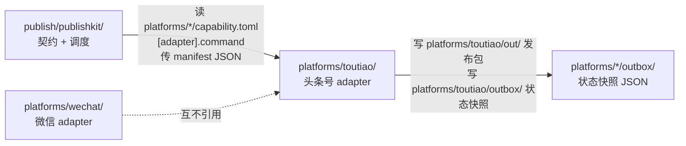

# 多平台发布架构：内容契约 · 平台能力模型 · 发布清单 · 展示扩展点

> **状态**：设计已确认（2026-11-11），待实施。
>
> **⚠️ 历史部分**：2026-11-18 的站点重做把 Hexo + matery 主题换成了 Astro，
> `sync-hexo.py` / `source/_posts/` / `themes/matery/` / `patch-theme.py` /
> `hexo generate` 全部没了。本文描述那套链路的章节，都以
> 「**⚠️ 本节描述的是 2026-11-18 撤掉的 Hexo 链路，已不适用。**」标出；
> 章节里单独提到死路径的地方，另行就地标注。
> 现行链路与待拍板项见
> [2026-11-19-整体架构与模块边界.md](../../review/specs/2026-11-19-整体架构与模块边界.md)：
> 现行链路是 `docs/` → `tools/build-content-units.py` → `content/units/`
> → `platforms/blog/site/tools/sync-content.py` → Astro 站点。
>
> **职责边界**：本文档的作者负责**整体架构设计**与 **`<站点地址>` 的展示**。
> 各平台 adapter 的具体实现由对应执行者按本文的契约完成。
>
> **前置阅读**：
> - [仓库架构](../../review/specs/ops/架构.md) —— 站点构建链路
> - [weixin 设计](../../platforms/wechat/docs/10-设计.md) —— 公众号 adapter 的实现规格（本文是其上位抽象）
> - [AIV 视频生产线](../../video/) —— 视频生产链路的资产边界（注：AIV 已于 2026-11-11 从 `docs/life/aiv/` 迁到仓库根目录的 `video/`，详见 §2.3）
>
> **本文所有仓库相关的判断来自读源码与全量统计**，不凭印象。涉及平台官方接口的部分，
> 标注了「**实测**」的是本号跑出来的结果，标注了来源的是公开资料。

---

## 一、目标与非目标

### 1.1 目标

1. 把「内容」从**文件**提升为**有契约的内容单元**，让同一份母稿可以稳定地派生为多个平台的产物。
2. 把**平台差异**（限额、审核、自动化等级）从散落在各 adapter 里的隐式知识，变成**声明式的能力模型**。
3. 让 `<站点地址>` 不只是母版，还是**内容谱系的索引**：文章页能回答「这篇还发到了哪些平台」，视频有详情页与合集页。
4. 建立**增量式 CI 闸门**，让新文章的规则由机器守住，而不是靠人记。

### 1.2 非目标（本期明确不做）

| 不做 | 原因 |
| --- | --- |
| 各平台 adapter 的具体实现 | 本文只交付契约；adapter 由执行者按契约写 |
| YouTube / B站的凭据申请与合规审核 | 平台侧流程，非代码工作 |
| 竖版 9:16 适配 | AIV 的 `validate()` 硬编码 1920×1080（`pyv/timeline.py:151`），改它是独立的工程任务 |
| 头条号的 Cookie 浏览器自动化 | 登录态易过期、有风控风险，不作为主线 |
| 改写 `platforms/wechat/` 的现有实现 | 另一个会话正在并行开发该模块；本文对它**只读** |
| 改写 AIV 的 `storyboard.json` 结构 | AIV 正在并行重构期（详见 §7.3）；契约层对它保持无知 |
| 数据回收（阅读量/播放量回流） | 需要各平台的数据接口，依赖 adapter 先跑起来 |

---

## 二、现状盘点

### 2.1 仓库的三层结构

| 层 | 位置 | 量级 | 状态 |
| --- | --- | --- | --- |
| 内容源 | `docs/` | 613 个 md + 3 个 html + 870 张图（实测于 2026-11-11 20:10） | 唯一真相，Hugo 风格 |
| 构建适配层 | `tools/` + `platforms/blog/site/tools/` | `tools/build-content-units.py`（编译器）+ `platforms/blog/site/tools/sync-content.py`（站点同步） | 成熟 |
| 站点 | `platforms/blog/site/`（Astro：`src/` → `dist/`） | — | 全自动，CI 2~3 分钟 |
| 公众号线 | `platforms/wechat/` | `wechat` 包 8 模块 3836 行 + 229 测试（实测 2026-11-11，全绿） | **已实现到草稿箱** |
| 头条号线 | `platforms/toutiao/` | 与 `platforms/wechat/` 同级同形的独立 adapter 目录（2026-11-11 决定） | **待建**，走双轨：出包 + 职业认证 |
| 视频线 | `video/pipeline/` | `pyv` 引擎 + `storyboard.json` 契约 | **只出片，无发布链路** |

编译器的 `build_unit()` / `render()`（`tools/build-content-units.py`）是整条链路的 CPU：
它读 `docs/` 下的 md，**重建 front matter**（标题 / 日期 / 摘要 / 分类 / 标签），
写到 `content/units/`。

> ⚠️ **正文一个字都不改**——链接重写、图片重写是渲染层的事（站点侧的 remark 插件）。
> 旧编译器（`sync-hexo.py`）的无视围栏全局正则那套做法没有带过来。

> **关于本文里的语料数字。** 内容树在 2026-11-11 当天正在被并行重构（§2.3），
> 所以「md 总数」「图片数」是**易变值**，本文标注了测量时间。
> 真正稳定、也是验收标准的是**内容单元数 564**（`docs/` 下会被编译成文章的条目数），
> 以及「排除规则命中 0」这个不变量。

### 2.2 站点展示层的现状

> ⚠️ **本节描述的是 2026-11-18 撤掉的 Hexo 链路，已不适用。**
> 下面的 `patch-theme.py`、`post-tldr.ejs`、`post-detail.ejs`、
> `reprint-statement.ejs`、`smart-summary.js`、`_config.matery.yml` 都是旧站点的形状；
> 现行站点（Astro）的页面与组件写在 `platforms/blog/site/src/` 下。

首页 = cover（Hero + 统计）+ home-content（learning-path 六车道 + Tabbed articles）+ bg-video。
定制集中在 `tools/patch-theme.py`（2600+ 行）用 marker-based 幂等注入。

**两处结构性缺失**：

1. **视频在站上零呈现**。全站 605 篇 md 里 `<iframe>` / `<video>` 只出现在
   `docs/notes/site-ops/视频嵌入指南.md`（教程本身）；`docs/movies/` 不存在；
   `video` widget 在 `_config.matery.yml:93-94` 是 `enable: false`；菜单无视频入口。
   仓库里有完整的视频生产能力，但站上看不到一条视频。
2. **展示元数据通道是断的**。展示层已经备好了渲染位——`post-tldr.ejs`（TL;DR + 难度星级）、
   `post-detail.ejs`（标签/分类/字数/时长）、`reprint-statement.ejs`（CC 声明）、
   `scripts/smart-summary.js`（智能摘要）、`patch-theme.py:172`（OG/Twitter 卡片）——
   但 `process()` 重建 front matter 时**只保留** `title` / `date` / `author` / `categories` / `tags`。

   后果（全部可验证）：

   | 后果 | 证据 |
   | --- | --- |
   | 全站 0 篇文章有 TL;DR 与难度星级 | `docs/` 里 `tldr:` 命中 0、`difficulty:` 命中 0 |
   | `smart_summary` 的前两条分支是死代码 | 它优先读 `post.description` / `post.summary`，而这两个字段永远不存在 |
   | 每篇文章的 `og:description` 都是站点级通用文案 | `patch-theme.py:172` 读 `page.description \|\| config.description`，而 `page.description` 永远为空 |

   最后一条在多平台分发下被放大：**分发出去的每一条链接都带不出自己的摘要**——
   分享到微信、B站、头条时，预览文案全是同一句站点简介。

### 2.3 「什么不是文章」：AIV 迁移前后

> ⚠️ **本节描述的是 2026-11-18 撤掉的 Hexo 链路，已不适用。**
> 这一节记的是 2026-11-11 的迁移现场（当时的编译器是 `sync-hexo.py`）。
> 现行编译器 `tools/build-content-units.py` 只扫 `docs/`，
> 工程内容与发布内容靠**物理分目录**隔开。

`sync-hexo.py` 的 `main()`（`tools/sync-hexo.py:1322`）只跳过**隐藏目录**，
不跳过**工程目录**。设计本文时实测发现的后果：

```text
https://<你的站点地址>/2026/11/11/life/aiv/pipeline/tests/fixtures/persona_script_bad/  →  HTTP 200
```

`persona_script_bad.md` 是**故意写坏的测试样本**，当时正在生产站点上作为公开文章。
同类文件还有 4 个（内部设计文档、内部实施计划、另两个测试夹具），
全部进了 `public/sitemap.xml` 与 `public/atom.xml`。
这不是新问题——2018 年的 `code/*-work/readme.md` 系列同样在发布。
根因是同一条：**内容编译层没有"什么不是文章"的判据。**

**2026-11-11 当天，AIV 的维护者把整个 `docs/life/aiv/` 迁到了仓库根目录的 `video/`。**
因为 `sync-hexo.py` 只扫 `docs/`，工程内容自然离开了发布范围。

**owner 随后拍板：内容留下，产物移走。** 具体做法是——
`docs/life/aiv/` 保留「要发到博客的文档」副本（三篇规范 + 5 份模块 README），
`video/` 里的工程内容（内部设计稿、实施计划、测试夹具、代码、素材）不再发布。
**发布脚本一个字没改**：副本仍走 `docs/`，`sync-hexo.py` 照旧扫 `docs/`。
副本与正本的一致性由 `video/scripts/sync_publish_docs.py` 同步、
`video/pipeline/tests/test_publish_copy.py` 盯着（漂了会红）。

> **⚠️ 2026-11-19：owner 改判了，这条已经反过来。**
> 上面这套「视频线的规范继续公开」的做法**整套撤掉**：
> `video/scripts/sync_publish_docs.py` 与它的守卫
> `video/pipeline/tests/test_publish_copy.py` 一起删了，
> `docs/life/aiv/` 下的 16 个文件（副本 + 分类页）也一并删了。
> `docs/` 现在是空的（只剩一个 `.gitkeep`）。
>
> **改判的理由**：那 9 篇是**模块内部说明书**（怎么搭一条视频流水线），
> 不是面向读者的稿子；而「发布路径写死在视频线的脚本里」等于这条线替站点挑了
> 分类树的位置——那不是它该管的事。现在这条线的文档只在 `video/` 里，
> **不进站点**；要发稿子，稿子就写在 `docs/` 里。
>
> 下面是 2026-11-11 的原始现场，**留作记录**（当时的结论已被上面的改判推翻）。

迁移后的现状（2026-11-11 实测）：

| 项 | 数值 |
| --- | --- |
| `docs/` 下的内容单元数 | **564**（= AIV 全量移出时的 556 + 8 篇 AIV 文档副本） |
| 路径排除规则命中数 | **0** |
| AIV 下不再发布的 md | 5 个（内部设计稿、实施计划、3 个测试夹具） |
| AIV 下继续发布的 md | 8 个（人格规范、形象与音色规范、背景音乐规范、5 份模块 README） |

**这个时间线改变了两件事：**

1. **紧急修复不再需要**。§4.3 的路径排除规则从「修线上缺陷」降级为「**防回归守卫**」——
   它当前 0 命中，价值在于将来有人在 `docs/` 下建了 `tests/`、`pipeline/` 这类工程目录时，
   构建期会拦住，而不是等几个月后才发现测试夹具上了线。
2. **规范继续公开，工程内部产物下线**（**2026-11-19 已改判，见上面的提示框**）。
   原 `docs/life/aiv/index.md` 明确写过
   「本目录存放的是这条线的**可评审资产**：口播稿、分镜脚本、海报文案、字幕工程、`storyboard.json` 契约」，
   并把「讲解底稿 / 口播稿 / 契约 / 物料文案」都标注为**入库**。
   迁到仓库根之后，这批资产连同口播稿、契约一起离开了仓库——
   它们按《运营手册》§3.4「个人号的物料单独建仓，不进公司仓库」不再留在这个仓库里。
   留在站点上的是**面向读者的规范**（人格、形象与音色、背景音乐、模块说明），
   它们的 URL、日期与分类**逐字节未变**（已用未改动的发布脚本对比前后两轮产物验证）。
   「AIV 视频生产线」专题页（`index.md`）随资产一并移除，
   站点上还有 6 处指向它的链接待处理。

> 本设计的**契约层不规定 AIV 的目录结构**，也不触碰 AIV 的任何文件（详见 §8.2）。
> 上面这条只作为**需要 owner 确认的事实**记录。
> **2026-11-19 的现状**：`docs/` 是空的，内容单元数 **0**；
> 视频线的文档留在 `video/` 里当模块内部说明书，不进站点。

### 2.4 平台能力（外部核实 + 实测）

| 平台 | 官方发布接口 | 门槛 | 自动化可停在哪 |
| --- | --- | --- | --- |
| 个人网站 | — | 无 | 完全自动 |
| 微信公众号 | `draft/add` + `freepublish/submit` | 认证 + **IP 白名单** | **草稿箱**（见下） |
| YouTube | `videos.insert`（OAuth `youtube.upload`） | GCP 项目 + OAuth 应用 | 过审后公开 |
| Bilibili | 开放平台 `arcopen/fn/archive/add-by-utoken` | 申请 `ARC_BASE` 权限 + 正式会员 | 投稿后审核 |
| 头条号 | 创作开放平台（文章发布 + 图片上传） | 企业/媒体认证号，或**个人认证号且粉丝 ≥1000** | 半自动出包（当前）→ 建草稿 → 无人值守 |
| 微信视频号 | **无面向普通第三方的发布接口** | — | 半自动：出片 + 清单 + 人工发 |

**公众号实测结论（2026-11-11，本号）**：

| 接口 | 结果 |
| --- | --- |
| `stable_token` | ✅ 通过。凭据字段名必须用 `secret`（只发 `appsecret` 会被回 `41004`） |
| `media/uploadimg` | ✅ 通过。token 必须走 query 参数 `?access_token=`（只放 Authorization header 会被回 `41001`） |
| `material/add_material` | ✅ 通过（封面已上传） |
| `draft/add` | ✅ 通过，草稿能建 |
| `freepublish/submit` | ❌ **48001 api unauthorized** —— 账号没有发表接口权限 |
| `freepublish/get` | ⏸️ 走不到（submit 被拒，没有 `publish_id`） |

**结论**：本号是订阅号·个人主体，**自动化的边界 = 自动生成 + 自动进草稿箱**，最后点一下发表由人完成。
这不是失败，是答案——草稿箱天然是审批闸门。

**YouTube 关键事实**：`videos.insert` 需 OAuth `youtube.upload` scope；
2020-07-28 之后创建的 GCP 项目**未过合规审核只能上传为 private**；
2026-06-01 起 `videos.insert` 移入独立配额桶，默认 **100 次/天**（不再占 10000 单位通用池）；
OAuth 应用处于 Testing 状态时 refresh token **7 天过期**。

**Bilibili 关键事实**：`arcopen` 的投稿接口需申请 `ARC_BASE` 权限 + 正式会员
（未转正式会员单日最多投递 5 个稿件），稿件提交后有审核过程；
`archive/view` 可查审核状态（`addit_info.state`）与 `video_info.iframe_url`。

---

## 三、概念模型与三条不变量

```
docs/<分类>/<名>.md              母稿（作者写，唯一真相）
   │ sync-hexo.py（内容编译 + 契约透传 + 路径排除）
   ▼
source/_posts/**                 内容单元 · content_id = 相对 source/_posts 的路径去后缀
   │        ├─► hexo generate ──────────────────► <站点地址>
   │        ├─► 切片器（平台适配）→ 发布清单 → 发布器 → 平台
   │        │                                          │
   │        │                                          ▼
   │        └──────────────────────────► platforms/<platform>/outbox/*.json（发布结果快照，入库）
   │                                                   │ 构建期汇总
   │                                                   ▼
   │                                     source/_data/publish_index.json
   │                                                   │ 主题 partial 消费
   └─────────────────────────────────────────────────► 文章页「已发布到 公众号 / YouTube / B站 / 头条号」
                                        ▲
                                        │ 选内容（规则 / 指定）
                     ┌──────────────────┴───────────────────┐
                     │            调度层（契约五）           │
                     │  定时触发：cron / launchd，周五       │
                     │  主动触发：人指定 content_id          │
                     │  周键幂等：同一周不重复调度            │
                     └──────────────────────────────────────┘
```

调度层的完整规格见 [06-发布计划与调度.md](06-发布计划与调度.md)。

> ⚠️ **图里的是旧链路**：`sync-hexo.py`、`source/_posts/**`、`hexo generate`、
> `source/_data/publish_index.json`（以及「主题 partial 消费」那一条）
> 随 2026-11-18 的站点重做一起撤掉了。现行链路是
> `docs/` → `tools/build-content-units.py` → `content/units/`
> → `platforms/blog/site/tools/sync-content.py` → Astro 站点。
> 下面**三条不变量仍然成立**。

**不变量一：母稿唯一。** 任何平台产物都能从 `content_id` 重建。平台侧的内容永远不是真相，
真相只在 `docs/` 里。

**不变量二：可重放 vs 有状态。** 切片与渲染是纯函数，可以随便重跑；
只有「发布」这一步有状态，其幂等键由 `platforms/<platform>/outbox/` 承载。

**不变量三：不静默成功。** 平台的「成功」必须是被显式确认过的成功，不能是「没报错就算成功」。
在发布场景里，发重了比发慢了糟糕得多。

---

## 四、契约一：内容契约

### 4.1 front matter 字段表

**推导字段**（编译器权威）

| 字段 | 来源 |
| --- | --- |
| `date` | 母稿写了 `date:` 就用它；没写才取 `git_date()`（`tools/build-content-units.py`）——该路径在**当前分支**的最早提交时间（`git log --follow`，**不带 `--all`**） |
| `categories` | 目录链上各级 `_index.md` 的 `cascade.categories`，去重 |
| `tags` | 目录链上各级 `_index.md` 的 `tags` ∪ 母稿自己的 `tags` |
| `author` | 母稿的 `author:`，缺省 `growdu` |
| `description` | 母稿的 `description:`，没有就取正文第一段 |
| `kind` / `source_path` | 编译器写的派生字段（`document` / `category`、相对 `content/units/` 的路径） |

> `date:` 覆盖能力是为替换现有 16 条 `DATE_OVERRIDES` 硬编码表而引入的。
> 那张表是「内容提交规则」被硬编码在工具里的一个例子——它应该回到内容层。

**透传字段**（作者权威，契约层白名单；⚠️ 编译器今天**一个也没往下传**）

| 字段 | 类型 | 约束 | 送达目标 |
| --- | --- | --- | --- |
| `title` | str | ≤ 80 字 | `page.title` |
| `short_title` | str | ≤ 32 字 | 给公众号/头条的短标题（可选） |
| `tldr` | str | ≤ 120 字 | `post-tldr.ejs` 的 TL;DR 区块 |
| `description` | str | ≤ 150 字 | `smart_summary` 首选、OG / Twitter 卡片 |
| `difficulty` | int | 1–5 | 难度星级 |
| `cover` | str | 相对文章目录 | 封面图 |
| `reprintPolicy` | str | 主题已支持的枚举 | 转载声明 |
| `kind` | str | `post`（默认）/ `video` | 内容单元类型 |
| `platforms` | list[str] | 平台 id 列表 | 发布候选集 + 发布索引的筛选项 |
| `publish_on` | str | `YYYY-MM-DD` | 指定发布日期（可选）。见 [06-发布计划与调度.md](06-发布计划与调度.md) |

> ⚠️ **现状（2026-11-19）**：编译器 `tools/build-content-units.py` 的白名单
> （`PASSTHROUGH`）列的是 `title` / `date` / `author` / `description` / `tags` /
> `top` / `draft`，而这 7 个键都被单独推导或单独写进 front matter——
> **额外透传的字段实际是空的**，上表里的字段一个也到不了内容单元。
> 跟踪见 [2026-11-19-整体架构与模块边界.md](../../review/specs/2026-11-19-整体架构与模块边界.md) §五 第 1 条。

### 4.2 格式规则

母稿的 front matter 由编译器用 **YAML** 解析（`tools/build-content-units.py` 的
`split_front_matter()`）；但**契约层**只认扁平格式，114 个带 front matter 的文件里
唯一用到的嵌套是 `_index.md` 的 `cascade`——契约对格式做硬约束：

- 只允许扁平 `key: value` 与单层 `key:` + `  - item`
- 嵌套仅 `cascade:` 允许（`_index.md` 专用）
- 多行值不支持
- 未声明的顶层字段**一律丢弃**——白名单透传，不做全文转储

> ⚠️ 编译器用 `yaml.safe_dump` 落盘，**长标量会按 YAML 折行**
> （`description` 一类字段尤其明显）——那与上面「多行值不支持」相撞，
> 读到折行处为止，后半截丢掉。

> 这套格式不是新发明。`platforms/wechat/posts.py:82` 的 `parse_front_matter()`
> 实现的正是同一套格式（`key: value` 标量 + `  - item` 列表），
> 其注释写着「a tiny hand-written parser avoids adding a YAML dependency for a format we control」。
> 契约与它逐条对齐，不是各写各的。

### 4.3 路径排除规则

> ⚠️ **这条规则随 Hexo 链路一起撤掉了**（2026-11-18）。现行编译器
> `tools/build-content-units.py` **没有**排除规则——它只扫 `docs/`，
> 工程内容与发布内容靠**物理分目录**隔开（正是本节末尾说的那个解法）。
> 本节留作那条规则的原设计与取舍记录。

**只排除工程目录，不排除任何文件名。**

```
tests  test  fixtures  plans  pipeline  build  out  _staging  frames
```

匹配方式：路径中任意一级目录名（大小写不敏感）命中即排除。隐藏目录沿用现有逻辑。

**当前状态：规则命中 0 个文件。** AIV 的工程目录迁出 `docs/` 后，`docs/` 下已无工程目录，
内容单元数 564（其中 8 篇是 AIV 留在 `docs/life/aiv/` 的文档副本），规则不改变任何结果。

> **2026-11-19 更新**：`docs/` 现在是空的，内容单元数 **0**——
> 那 8 篇副本已随「视频线不发布」的决定一起删掉（见 §2.3 的改判框）。
> 本节整段留作 2026-11-11 的历史记录。

> **AIV 的解法比排除规则更彻底，值得记下来。** 迁移不是简单地把工程目录搬走——
> owner 保留了 8 篇「要发到博客的文档」副本在 `docs/life/aiv/`，
> 工程内容（代码、素材、内部设计稿、实施计划、测试夹具）搬到仓库根的 `video/`。
> **发布脚本一个字没改**：副本仍走 `docs/`，`sync-hexo.py` 照旧扫 `docs/`。
> 副本与正本的一致性由 `video/scripts/sync_publish_docs.py` 同步、
> `video/pipeline/tests/test_publish_copy.py` 盯着（漂了会红）。
>
> 这给排除规则定了位：它是**兜底守卫**，不是解决方案。
> 真正的解法是「想清楚哪些内容该发布，然后让发布路径与工程路径物理分离」。
>
> （2026-11-19：副本机制本身也撤了——「发布路径写死在视频线的脚本里」
> 等于这条线替站点挑分类树的位置。现在的解法更彻底：**该发的稿子写进 `docs/`，
> 模块内部说明书留在自己的模块里，压根不发布**。）

因此这条规则的定位是**防回归守卫**，不是修复手段：

> 如果将来有人在 `docs/` 下建了 `tests/`、`pipeline/`、`plans/` 这类工程目录，
> 构建期会拦住它们被当成文章发布——而不是等几个月后才发现测试夹具上了线，
> 就像 §2.3 记录的那样。

**为什么按目录而不是按文件名。** 初版方案曾排除 `README.md`，实测发现同名文件性质完全相反：

| 文件 | 字符数 | 判定 |
| --- | --- | --- |
| `engineering/engineering-practice/code/java-work/readme.md` | 56 | 占位垃圾（"# preview / This directory include some code using java."） |
| `video/voice/README.md` | 1088 | 音色规范 ✅ |
| `video/music/README.md` | 1773 | 选曲规范 ✅ |
| `video/character/README.md` | 2351 | 形象规范 ✅ |
| `video/brand/README.md` | 4055 | 品牌规范 ✅ |
| `video/人格规范.md` | 11304 | 人格规范 ✅ |

更关键的是 AIV 的既定意图：原 `docs/life/aiv/index.md` 明确写着
「本目录存放的是这条线的**可评审资产**：口播稿、分镜脚本、海报文案、字幕工程、`storyboard.json` 契约」，
其九个环节表里「讲解底稿 / 口播稿 / 契约 / 物料文案」都标注**入库**。
那些 README 是有意发布的——按文件名排除会误伤内容资产边界。

**唯一需要人工清理的残留**：`docs/engineering/engineering-practice/code/*-work/readme.md` 共 10 个占位 README
（正文均不足 100 字符，内容是 "This directory include some code using xxx."）。
它们无价值但也无害（2018 年日期、沉在归档底部、不进 atom feed 的最近 20 篇）。
「占位 README 应删除或补写实质内容」写进文档提交规则，作为**内容规范**而非构建期规则。

### 4.4 这一改动的直接收益

- `og:description` / `twitter:description` 从「每篇都是站点简介」变成每篇自己的摘要
- TL;DR 区块与难度星级从「永远不显示」变成「作者写了就有」
- `description` 成为公众号摘要、头条摘要、YouTube description 的**统一来源**
- `date:` 覆盖能力让 `DATE_OVERRIDES` 那张硬编码表可以退休

---

## 五、契约二：平台能力模型

每个平台一份 TOML。`tomllib` 是 Python 3.11 标准库（本机 3.11.3 已验证），零依赖。

```toml
# platforms/wechat/capability.toml
id = "wechat"
name = "微信公众号"
kind = "document"          # document | video
auth = "appid_secret"
ip_allowlist = true        # 调用方出口 IP 必须在后台白名单
automation = "api_draft"   # api_draft | api_publish | manual
review = "platform"        # none | platform | precheck
requires_certification = true
verified = "2026-11-11"    # 该 automation 取值的实测日期；未实测则省略

[limits]
title_chars = 32
body_chars = 20000
digest_chars = 120
image_bytes = 1048576
image_formats = ["jpg", "png"]
```

### 5.1 五个平台的声明

| 能力声明 | kind | automation | 门槛与依据 |
| --- | --- | --- | --- |
| `platforms/wechat/capability.toml` | document | `api_draft` | **实测** 48001，无发表权限；草稿箱可进 |
| `platforms/toutiao/capability.toml` | document | `manual` | 开放平台 API 存在，但需企业/媒体认证号，或**个人认证号且粉丝 ≥1000**；未认证会返回「权限不足」。**2026-11-12 实测：未达标账号后台不渲染该入口**。**走职业认证（无粉丝门槛）解锁，认证能否顺带满足粉丝条件待实测**（[06](06-发布计划与调度.md) §6） |
| `platforms/douyin/capability.toml` | video | `manual` | 个人主体拿不到开放平台的 OAuth2 凭据（`video.create.bind` 只批党政机关或事业单位），**走浏览器自动化**（`creator.douyin.com` 后台上传），与视频号同一套路；后台可暂存 `drafted`，等人点发表（[07](07-视频发布契约.md) §6.6） |
| `platforms/channels/capability.toml` | video | `manual` | 无面向普通第三方的发布接口 |
| `platforms/bilibili/capability.toml` | video | `manual` | **当前 `manual`**（出包 + 人工上传）；转 `api_publish` 需申请 `ARC_BASE` + 正式会员（否则 5 稿/天）+ 审核 |

**youtube 尚未建**：需要 GCP 项目 + OAuth 应用（`videos.insert`，scope `youtube.upload`）；
未过合规审核只能上传为 private；独立配额桶 100 次/天（§2.4）。
**它不算这五个平台之一**——仓库里没有 `platforms/youtube/`。

**能力声明跟着平台住**：一份声明住在 `platforms/<platform>/capability.toml`，
目录名就是平台 id——声明与它的读者住在同一个目录里。
**加平台 = 加一个目录 + 一份 TOML，不改契约层的代码。**

### 5.2 能力模型驱动的三件事

| 能力字段 | 驱动什么 | 现有对应物 |
| --- | --- | --- |
| `limits.*` | 合格性判定；超限**跳过并记录**，不做静默截断 | `platforms/wechat/posts.py:240 check_eligibility()` |
| `automation` | 自动化停在哪一步；`manual` 的平台只产出发布清单 | `platforms/wechat/cli.py` 的 `--publish` 开关 |
| `review` | 是否需要轮询发布状态；`platform` 审核不通过时转人工不重试 | `platforms/wechat/publish.py:161 freepublish_get()` |

### 5.3 与 `platforms/wechat/` 常量的单一真相问题

能力模型的 `limits` 与 `platforms/wechat/posts.py:18-31` 的
`TITLE_LIMIT` / `BODY_LIMIT` / `DIGEST_LIMIT` 描述的是同一批数字，会漂移。

**解法不是改 `platforms/wechat/`，而是在契约层加一条兼容性测试**：

```python
# publish/tests/test_capability_compat.py
from wechat import posts

def test_wechat_limits_match_capability():
    cap = load_capability("wechat")
    assert cap.limits["title_chars"] == posts.TITLE_LIMIT
    assert cap.limits["body_chars"] == posts.BODY_LIMIT
    assert cap.limits["digest_chars"] == posts.DIGEST_LIMIT
```

这条测试**只读** `platforms/wechat/`，不改它一个字节。任一边漂移，测试立刻红。

---

## 六、契约三：发布清单（Manifest）

一个内容单元 × 一个平台 = 一个 manifest。**纯数据，可重放。**

```toml
content_id = "source-tracks/postgresql/logical-replication/postgresql-logical-replication-add-guc"
platform   = "wechat"
kind       = "document"
title      = "..."                    # 必须在 limits.title_chars 内
digest     = "..."                    # ≤ limits.digest_chars
cover      = "source/images/xxx.jpg"
body_html  = "..."                    # 已按平台要求渲染
source_url = "https://<你的站点地址>/<该篇地址>..."
assets     = ["source/images/a.png", ...]
```

### 6.1 谁生成 manifest

manifest 由**切片器**从「内容单元 + 平台能力模型」生成，**不手写**。
人手写的是 `docs/` 里的内容单元和 `platforms` 列表——作者不为每个平台手写文案。

### 6.2 manifest 的校验

契约层提供校验器，检查 manifest 是否满足对应能力模型的 `limits`。
校验不通过的 manifest **不进入发布环节**，被记录并跳过——
超限就跳过，不做静默截断（截断出来的标题和正文对读者没有意义，反而掩盖问题）。

### 6.3 与 AIV 的 `storyboard.json` 的关系：正交，不合并

| | `storyboard.json` | 发布清单 manifest |
| --- | --- | --- |
| 回答的问题 | 这一期**画面怎么排** | 这一期**发到某平台要发什么** |
| 基数 | 一期一个 | 一期 × 平台 N 个 |
| 归属 | AIV 内部真相 | 契约层真相 |
| 消费者 | `pyv/` 渲染引擎 | 平台发布器 |

**AIV 不需要为多平台改任何数据结构。** `Storyboard.load()`
（`pyv/timeline.py:93`）只读它认识的那几个 key，不拒绝未知顶层 key，
所以即使将来要在 storyboard 里放平台信息，也不会破坏现有流水线。但契约层不需要它。

---

## 七、契约四：幂等状态

沿用 `platforms/wechat/state.py` 已验证的三层键，泛化到任意平台。

| 层 | 键 | 判定 | weixin 现有对应物 |
| --- | --- | --- | --- |
| 内容层 | `content_id` + `fingerprint`（正文 sha256） | 正文未变 → 不重建产物 | `posts.py:62 Post.fingerprint` |
| 平台对象层 | `object_id`（wechat media_id / youtube video id / bilibili bvid） | 已有 → 不重复创建 | `state.py:25 PublishState.media_id` |
| 发布层 | `publish_id` + `status` | 已有 → 只查状态，不重复 submit | `state.py:25 PublishState.publish_id` + `:81 needs_submit()` |

### 7.1 状态落盘位置与公开性

状态快照落 `platforms/<platform>/outbox/<content_id>__<platform>.json`，**只含公开信息**：

```json
{
  "content_id": "source-tracks/postgresql/logical-replication/postgresql-logical-replication-add-guc",
  "platform": "wechat",
  "title": "...",
  "url": "https://mp.weixin.qq.com/s/...",
  "object_id": "...",
  "status": "draft",
  "published_at": "2026-11-11 20:00:00"
}
```

**token 与 secret 永不入库。** 各 adapter 自己的私有状态（`platforms/wechat/out/state.json` 等）
继续留在自己目录里，契约层不规定其位置——契约只规定**公开快照的格式**。

### 7.2 outbox 是站点索引的数据源

`platforms/<platform>/outbox/` 既是发布器的输出，也是站点「跨平台索引」的输入。
构建期由独立工具汇总成 `source/_data/publish_index.json`，
主题 partial 通过 Hexo 原生的 `site.data` 机制消费。

> ⚠️ 后两句是**旧链路**（Hexo 的 `site.data` + `source/_data/`）：2026-11-18 的
> 站点重做把它们撤掉了，跨平台索引在现行站点（Astro）上还没有落点。

---

## 八、与既有模块的兼容性

### 8.1 `platforms/wechat/` —— 契约是它的上位抽象

`platforms/wechat/` 已经把本文的四份契约实现了一遍，只是没有抽象出来：

| 本文的契约 | weixin 里的对应物 | 关系 |
| --- | --- | --- |
| 内容契约（front matter 格式） | `posts.py:82 parse_front_matter()` | **完全一致** |
| content_id | `posts.py:189 build_permalink(slug, date)` | **完全一致** |
| 幂等·内容层键 | `posts.py:62 Post.fingerprint` | **完全一致** |
| 幂等·对象层/发布层键 | `state.py:25` + `:74 needs_draft()` + `:81 needs_submit()` | **完全一致** |
| 平台能力模型 | `posts.py:18-31` 的限额常量 | 由 §5.3 的兼容性测试锁住 |
| 发布清单 | `render.py` 产出的 HTML + `publish.py:145 add_draft()` 的 payload | **形状一致** |
| 平台客户端 | `publish.py:45 WeChatClient` | **无需改动** |

三个具体结论：

1. **加字段不破坏 `platforms/wechat/`。** `parse_front_matter` 把所有 key 收进 dict，未知 key 直接忽略。
   契约新增的 `tldr` / `description` / `difficulty` / `cover` / `platforms` 对它完全透明。
2. **有一个语义升级点，不在本期动手。** `posts.py:140 make_digest(body)` 从正文首段自动抽取摘要；
   理想状态是 `digest = fields.get('description') or make_digest(body)`。
   **这是 `platforms/wechat/` 的改动，且该模块正在被并行开发**——本设计只把它写进契约文档作为建议。
3. **路径与 CLI 全兼容。** `cli.py:35-38` 的默认路径全是可覆盖参数
   （`--posts-dir` / `--out-dir` / `--secrets-file`），本设计不动任何默认值。

### 8.2 AIV —— 契约层对它保持无知

AIV 正在被并行重构：2026-11-11 当天就有 18:12、18:16 两个提交，
随后整个 `docs/life/aiv/` 被迁到仓库根目录的 `video/`（详见 §2.3）。

**因此本设计明确规定：契约层不规定视频内容单元在 `docs/` 下的路径。**
契约只要求「视频是一个 `kind: video` 的内容单元」，
它在 `docs/videos/` 下、在 `docs/life/` 下，还是在别的位置，对契约层完全等价。

**本设计不修改 AIV 的任何文件**，包括 `storyboard.json` 的结构与 `video/pipeline/` 下的引擎。

### 8.3 一处需要更正的说法

`docs/notes/site-ops/blog-to-wechat/index.md` §6.3 说：

> **「这意味着"换平台"不是改代码，是改 JSON。」**

**对 AIV 这不成立。** `pyv/timeline.py:151` 硬编码了画布尺寸：

```python
if (self.video.width, self.video.height) != (1920, 1080):
    errors.append("画布必须是 1920x1080，...")
```

把 `video` 段改成 `1080×1920` 会直接让 `validate()` 失败。
竖版 9:16 需要改代码（场景布局也要重排），超出本期范围。
本设计文档更正这一说法，避免后续实施者按错误前提动手。

### 8.4 并发安全

`platforms/wechat/` 与 AIV 都在被并行开发。本设计的每一处改动都不触碰它们：

| 动作 | 触碰范围 | 冲突风险 |
| --- | --- | --- |
| 修排除规则 | ⚠️ 旧链路是 `tools/sync-hexo.py`；现行编译器 `tools/build-content-units.py` 没有排除规则 | 低——并发会话在改 `video/` 与 `platforms/wechat/` |
| 内容契约透传 | `tools/build-content-units.py` | 低——同上 |
| 能力模型 / manifest / state | 新增 `publish/` | **零**——全新目录 |
| 兼容性测试读 `wechat.posts` | 只读 | **零** |
| 展示层 partial + 注入 | ⚠️ 旧链路是 `tools/patch-theme.py` + 主题 partial，随 Hexo 链路撤掉了 | 低——AIV 不碰主题 |
| 视频期目录 | **不碰** | 零 |

---

## 九、展示层扩展点

> ⚠️ **本节描述的是 2026-11-18 撤掉的 Hexo 链路，已不适用。**
> 下面这些落点（`_partial/*.ejs`、`patch-theme.py`、`movies.ejs`、
> `_config.matery.yml`、`source/videos/index.md`）都是旧站点的形状。
> 现行站点（Astro）的页面与组件写在 `platforms/blog/site/src/` 下，
> 导航在 `platforms/blog/site/data/site.json`。
> §9.1 的**两条纪律**（不新增主题 layout、成片本体不在站点托管）仍然成立。

| 扩展 | 落点 | 机制 | 状态 |
| --- | --- | --- | --- |
| TL;DR + 难度星级 | `_partial/post-tldr.ejs` | 渲染位已存在，只差内容层透传 | 零改动 |
| OG / Twitter 摘要 | `patch-theme.py:172` | 渲染位已存在，只差内容层透传 | 零改动 |
| 跨平台发布状态 | 新增 `_partial/publish-status.ejs` | patch-theme 注入 `post-detail.ejs` | 新增 |
| 视频详情页 | `kind: video` 的内容单元 + `_partial/video-embed.ejs` | patch-theme 注入播放器区块 | 新增 |
| 视频合集页 | `source/videos/index.md`（构建期生成） | patch-theme 改写主题 `movies.ejs` | 新增 |
| 菜单入口 | `_config.matery.yml` 的 `menu:` | 加「视频」 | 零改动 |

### 9.1 两条纪律

**不新增主题 layout。** 主题文件会被升级冲掉，`tools/patch-theme.py` 的 marker-based
幂等注入是本仓库既有纪律（`related-posts.ejs` 就是这么进去的）。
视频详情页用**默认 post layout** + `kind: video` 内容单元，播放器区块由 partial 注入。

**视频本体不在站点托管。** 成片在 B站 / YouTube，站点只嵌 iframe + 给外链。
这既符合「母版 + 跨平台索引」的定位，也让站点不承担视频带宽。

### 9.2 视频合集页为什么改写 `movies.ejs`

主题自带的 `themes/matery/layout/movies.ejs` 是一个硬编码示例页
（一个「励志短片」的 B站 iframe，样式全是内联 style），不是可用的合集页。
改写它必须走 `patch-theme.py`（幂等 marker），不能直接改主题文件——
`_config.matery.yml` 是 overlay，但 `themes/matery/layout/*.ejs` 会被主题升级覆盖。

### 9.3 站点作为内容谱系的根

文章页的「发布状态」区块读 `site.data.publish_index[content_id]`，
渲染出「已发布到 公众号 / YouTube / B站 / 头条号」及各自链接。
这让站点能回答「这篇还发到哪了」——这是「母版 + 跨平台索引」角色的落点。

---

## 十、增量 CI 闸门

> ⚠️ **本节描述的是 2026-11-18 撤掉的 Hexo 链路，已不适用。**
> `publish/publishkit/lint.py` **没有实现**，`hexo.yml` 也没有了
> （站点构建改成 Astro 的 workflow）；第 4 条「路径排除规则」随旧编译器一起撤掉。
> 站点侧现行的体检是 `platforms/blog/site/tools/check-markdown.py`。

`publish/publishkit/lint.py`，只对**本次 push 改动的 .md** 执行：

1. front matter 契约校验（字段名 / 类型 / 长度约束）
2. 未知顶层字段**告警**（不 fail，让作者知道自己写错了）
3. 格式规则——**复用 `check-markdown.py` 的规则，不重写**
4. 路径排除规则校验（改动文件落在被排除目录 → 告警）

### 10.1 为什么必须是增量式

`tools/check-markdown.py` 实测扫 617 个文件，407 个有问题、8473 个 issue
（其中 8217 个是代码围栏没写语言标记）。全量硬闸门会立刻卡住所有发布。
增量式让**新文章有硬约束、老债不挡路**。

### 10.2 CI 落法

- 新增 `.github/workflows/content-lint.yml`：`pull_request` + `workflow_dispatch`
- ⚠️ 旧落法是 `hexo.yml` 的 `build` job 加一步（放在 `hexo generate` 之前）；
  站点构建改成 Astro 的 workflow 之后，这一层要重新落
  → 失败则 `deploy-server`（`needs: build`）不执行 → **push 到 master 也被闸住**
- 两处共用同一个脚本，单一真相

> **后续动作（非代码）**：CI 闸门要真正阻断合并，还需在 GitHub 仓库设置里
> 把该 check 加入 branch protection 的 required status checks。
> 这一步在仓库外，需人工完成。

---

## 十一、目录结构

> ⚠️ 下面这张目录清单是**设计稿**：清单里的 `publish/spec/01~05`、
> `publish/publishkit/{state,plan,index,lint}.py` **都没有实现**；
> 实际落地的是 `publish/spec/{00,06,07,08,09}.md` 与
> `publish/publishkit/{capability,cli,contract,episode,manifest,schedule}.py`。
> 站点侧的 `tools/patch-theme.py`、`themes/matery/`、`source/` 随
> 2026-11-18 的站点重做一起撤掉了。

**三层：契约层 + 平台 adapter 目录 + 站点内容源。**
平台 adapter **一个平台一个顶层目录**，与 `platforms/wechat/` 平级，互不引用。

```
publish/                       # 契约层（平台无关，不在 docs/ 下，不进站点）
├── README.md                  # 契约总览 + 怎么加一个新平台
├── spec/                      # 人读的契约规范
│   ├── 00-架构设计.md          # ← 本文档
│   ├── 01-内容契约.md
│   ├── 02-平台能力模型.md
│   ├── 03-发布清单.md
│   ├── 04-幂等状态.md
│   ├── 05-展示扩展点.md
│   └── 06-发布计划与调度.md      # 契约五：何时发、发什么、谁触发
├── schedule.json              # 调度状态（入库）：week_key → 已调度记录
├── deploy/                    # 触发器配置模板
│   ├── launchd.plist.template  # 本机先跑（macOS）
│   ├── crontab.template        # 迁到 <站点地址> 服务器时
│   └── github-action.yml.template   # 不推荐（IP 白名单）
├── publishkit/                # Python 包（形状照抄 platforms/wechat/）
│   ├── __init__.py
│   ├── contract.py            # 内容契约：front matter 解析 + 透传白名单 + 校验
│   ├── capability.py          # 能力模型加载与限额查询
│   ├── manifest.py            # 发布清单：构造 + 校验
│   ├── state.py               # 幂等状态模型
│   ├── plan.py                # 发布计划：候选集 + 选题规则 + 周键
│   ├── schedule.py            # 定时 / 主动两种触发路径
│   ├── index.py               # 发布索引生成（outbox → source/_data/）
│   ├── lint.py                # 增量校验器
│   └── cli.py                 # 命令行入口
└── tests/
    ├── conftest.py            # 照抄 platforms/wechat/tests/conftest.py 的 sys.path 写法
    ├── test_contract.py
    ├── test_capability.py
    ├── test_capability_compat.py   # 与 weixin 常量的一致性断言
    ├── test_manifest.py
    ├── test_state.py
    ├── test_plan.py
    ├── test_schedule.py
    ├── test_lint.py
    └── test_index.py

platforms/                       # 平台适配层（每个平台一个目录，目录名即包名）
├── wechat/                    #   微信 adapter（已存在，并行开发中，本文只读）——目录即 Python 包
│   ├── capability.toml        #     平台能力声明（数据，平台自报）
│   ├── outbox/                #     发布结果快照（入库，只含公开信息；纯 JSON）
│   ├── docs/                  #     设计与实测记录
│   ├── tests/                 #     单元 + 集成测试
│   ├── out/                   #     渲染产物（gitignore）
│   └── secrets.json           #     凭据（gitignore，永不入库）
│
├── douyin/                    #   抖音 adapter（竖版 9:16 那条线）——目录即 Python 包
├── bilibili/                  #   B站 adapter（arcopen 投稿）——目录即 Python 包
├── channels/                  #   视频号 adapter——目录即 Python 包
│
└── toutiao/                   #   头条号 adapter（2026-11-11 新建，与 wechat 同级同形）——目录即 Python 包
    ├── capability.toml        #     平台能力声明（数据，平台自报）
    ├── outbox/                #     发布结果快照（入库，只含公开信息；纯 JSON）
    ├── __init__.py
    ├── cli.py                 #     命令行入口
    ├── contract.py            #     头条版切片规则（3K 精简稿 / 标题 30 字 / 正文图最多 3 张）
    ├── render.py              #     Markdown → 头条 HTML
    ├── assets.py              #     图片转 webp、封面 3:4 裁切
    ├── publish.py             #     调 API 或产出发布包
    ├── state.py               #     幂等状态
    ├── notify.py              #     出包 / 草稿 / 已发的通知
    ├── docs/                  #     设计与实测记录
    │   ├── 00-设计.md
    │   ├── 01-接口与发布.md
    │   └── 02-试点记录.md          #     Phase 0 实测清单的填答处
    ├── tests/                 #     单元 + 集成测试
    ├── out/                   #     发布包等本地产物（gitignore）
    └── secrets.json           #     凭据（gitignore，永不入库）
```

**契约层自己不带这两样东西**：能力声明住在 `platforms/<platform>/capability.toml`，
发布结果快照住在 `platforms/<platform>/outbox/`——**跟着平台走，
不集中摆在契约层**。理由与 §11.1 一样：声明的读者是平台自己，
快照的写入者也是平台自己，中间没有第三方需要跨平台扫一遍。

**后续平台照这个形状加**：`platforms/youtube/`，
各自 `目录即包名` + `capability.toml` + `outbox/` + `docs/` + `tests/` + `out/`。

### 11.1 依赖方向：只有一处接缝



| 谁 | 依赖谁 | 怎么依赖 |
| --- | --- | --- |
| 契约层 `publishkit` | 各平台 adapter | 只认 `platforms/<platform>/capability.toml` 里的 `[adapter].command` 与一份 manifest JSON。**不 import 平台内部模块** |
| 平台 adapter | 契约层 | **不 import**。只认 manifest JSON 的格式与自己的 TOML 限额 |
| `platforms/wechat/` | `platforms/toutiao/` | **无**。两个平台互不引用 |

**各平台之间是「复制」关系，不是「共用」关系。**
一个平台 adapter 目录是从另一个**派生出来的独立副本**：可以复制代码作为起点，
但复制之后就是两份各自演化的代码——
**不抽公共模块、不做同步修复、不把一边的修改回流到另一边**。
理由很实际：各平台并行开发，合并它们的代码等于制造并发冲突源；
而且平台规则本来就各不相同（头条 30 字标题、公众号 32 字），
强行共用只会让差异藏进 if 里。

`platforms/wechat/` 与 `platforms/toutiao/` 各改各的。已知其中一边的缺陷，**由那一边自己处理**，
另一边不跟踪、不同步。

**接缝就是 TOML 里的 `[adapter]` 段**：

```toml
# platforms/toutiao/capability.toml
[adapter]
package = "toutiao"            # adapter 的 Python 包名
command = ["python3", "-m", "toutiao.cli"]
```

**为什么不做成「一个包，多个平台模块」。** `platforms/wechat/` 正在被另一个会话并行开发，
头条号是独立的新工作。放进同一个包意味着两个执行者改同一个目录——
这是最典型的并发冲突源。分成两个顶层目录后，两个执行者的文件集合完全不重叠，
各自可以独立提交、独立回滚、独立跑测试。

**目录就是 Python 包**，外面没有再套一层：

| 平台 | 顶层目录 | Python 包 | import 路径 |
| --- | --- | --- | --- |
| 微信 | `platforms/wechat/` | `platforms/wechat/` | `wechat.*` |
| 头条号 | `platforms/toutiao/` | `platforms/toutiao/` | `toutiao.*` |

**为什么不放在 `docs/` 下。** `docs/` 是站点的内容源——放进去就会被
`tools/build-content-units.py` 编译成内容单元并发布到 `<站点地址>`。
契约层是内部工作材料，形态照 `platforms/wechat/docs/`（同样在 `docs/` 之外）。

**包结构照抄 `platforms/wechat/`。** `platforms/wechat/` 本身就是那个 Python 包，
（`platforms/wechat/tests/conftest.py:6-8` 把 `REPO_ROOT/'platforms'` 插进 `sys.path` 后 `import wechat.cli`）。
`publish/` 同理：`publish/` 不是包，`publish/publishkit/` 才是；
`platforms/toutiao/` 同理：`platforms/toutiao/` 本身就是那个包。

---

## 十二、实施顺序

> ⚠️ 这张表是 2026-11-11 的实施计划，其中**照着旧链路写的部分**要标出来：
> commit 0 的路径排除规则随旧编译器一起撤掉了（现行编译器没有排除规则）；
> commit 2 的透传落在 `tools/build-content-units.py`（不是 `sync-hexo.py`），
> 而且它今天**一个额外字段也没透传**（见 §4.1）；
> commit 4 / 6 / 8 里的 `publishkit/lint.py` / `state.py` / `index.py` / `plan.py`
> **都没有实现**——契约层实际落地的是 `capability.py` / `contract.py` /
> `manifest.py` / `schedule.py` / `cli.py` / `episode.py`；
> commit 5 的 `hexo.yml` 随站点重做没了。

遵循「每个子模块完成立即 commit、配套单元 + 集成测试、
每个 commit 在只含该 commit 内容的干净检出上独立跑通全部测试」。

| # | commit | 内容 | 测试 |
| --- | --- | --- | --- |
| 0 | `fix(sync): 内部工程目录不再被发布为文章` | 路径排除规则（防回归守卫）⚠️ 旧编译器的事，现行编译器没有这条规则 | 排除规则命中集快照 + 内容单元数断言（当前 564，规则命中 0） |
| 1 | `docs(publish): 平台能力模型与四份契约规范` | `publish/spec/*.md` + `platforms/*/capability.toml` + `publishkit/capability.py` + `publishkit/manifest.py` | TOML 可解析、字段完整、限额校验 |
| 2 | `feat(publish): 内容契约与 front matter 透传` | `publishkit/contract.py` + 编译器透传（`tools/build-content-units.py`） | 单测 + 集成（真文章 → front matter 含 tldr/description/difficulty） |
| 3 | `docs(blog): 文档提交规则` | `docs/blog/文档提交规则.md` | 规则文档与契约字段表的一致性校验 |
| 4 | `feat(publish): 增量内容校验器` | `publishkit/lint.py` + `cli.py` | 合规 / 不合规样本 |
| 5 | `ci(publish): 增量内容校验闸门` | `content-lint.yml` + `hexo.yml` 加一步 | workflow 语法 + 本地跑通 |
| 6 | `feat(publish): 发布结果快照与跨平台索引` | `publishkit/state.py` + `index.py` | 状态转移 + 索引生成集成 |
| 7 | `feat(publish): 站点展示扩展点` | partials + patch-theme 注入 + 视频落地页生成 | 渲染产物断言 |
| 8 | `feat(publish): 发布计划与候选集` | `publishkit/plan.py` + `publish_on` 字段 | 周键计算（跨年边界）、候选集筛选、`publish_on` 优先、最久未发排序 |
| 9 | `feat(publish): 定时与主动两条发布路径` | `publishkit/schedule.py` + `schedule.json` + 触发器模板 | 周键幂等（重复触发被跳过、`done=false` 重跑）、主动发布不写周键、`automation` 三档分支 |
| 10 | `feat(publish): 头条号权限实测与能力声明` | `platforms/toutiao/capability.toml` 的 `limits` + `[adapter]` 段 + Phase 0 实测记录 | 限额校验 + 实测结论回填 |
| 11 | `feat(toutiao): 能力模型与限额读取` | `platforms/toutiao/capability.toml` + `platforms/toutiao/capability.py` | TOML 字段完整、非法 `automation` 被拒、缺字段被拒 |
| 12 | `feat(toutiao): 母稿 front matter 解析与正文装载` | `platforms/toutiao/mdparse.py` | 标量 / 列表 / 未知字段、slug 推导、目录缺失报错 |
| 13 | `feat(toutiao): 头条版切片规则——标题 30 字、正文 3K、链接降级` | `platforms/toutiao/contract.py` | 标题裁剪标记、代码块与表格丢弃、链接降级、选图上限 |
| 14 | `feat(toutiao): 正文图转 webp 与封面 3:4 裁切` | `platforms/toutiao/assets.py` | 体积上限、封面比例、最小像素 |
| 15 | `feat(toutiao): 头条 HTML 与纯文本渲染` | `platforms/toutiao/render.py` | inline style、无 class、内联 Markdown、HTML 转义 |
| 16 | `feat(toutiao): 半自动发布包与跨平台状态快照` | `platforms/toutiao/publish.py` | 产物结构断言、快照只含公开信息 |
| 17 | `feat(toutiao): 幂等状态与内容指纹` | `platforms/toutiao/state.py` | 三层键、损坏的状态文件不炸 |
| 18 | `feat(toutiao): 待上传 / 待发表 / 已发布三种通知措辞` | `platforms/toutiao/notify.py` | 三种状态各有措辞、未知状态被拒 |
| 19 | `feat(toutiao): scan / convert / publish / status 命令` | `platforms/toutiao/cli.py` | 退出码、幂等重跑、产物落位 |
| 20 | `fix(toutiao): 状态文件写入改成原子的` | `platforms/toutiao/state.py` | 写坏了旧状态文件原封不动、临时文件用完清掉 |
| 21 | `fix(toutiao): 通知要确认平台回执` | `platforms/toutiao/notify.py` | 回执里的错误码算失败、投递失败与回执失败分成两个异常 |
| 22 | `test(toutiao): 收紧未知通知通道的断言` | `platforms/toutiao/tests/test_notify.py` | 断言里带上本模块自己的拒绝理由，不靠 urllib 顶错 |
| 23 | `feat(publish): 调度器接入平台 adapter` | `publishkit/schedule.py` 按 `[adapter].command` 调用 | 假 adapter 集成测试：命令被调、manifest 正确、状态回写 |

**commit 11~22 是头条号 adapter 的实现**（§一 职责边界），逐条任务见
[../../platforms/toutiao/docs/11-实施计划.md](../../platforms/toutiao/docs/11-实施计划.md)。
它们与 commit 0~10 的契约层工作**没有共同的代码依赖**，可以并行推进——
两边只在 `platforms/toutiao/capability.toml` 这份数据上对齐。
这正是把平台拆成独立顶层目录换来的好处（§11.1）。

**commit 20~22 是评审后补的三个修正**：状态文件的原子写、通知回执的确认、
以及那条太弱的断言。它们各自带自己的测试，也各自是一个能独立跑通全部
测试的 commit——不是把三个问题塞进同一个 commit 里。

**commit 23 刻意排在最后。** 调度器不该在 adapter 存在之前就写死对接方式；
先有真实的 adapter，再让调度器按 `[adapter].command` 去调，
中间用假 adapter 做集成测试。

**commit 0 排在最前**，因为它只改一处逻辑、零架构依赖，可以独立验证、独立回滚。
它现在定位为**防回归守卫**（§2.3 记录的泄漏已由 AIV 目录迁移修复），
但仍然先做：守卫必须在第一次有人误建工程目录之前就位，而不是之后。

**commit 7 的视频展示依赖一个前置决定**：视频内容单元放在 `docs/` 下的哪里。
契约层不规定路径（§8.2），但展示层需要一个实际的落点。
若 AIV 的迁移者同时也在决定这件事，commit 7 应等那个决定出来后再做。

**依赖顺序严格递增**：每个 commit 单独 checkout 都能跑通全部测试，
不得引用后续 commit 才引入的文件。

---

## 十三、风险与兜底

| 风险 | 概率 | 影响 | 兜底 |
| --- | --- | --- | --- |
| 透传字段改变了站点渲染结果 | 中 | 低 | 只新增字段不改既有字段；CI 的 body 标签校验与 Gitalk 判重（按 `post.id` 路径哈希）都不受影响 |
| 排除规则误伤内容 | 低 | 高 | 验收标准：规则命中集必须为空（当前 564 个内容单元，0 命中）；一旦命中非 0，列出每一项人工确认 |
| 能力模型与 `platforms/wechat/` 常量漂移 | 中 | 中 | §5.3 的兼容性测试，任一边改动即红 |
| `outbox` 里混入敏感信息 | 低 | 高 | 只允许白名单字段；契约层提供校验器拒绝其他 key |
| AIV 并行重构与本设计冲突 | 中 | 低 | 契约层不规定 AIV 的目录结构、不改 AIV 任何文件 |
| 平台接口权限变化 | 高 | 中 | 能力模型是声明式的，改一个 TOML 即可；`verified` 字段记录实测日期 |
| CI 闸门挡住正常发布 | 低 | 中 | 只校验改动文件；未知字段只告警不 fail |

**一条通用原则：流水线里的每一个「成功」，都必须是显式确认过的成功，不能是「没报错就算成功」。**
在发布场景里，发重了比发慢了糟糕得多。

---

## 十四、待验证项

以下事项无法靠读代码定论，需要在实施过程中或实施后确认：

1. **GitHub branch protection** —— CI 闸门要真正阻断合并，需在仓库设置里加 required status checks（仓库外动作）。
2. ~~**AIV 迁移后的资产归属**~~ —— **owner 已拍板（2026-11-11），并于 2026-11-19 改判**：
   - 2026-11-11 那一版：`docs/life/aiv/` 迁到仓库根的 `video/` 后，
     **规范继续公开**（三篇规范 + 5 份模块 README 以副本形式留在 `docs/life/aiv/`，URL 与日期不变），
     **工程内部产物下线**。
   - **2026-11-19 那一版（现行）**：**规范也不发了**。那 9 篇是模块内部说明书，
     不是稿子；副本机制（`video/scripts/sync_publish_docs.py` +
     `video/pipeline/tests/test_publish_copy.py`）整套删掉，`docs/life/aiv/` 也删掉，
     `docs/` 归零。**视频线的文档只留在 `video/` 里，不进站点。**
   - 连带了结：「AIV 视频生产线」专题页与那 6 处指向它的链接，
     随内容清空一并消失——站点现在是零内容的空架子。
3. **视频内容单元的落点** —— 视频母稿放在 `docs/` 下的哪个位置。这是展示层的前置决定，契约层不规定（§8.2）。
4. **`platforms/wechat/` 的 digest 语义升级** —— 是否改为优先用 `description`，由 `platforms/wechat/` 的维护者决定；本文只记录建议。
5. **YouTube 账号与 GCP 项目** —— 未创建、未过合规审核前，视频只能上传为 private。
6. **B站 `ARC_BASE` 权限** —— 未申请；非正式会员单日 5 稿限制仍在。
7. **头条号的 API 权限** —— 开放平台 API 存在，但需企业/媒体认证号，或**个人认证号且粉丝 ≥1000**；
   未认证号即使完成 OAuth2 登录也会返回「权限不足」。**账号实际能不能开通，未实测**——
   见 [06-发布计划与调度.md](06-发布计划与调度.md) §6.3 的 Phase 0 清单。
   2026-11-12 实测：未达门槛的账号**后台连「开放平台」入口都不渲染**，
   所以这一步只能等认证之后（排查清单见 `platforms/toutiao/docs/02-试点记录.md` §R1）。
   **路线已定**：双轨并行——轨道 A 半自动出包（本周就能发）+
   轨道 B 走**职业认证**（官方口径无粉丝门槛，§6.1.2）。
   **成功判据是「实测能否开通 API 权限」，不是「认证通过」**——
   「个人认证号」与「粉丝 ≥1000」是否可由职业认证一次性满足，官方未写清楚。
8. **调度层的执行位置迁移** —— 先在本机（launchd）跑，后续迁到 `<站点地址>`（cron）。
   迁到服务器时，**服务器的出口 IP 需要加进公众号后台的 IP 白名单**（当前白名单里配的是本机经分流代理的出口）。
