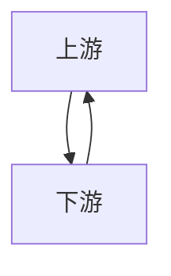

# 通用母稿（夹具）

这是**合成的母稿**：内容不入库，夹具是测试资产。

通用渲染器画的是母稿里的块——代码、表格、图。这个文件给基准与守卫用，
所以它得**每一块都齐**：代码块、表格块、图（贴图那条路与降级那条路）。




```python
def total(rows):
    return sum(row["amount"] for row in rows)
```

| mode | who locks | on conflict |
| --- | --- | --- |
| FOR UPDATE | writer | wait |
| FOR SHARE | reader | deadlock |
| SKIP LOCKED | nobody | nothing |
